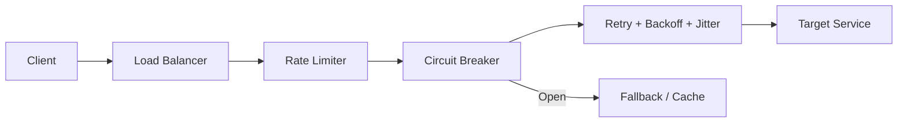

# ARCHITECTURE.md — System Design & Architecture Principles

> Design for the failure, scale, and change you can reasonably foresee — and no further. Simple, boring, and well-understood beats clever.

---

## 1. Foundational Principles

| Principle | Description |
|---|---|
| **Simplicity First** | Smallest design that meets stated requirements + NFRs. Start modular monolith; extract services only for real reasons (independent scaling, team boundaries, fault isolation, different runtimes). |
| **Separation of Concerns** | Transport (HTTP/CLI/queue) → Application/Use-Case → Domain → Persistence/Integration. Dependencies point inward (hexagonal/clean architecture). Domain code has zero framework or I/O imports. |
| **SOLID + DRY + KISS + YAGNI** | Single Responsibility, Open/Closed, Liskov Substitution, Interface Segregation, Dependency Inversion. DRY with rule of three. Keep It Simple. You Aren't Gonna Need It. |
| **Law of Demeter** | Composition over inheritance. Least astonishment. |
| **Illegal States Unrepresentable** | Sum types/enums, value objects, branded IDs, non-nullable by default. |
| **Explicit Over Implicit** | Dependency injection at composition root. No hidden globals. No import-time side effects. No singletons holding mutable state. |
| **Idempotent by Design** | Retry-safe and observable by default. |
| **Secure by Design** | Trust boundaries drawn and validated. Least privilege between components. |
| **Reversibility** | Reversible decisions fast, irreversible decisions slowly. Record significant ones as **ADRs** (Architecture Decision Records). |

---

## 2. Non-Functional Requirements (NFRs) — Design with Numbers, Not Fashion

Before designing, write down concrete numbers:

```markdown
| NFR Category         | Metric / Target                              |
|----------------------|----------------------------------------------|
| Throughput           | Expected RPS (peak / average)                |
| Data Volume          | Size now, growth rate, retention period       |
| Latency              | p50 / p95 / p99 targets                       |
| Availability         | SLO (e.g., 99.9% = 8.76h downtime/year)      |
| Consistency          | Strong / Eventual / Read-your-writes          |
| Durability (RPO)     | Max data loss window                          |
| Recovery Time (RTO)  | Max time to restore service                   |
| Compliance           | GDPR, HIPAA, SOC2, PCI-DSS                   |
| Budget               | Monthly infrastructure cost ceiling           |
| Team Skills          | Languages, frameworks team knows              |
| Deployment           | Cloud / hybrid / on-prem constraints          |
```

> [!IMPORTANT]
> If any number is unknown, assume conservatively, state the assumption explicitly, and design the system so the assumption can change without a rewrite.

---

## 3. Structural Checklist

### Module Boundaries
- Clear module boundaries with **public interfaces only**; no cross-module reach into internals
- Enforce with lint tooling: `dependency-cruiser` (JS/TS), `ArchUnit` (Java), `import-linter` (Python), `go-arch-lint` (Go)

### Single Source of Truth
- Each fact lives in one place. Derived data is rebuildable

### Configuration (12-Factor)
- Environment-based, validated at startup, typed, with safe defaults for non-secrets and **none** for secrets
```python
# GOOD: Validated config with Pydantic
class AppConfig(BaseSettings):
    database_url: PostgresDsn
    redis_url: RedisDsn
    jwt_secret: SecretStr  # No default — fails fast if missing
    debug: bool = False
    max_connections: int = Field(default=20, ge=1, le=100)

    model_config = SettingsConfigDict(env_file=".env", env_file_encoding="utf-8")
```

### Error Architecture
- Typed domain errors vs infrastructure errors
- Mapped once at the boundary to protocol responses
- Use **RFC 9457 Problem Details** for HTTP APIs:
```json
{
  "type": "https://api.example.com/errors/insufficient-funds",
  "title": "Insufficient Funds",
  "status": 422,
  "detail": "Account balance is $30.00 but transfer requires $50.00.",
  "instance": "/transfers/txn-abc-123"
}
```

### Cross-Cutting Concerns
Authn/authz, validation, logging, tracing, rate limiting, caching → **middleware/interceptors**, never copy-pasted

### Background Work
Durable queue/job system with retries, dead-letter queue, idempotent handlers, and visibility
→ See `sections/backend/background-jobs-queues.md`

### Feature Flags
Incomplete or risky features behind flags with owners and removal dates
→ See `workflows/feature-flags.md`

---

## 4. Distributed Systems Checklist

> When more than one process is involved, assume the network fails.

### Resilience Patterns



| Pattern | Purpose | Implementation |
|---|---|---|
| **Timeouts** | Prevent indefinite waits | Every external call has an explicit timeout |
| **Retries** | Handle transient failures | Exponential backoff with jitter, max 3-5 retries |
| **Circuit Breaker** | Stop cascading failures | Open after N failures in window, half-open probe |
| **Bulkhead** | Isolate failure domains | Separate thread/connection pools per dependency |
| **Rate Limiting** | Protect from overload | Token bucket or sliding window per client/tenant |
| **Load Shedding** | Graceful degradation | Drop low-priority requests under high load |
| **Backpressure** | Signal upstream to slow down | Bounded queues, HTTP 429, reactive streams |

### Idempotency
- Make operations **idempotent** using idempotency keys, natural keys, or upserts
- Delivery is **at-least-once**; design for duplicates and reordering

### Consistency
- Prefer **eventual consistency + explicit invariants** across services
- Use **Outbox Pattern** for "write DB and publish event"
- Use **Sagas** for multi-service workflows
- Use **CDC (Change Data Capture)** for replication
- Avoid distributed transactions (2PC) unless justified

### Ordering and Clocks
- **Never rely on synchronized clocks for correctness**
- Use monotonic time for durations
- Use logical ordering or DB sequences for event ordering

### Contract Versioning
- Version every contract (API, events, schemas)
- Be tolerant readers and conservative writers
- Never break consumers without a deprecation window

---

## 5. API Design Quick Reference

| Style | Key Rules |
|---|---|
| **REST/HTTP** | Resource-oriented URLs, correct verbs/status codes, RFC 9457 errors, cursor-based pagination, `Idempotency-Key` for unsafe ops, OpenAPI 3.1 as source of truth |
| **GraphQL** | Depth/complexity limits, persisted queries, DataLoader batching, field-level authz, disable introspection in prod |
| **gRPC/Protobuf** | Backward-compatible field evolution, deadlines on every call, health checking protocol, reflection off in prod |
| **WebSockets/SSE** | Auth at connect + per message, heartbeat, backpressure, reconnect with resume, origin checks |
| **Webhooks (inbound)** | Verify signatures, timestamp tolerance (replay protection), idempotent processing, fast 2xx then process async |
| **Webhooks (outbound)** | Signing, retries with backoff, delivery log, per-endpoint disable |

> Bulk and long-running operations return `202 Accepted` with a status resource. Never block requests on slow work.

→ Deep dive: `sections/backend/api-design.md`

---

## 6. Multi-Tenancy Patterns

| Model | Isolation | Cost | Migration Complexity |
|---|---|---|---|
| **Shared schema + `tenant_id` + RLS** | Low (logical) | Lowest | Easiest |
| **Schema-per-tenant** | Medium | Medium | Medium |
| **Database-per-tenant** | Highest | Highest | Hardest |

**Rules**:
- Tenant context derived from **authenticated identity**, never from a client-supplied header alone
- Every query, cache key, queue message, file path, and log line carries the tenant
- Per-tenant rate limits, quotas, resource limits, backups/restore, and data export/deletion
- Test cross-tenant access explicitly (negative tests)

---

## 7. Caching Strategy

- Cache only **measured hot spots** — don't pre-optimize
- Define key design, TTL, invalidation, and stampede protection upfront
- Never cache per-user data under shared keys
- Respect `Cache-Control`, `Vary`, `ETag` at HTTP and CDN layers
- **Treat cache as disposable**: system MUST work (slower) without it

→ Deep dive: `sections/backend/caching-strategies.md`

---

## 8. Documentation as Part of the Design

| Document | Purpose |
|---|---|
| **README** | What, why, quick start that actually works |
| **Architecture Overview** | C4 context/container diagrams as code (Mermaid/Structurizr) |
| **ADRs** | Decision records with context, options, consequences |
| **API Docs** | OpenAPI spec, generated clients |
| **Runbooks** | Operational procedures for incidents |
| **Data Dictionary** | Schema documentation, entity relationships |
| **Env Var Reference** | Every environment variable with type, default, description |
| **Onboarding Steps** | Tested by following them from a clean machine |

---

## 9. Evolution Patterns

| Pattern | When |
|---|---|
| **Strangler Fig** | Replacing legacy systems incrementally |
| **Expand/Contract** | Schema and API migrations |
| **Branch by Abstraction** | Large internal refactors |
| **Feature Flags** | Incremental rollout of new capabilities |

**Keep the system shippable at every step.** Track tech debt explicitly with owners; never hide it in code comments.

---

## 10. Architecture Decision Record (ADR) Template

```markdown
# ADR-NNN: [Decision Title]

## Status
Proposed | Accepted | Deprecated | Superseded by ADR-XXX

## Context
What is the issue that we're seeing that is motivating this decision?

## Decision
What is the change that we're proposing and/or doing?

## Consequences
What becomes easier or more difficult to do because of this change?

## Alternatives Considered
What other options were evaluated and why were they rejected?
```

---

## Verification Checklist

- [ ] NFRs documented with concrete numbers before design started
- [ ] Module boundaries enforced by lint/architecture tests
- [ ] Configuration validated at startup with typed schemas
- [ ] Errors mapped to RFC 9457 at transport boundary
- [ ] Cross-cutting concerns in middleware, not copy-pasted
- [ ] Distributed calls have timeouts, retries, circuit breakers
- [ ] All operations are idempotent or explicitly documented as non-idempotent
- [ ] API contracts versioned with backward compatibility
- [ ] ADRs recorded for significant decisions
- [ ] Cache strategy documented with invalidation plan
- [ ] Multi-tenant isolation tested with negative tests
