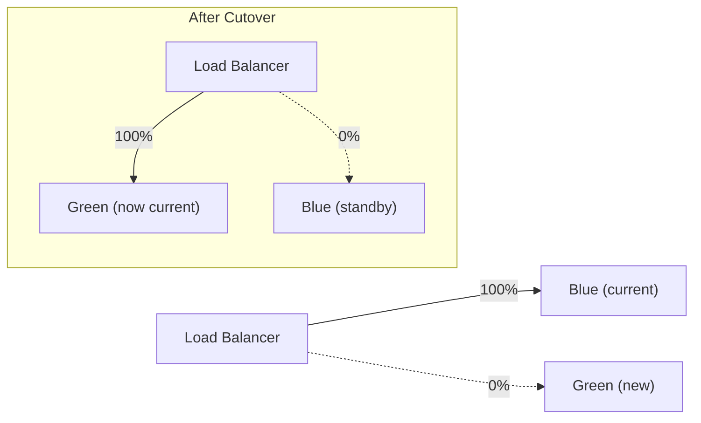
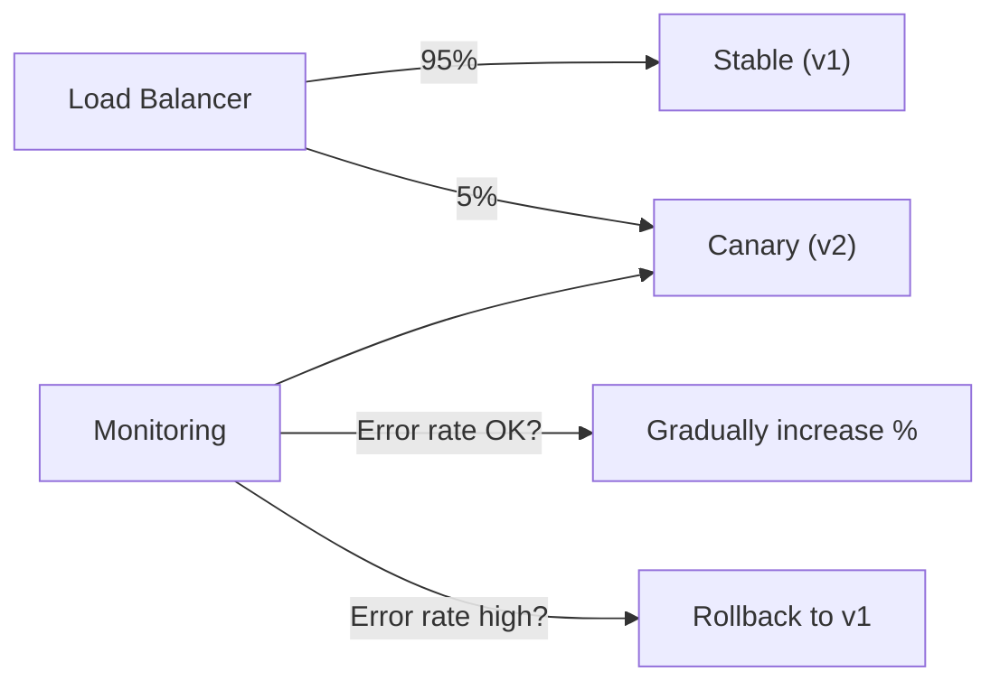
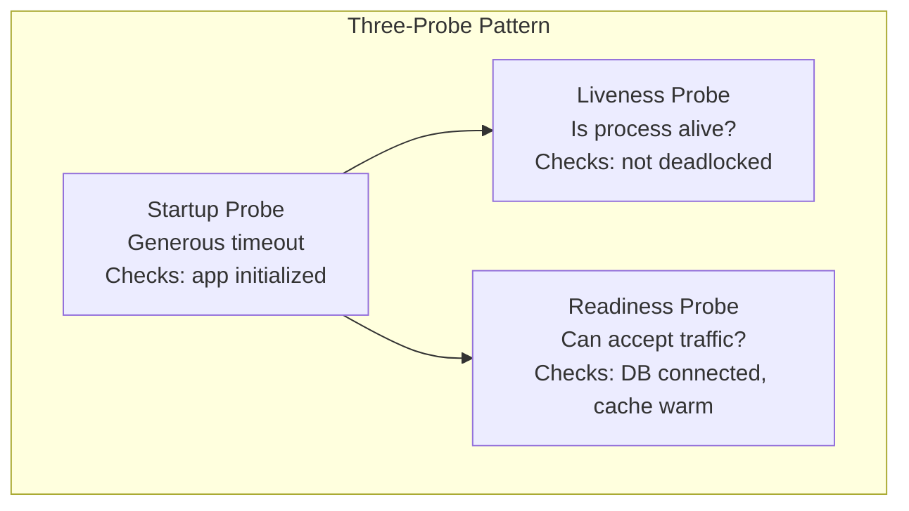

# DEPLOYMENT.md — Production Deployment & Infrastructure Guide

> Every deployment MUST be automated, reproducible, reversible, and observable. If you can't roll back in under 5 minutes, you're not production-ready.

---

## 1. Deployment Principles

| Principle | Description |
|---|---|
| **Immutable Infrastructure** | Never patch running servers. Build new images, deploy, destroy old ones. |
| **Infrastructure as Code** | All infrastructure defined in version-controlled code (Terraform, Pulumi, CloudFormation). No manual console changes. |
| **GitOps** | Git is the single source of truth. Changes flow: commit → CI → deploy. No `kubectl apply` from laptops. |
| **Blue/Green or Canary** | Zero-downtime deployments with instant rollback capability. |
| **Environment Parity** | Dev, staging, and production environments MUST be structurally identical. Only secrets and scale differ. |

---

## 2. Deployment Strategies

### Blue/Green Deployment


**Pros**: Instant rollback, zero downtime  
**Cons**: 2× infrastructure cost during deployment  
**Use when**: Database schema is backward-compatible, stateless services

### Canary Deployment


**Progressive rollout**: 1% → 5% → 25% → 50% → 100%  
**Automated promotion**: Based on error rate, latency p99, and custom metrics  
**Use when**: High-traffic services where you need confidence before full rollout

### Rolling Update
- Default Kubernetes strategy
- Replace pods N at a time (`maxSurge`, `maxUnavailable`)
- **Requires**: health checks, graceful shutdown, backward-compatible APIs

---

## 3. Container Best Practices

### Production Dockerfile Template
```dockerfile
# === Stage 1: Build ===
FROM node:22-alpine AS builder
WORKDIR /app

# Install dependencies first (layer caching)
COPY package.json package-lock.json ./
RUN npm ci --ignore-scripts

# Copy source and build
COPY . .
RUN npm run build

# Prune dev dependencies
RUN npm prune --production

# === Stage 2: Runtime ===
FROM node:22-alpine AS runtime

# Security: non-root user
RUN addgroup -S appgroup && adduser -S appuser -G appgroup

# Security: read-only filesystem support
WORKDIR /app

# Copy only production artifacts
COPY --from=builder --chown=appuser:appgroup /app/dist ./dist
COPY --from=builder --chown=appuser:appgroup /app/node_modules ./node_modules
COPY --from=builder --chown=appuser:appgroup /app/package.json ./

# Security: drop all capabilities, run as non-root
USER appuser

# Health check
HEALTHCHECK --interval=30s --timeout=3s --retries=3 \
  CMD wget --no-verbose --tries=1 --spider http://localhost:8080/health || exit 1

EXPOSE 8080
CMD ["node", "dist/main.js"]
```

### Container Security Checklist
- [ ] Multi-stage build (build tools not in runtime image)
- [ ] Non-root user (`USER appuser`)
- [ ] Read-only root filesystem where possible
- [ ] No secrets baked into image layers
- [ ] Minimal base image (Alpine, Distroless, or Chainguard)
- [ ] Pinned base image digest (not just tag)
- [ ] HEALTHCHECK defined
- [ ] `.dockerignore` excludes `.git`, `node_modules`, `.env`, tests
- [ ] Image scanned with Trivy/Snyk before push
- [ ] SBOM generated (`syft`) and signed (`cosign`)

---

## 4. Kubernetes Production Configuration

### Deployment Manifest Template
```yaml
apiVersion: apps/v1
kind: Deployment
metadata:
  name: api-server
  labels:
    app.kubernetes.io/name: api-server
    app.kubernetes.io/version: "1.2.3"
spec:
  replicas: 3
  strategy:
    type: RollingUpdate
    rollingUpdate:
      maxSurge: 1
      maxUnavailable: 0
  selector:
    matchLabels:
      app.kubernetes.io/name: api-server
  template:
    metadata:
      labels:
        app.kubernetes.io/name: api-server
    spec:
      securityContext:
        runAsNonRoot: true
        runAsUser: 1000
        fsGroup: 1000
        seccompProfile:
          type: RuntimeDefault
      containers:
        - name: api-server
          image: ghcr.io/org/api-server:1.2.3@sha256:abc123...
          ports:
            - containerPort: 8080
              protocol: TCP
          resources:
            requests:
              cpu: 250m
              memory: 256Mi
            limits:
              cpu: "1"
              memory: 512Mi
          # Startup probe: generous for cold starts
          startupProbe:
            httpGet:
              path: /health/startup
              port: 8080
            failureThreshold: 30
            periodSeconds: 2
          # Liveness: restart if hung
          livenessProbe:
            httpGet:
              path: /health/live
              port: 8080
            periodSeconds: 10
            failureThreshold: 3
          # Readiness: stop traffic if overloaded
          readinessProbe:
            httpGet:
              path: /health/ready
              port: 8080
            periodSeconds: 5
            failureThreshold: 2
          env:
            - name: NODE_ENV
              value: production
            - name: DATABASE_URL
              valueFrom:
                secretKeyRef:
                  name: api-secrets
                  key: database-url
          securityContext:
            allowPrivilegeEscalation: false
            readOnlyRootFilesystem: true
            capabilities:
              drop: ["ALL"]
          volumeMounts:
            - name: tmp
              mountPath: /tmp
      volumes:
        - name: tmp
          emptyDir:
            sizeLimit: 100Mi
      terminationGracePeriodSeconds: 30
      topologySpreadConstraints:
        - maxSkew: 1
          topologyKey: topology.kubernetes.io/zone
          whenUnsatisfied: DoNotSchedule
          labelSelector:
            matchLabels:
              app.kubernetes.io/name: api-server
```

---

## 5. Health Check Design



```typescript
// Express health check implementation
app.get('/health/startup', (req, res) => {
  // Heavy checks only at startup
  res.status(appInitialized ? 200 : 503).json({ status: appInitialized ? 'ok' : 'starting' });
});

app.get('/health/live', (req, res) => {
  // Lightweight — only checks process is responsive
  res.status(200).json({ status: 'ok', uptime: process.uptime() });
});

app.get('/health/ready', async (req, res) => {
  try {
    await db.query('SELECT 1');
    await redis.ping();
    res.status(200).json({ status: 'ready' });
  } catch (error) {
    res.status(503).json({ status: 'not_ready', error: error.message });
  }
});
```

---

## 6. Graceful Shutdown

```typescript
// Node.js graceful shutdown pattern
const server = app.listen(8080);

const shutdown = async (signal: string) => {
  console.log(`Received ${signal}. Starting graceful shutdown...`);
  
  // 1. Stop accepting new connections
  server.close();
  
  // 2. Mark as not ready (K8s stops routing traffic)
  isReady = false;
  
  // 3. Wait for in-flight requests (with timeout)
  await Promise.race([
    drainConnections(),
    new Promise(resolve => setTimeout(resolve, 25_000)), // K8s default is 30s
  ]);
  
  // 4. Close database connections
  await db.end();
  await redis.quit();
  
  // 5. Exit cleanly
  process.exit(0);
};

process.on('SIGTERM', () => shutdown('SIGTERM'));
process.on('SIGINT', () => shutdown('SIGINT'));
```

---

## 7. Secrets Management

| ❌ NEVER | ✅ ALWAYS |
|---|---|
| Secrets in `.env` committed to git | Secrets in vault (HashiCorp Vault, AWS Secrets Manager, GCP Secret Manager) |
| Secrets as build args in Dockerfile | Secrets injected at runtime via env vars or mounted files |
| Secrets in CI pipeline logs | Secrets masked in CI output |
| Same secrets across environments | Per-environment secrets with automatic rotation |

### Rotation Strategy
1. Secrets rotated every **90 days** (automated via vault)
2. Two active versions during rotation window (old + new)
3. Applications read from vault on startup / with short TTL cache
4. Rotation tested in staging before production

---

## 8. DNS, TLS & CDN

- **TLS 1.3** minimum (TLS 1.2 with strong cipher suites as fallback)
- **HSTS**: `max-age=63072000; includeSubDomains; preload`
- **Certificate automation**: Let's Encrypt with cert-manager (Kubernetes) or ACM (AWS)
- **CDN**: Static assets served from CDN edge with immutable hashes in filenames
- **DNS TTL**: Short TTL (60-300s) for services that need fast failover

---

## 9. Monitoring & Alerting in Deployment

### Key Metrics to Watch During Deployment

| Metric | Threshold | Action |
|---|---|---|
| Error rate (5xx) | > 1% increase from baseline | Auto-rollback |
| Latency p99 | > 2× baseline | Pause rollout, investigate |
| CPU usage | > 80% sustained | Check resource limits |
| Memory usage | > 85% sustained | Check for memory leaks |
| Pod restart count | > 0 in first 5 minutes | Check startup/liveness probes |

### Deployment Runbook
1. Announce deployment in `#deployments` channel
2. Verify staging deployment succeeded with all tests green
3. Deploy to production (canary → full)
4. Monitor dashboards for 15 minutes
5. Run smoke tests against production
6. Confirm deployment in channel with version and commit SHA

---

## 10. Rollback Procedures

```bash
# Kubernetes instant rollback
kubectl rollout undo deployment/api-server

# Check rollout history
kubectl rollout history deployment/api-server

# Rollback to specific revision
kubectl rollout undo deployment/api-server --to-revision=3
```

### Rollback Decision Matrix
| Severity | Indicator | Action | Timeline |
|---|---|---|---|
| **P0 — Critical** | Service down, data corruption | Immediate rollback, incident declared | < 5 minutes |
| **P1 — High** | Error rate > 5%, latency 10× | Rollback, post-mortem | < 15 minutes |
| **P2 — Medium** | Degraded but functional | Hotfix forward or rollback | < 1 hour |
| **P3 — Low** | Minor UI issue, log noise | Fix forward in next release | Next sprint |

---

## Verification Checklist

- [ ] Deployment is fully automated (no manual steps)
- [ ] Rollback takes < 5 minutes
- [ ] Health checks cover startup, liveness, and readiness
- [ ] Graceful shutdown handles in-flight requests
- [ ] Secrets injected at runtime, never baked in images
- [ ] Container runs as non-root with read-only filesystem
- [ ] Resource requests and limits defined
- [ ] Pod topology spread prevents single-zone failures
- [ ] Monitoring alerts configured for deployment metrics
- [ ] Deployment runbook documented and tested
