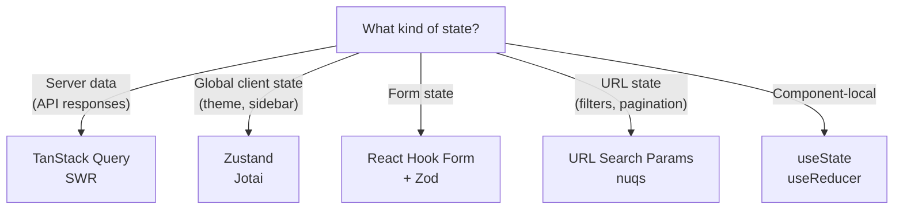

# FRONTEND.md — Frontend Engineering Standards & Best Practices

> Every pixel ships a promise to the user. Fast, accessible, beautiful, and resilient — or it's not production-ready.

---

## 1. Foundational Principles

| Principle | Description |
|---|---|
| **Progressive Enhancement** | Core functionality works without JavaScript. Enhance with JS for richer experience. |
| **Mobile-First** | Design and build for mobile viewport first, then scale up. |
| **Semantic HTML** | Use correct HTML elements (`<nav>`, `<main>`, `<article>`, `<button>`) before reaching for ARIA. |
| **Accessible by Default** | WCAG 2.2 AA minimum. Keyboard-navigable, screen-reader-friendly, sufficient contrast. |
| **Performance Budget** | Define and enforce: LCP < 2.5s, INP < 200ms, CLS < 0.1. |

---

## 2. Project Structure (React/Next.js)

```
src/
├── app/                    # Next.js App Router pages/layouts
│   ├── (auth)/             # Route groups for auth-required pages
│   ├── (marketing)/        # Public marketing pages
│   ├── api/                # Route handlers (API endpoints)
│   ├── layout.tsx          # Root layout with providers
│   ├── error.tsx           # Global error boundary
│   ├── not-found.tsx       # 404 page
│   └── loading.tsx         # Global loading UI
├── components/
│   ├── ui/                 # Atomic design system components (Button, Input, Card)
│   ├── forms/              # Form components with validation
│   ├── layouts/            # Layout components (Sidebar, Header, Footer)
│   └── features/           # Feature-specific composed components
├── hooks/                  # Custom React hooks
├── lib/                    # Utilities, API client, formatters
├── stores/                 # Client state (Zustand stores)
├── types/                  # Shared TypeScript types
├── styles/                 # Global CSS, theme tokens
└── __tests__/              # Test files mirroring src structure
```

---

## 3. Component Patterns

### Good Component Design
```tsx
// GOOD: Single responsibility, typed props, accessible, handles loading/error
interface UserProfileProps {
  readonly userId: string;
  readonly variant?: 'compact' | 'full';
}

export function UserProfile({ userId, variant = 'full' }: UserProfileProps) {
  const { data: user, isLoading, error } = useUser(userId);

  if (isLoading) return <UserProfileSkeleton variant={variant} />;
  if (error) return <ErrorDisplay error={error} retry={() => void 0} />;
  if (!user) return null;

  return (
    <article
      aria-label={`Profile for ${user.displayName}`}
      className={cn('rounded-lg border p-4', variant === 'compact' && 'p-2')}
    >
      <div className="flex items-center gap-3">
        <Avatar
          src={user.avatarUrl}
          alt=""  {/* Decorative — name is in text */}
          size={variant === 'compact' ? 'sm' : 'md'}
        />
        <div>
          <h2 className="text-lg font-semibold">{user.displayName}</h2>
          <p className="text-sm text-muted-foreground">{user.email}</p>
        </div>
      </div>
      {variant === 'full' && <UserStats stats={user.stats} />}
    </article>
  );
}
```

### Anti-Patterns to Avoid
```tsx
// BAD: God component, inline styles, no types, no loading/error states
function Profile({ id }) {
  const [user, setUser] = useState(null);
  
  useEffect(() => {
    fetch(`/api/users/${id}`).then(r => r.json()).then(setUser);
  }, []);  // Missing dependency, no error handling, no cleanup
  
  return (
    <div style={{ padding: 20 }}>  {/* Inline styles, no semantic HTML */}
      <div>{user?.name}</div>  {/* No loading state, no alt text, no accessibility */}
      <div>{user?.email}</div>
    </div>
  );
}
```

---

## 4. State Management Strategy



### Rules
1. **Server state ≠ Client state** — never put API data in Zustand/Redux
2. **URL is state** — filters, pagination, sort order belong in URL params
3. **Derive don't store** — if it can be computed from other state, compute it
4. **Minimize global state** — most state is local to a component or subtree

→ Deep dive: `sections/frontend/state-management.md`

---

## 5. Forms & Validation

```tsx
// Production form with React Hook Form + Zod
import { useForm } from 'react-hook-form';
import { zodResolver } from '@hookform/resolvers/zod';
import { z } from 'zod';

const createUserSchema = z.object({
  email: z.string().email('Invalid email address'),
  name: z.string().min(2, 'Name must be at least 2 characters').max(100),
  role: z.enum(['admin', 'editor', 'viewer'], {
    errorMap: () => ({ message: 'Select a valid role' }),
  }),
  agreeToTerms: z.literal(true, {
    errorMap: () => ({ message: 'You must accept the terms' }),
  }),
});

type CreateUserInput = z.infer<typeof createUserSchema>;

export function CreateUserForm({ onSubmit }: { onSubmit: (data: CreateUserInput) => Promise<void> }) {
  const {
    register,
    handleSubmit,
    formState: { errors, isSubmitting },
  } = useForm<CreateUserInput>({
    resolver: zodResolver(createUserSchema),
  });

  return (
    <form onSubmit={handleSubmit(onSubmit)} noValidate>
      <fieldset disabled={isSubmitting}>
        <div>
          <label htmlFor="email">Email</label>
          <input
            id="email"
            type="email"
            autoComplete="email"
            aria-describedby={errors.email ? 'email-error' : undefined}
            aria-invalid={!!errors.email}
            {...register('email')}
          />
          {errors.email && (
            <p id="email-error" role="alert" className="text-red-600 text-sm">
              {errors.email.message}
            </p>
          )}
        </div>
        {/* ... more fields ... */}
        <button type="submit" disabled={isSubmitting}>
          {isSubmitting ? 'Creating...' : 'Create User'}
        </button>
      </fieldset>
    </form>
  );
}
```

---

## 6. Performance Optimization

### Core Web Vitals Targets
| Metric | Good | Needs Improvement | Poor |
|---|---|---|---|
| **LCP** (Largest Contentful Paint) | ≤ 2.5s | ≤ 4.0s | > 4.0s |
| **INP** (Interaction to Next Paint) | ≤ 200ms | ≤ 500ms | > 500ms |
| **CLS** (Cumulative Layout Shift) | ≤ 0.1 | ≤ 0.25 | > 0.25 |

### Performance Checklist
- [ ] Images optimized: WebP/AVIF format, `sizes` attribute, `loading="lazy"` below fold
- [ ] Fonts: `font-display: swap`, subset to used characters, preloaded critical fonts
- [ ] Code splitting: dynamic `import()` for routes and heavy components
- [ ] Bundle analyzed: no duplicate dependencies, tree-shaking enabled
- [ ] Critical CSS inlined, non-critical deferred
- [ ] Resource hints: `<link rel="preconnect">` for API domains, `<link rel="prefetch">` for likely navigation
- [ ] Third-party scripts loaded with `async`/`defer`, behind consent if analytics

→ Deep dive: `sections/frontend/web-performance.md`

---

## 7. Accessibility (a11y) Requirements

### Mandatory
- **Keyboard navigation**: Every interactive element reachable and operable with keyboard
- **Focus management**: Visible focus indicators, logical tab order, focus traps for modals
- **Color contrast**: 4.5:1 for normal text, 3:1 for large text (WCAG AA)
- **Alt text**: All informational images have descriptive alt text; decorative images use `alt=""`
- **Form labels**: Every input has an associated `<label>` (not just placeholder)
- **Error messages**: Announced to screen readers via `role="alert"` or `aria-live="polite"`
- **Motion**: Respect `prefers-reduced-motion` media query
- **Skip navigation**: "Skip to main content" link as first focusable element

### Testing Tools
```bash
# Automated accessibility CI check
npx @axe-core/cli --exit http://localhost:3000

# Lighthouse CI (includes accessibility)
npx lhci autorun --collect.url=http://localhost:3000

# Pa11y for CI/CD
npx pa11y http://localhost:3000 --standard WCAG2AA
```

→ Deep dive: `sections/frontend/accessibility-a11y.md`

---

## 8. Security Headers

Every frontend application MUST set these response headers:

```nginx
# nginx security headers
add_header Strict-Transport-Security "max-age=63072000; includeSubDomains; preload" always;
add_header X-Content-Type-Options "nosniff" always;
add_header X-Frame-Options "DENY" always;
add_header Referrer-Policy "strict-origin-when-cross-origin" always;
add_header Permissions-Policy "geolocation=(), microphone=(), camera=()" always;
add_header Content-Security-Policy "default-src 'self'; script-src 'self'; style-src 'self' 'unsafe-inline'; img-src 'self' data: https:; font-src 'self'; connect-src 'self' https://api.example.com; frame-ancestors 'none'; base-uri 'self'; form-action 'self';" always;
```

### XSS Prevention in React
```tsx
// NEVER use dangerouslySetInnerHTML with user input
// If you must render HTML, sanitize first:
import DOMPurify from 'dompurify';

function SafeHTML({ html }: { html: string }) {
  return <div dangerouslySetInnerHTML={{ __html: DOMPurify.sanitize(html) }} />;
}
```

---

## 9. Internationalization (i18n)

```tsx
// Use next-intl or react-intl — never hardcode user-facing strings
import { useTranslations } from 'next-intl';

function Greeting({ name }: { name: string }) {
  const t = useTranslations('common');
  return <h1>{t('greeting', { name })}</h1>;
}
```

### i18n Checklist
- [ ] All user-facing strings externalized to translation files
- [ ] Date/time formatted with `Intl.DateTimeFormat` (respects locale)
- [ ] Numbers formatted with `Intl.NumberFormat` (currency, percentages)
- [ ] Pluralization rules handled by i18n library
- [ ] RTL layout support (CSS logical properties: `margin-inline-start`)
- [ ] Text expansion tested (German text ~30% longer than English)

---

## 10. SEO & Meta

```tsx
// Next.js metadata API
export const metadata: Metadata = {
  title: {
    template: '%s | MyApp',
    default: 'MyApp — Tagline',
  },
  description: 'Clear description under 160 characters.',
  openGraph: {
    type: 'website',
    locale: 'en_US',
    url: 'https://myapp.com',
    siteName: 'MyApp',
    images: [{ url: '/og-image.png', width: 1200, height: 630, alt: 'MyApp' }],
  },
  twitter: {
    card: 'summary_large_image',
    creator: '@handle',
  },
  robots: {
    index: true,
    follow: true,
  },
};
```

### SEO Checklist
- [ ] Unique `<title>` and `<meta name="description">` per page
- [ ] Open Graph and Twitter Card meta tags
- [ ] Canonical URLs set
- [ ] Structured data (JSON-LD) for rich results
- [ ] `sitemap.xml` generated and submitted
- [ ] `robots.txt` configured
- [ ] Semantic heading hierarchy (single `<h1>` per page)
- [ ] Image alt text for SEO
- [ ] 301 redirects for moved pages
- [ ] Custom 404 page

---

## 11. Testing Strategy

| Layer | Tool | What to Test |
|---|---|---|
| **Unit** | Vitest / Jest | Utility functions, hooks, formatters |
| **Component** | Testing Library | Rendering, user interactions, accessibility |
| **Integration** | Testing Library + MSW | Components with API calls, form submissions |
| **E2E** | Playwright | Critical user journeys, auth flows |
| **Visual** | Playwright / Chromatic | Screenshot regression |
| **Accessibility** | axe-core + Pa11y | WCAG compliance |

```tsx
// Component test with Testing Library
import { render, screen } from '@testing-library/react';
import userEvent from '@testing-library/user-event';

test('shows validation error for invalid email', async () => {
  const user = userEvent.setup();
  render(<CreateUserForm onSubmit={vi.fn()} />);
  
  const emailInput = screen.getByLabelText(/email/i);
  await user.type(emailInput, 'not-an-email');
  await user.click(screen.getByRole('button', { name: /create/i }));
  
  expect(screen.getByRole('alert')).toHaveTextContent(/invalid email/i);
});
```

---

## Verification Checklist

- [ ] Lighthouse score ≥ 90 for Performance, Accessibility, Best Practices, SEO
- [ ] Zero axe-core accessibility violations
- [ ] Bundle size within budget (JS < 200KB gzipped for initial load)
- [ ] All forms have server-side validation (client-side is UX, not security)
- [ ] Error boundaries at route level and feature level
- [ ] Loading and error states for all async operations
- [ ] Security headers score A+ on securityheaders.com
- [ ] i18n strings externalized, no hardcoded user-facing text
- [ ] SEO meta tags on all public pages
- [ ] E2E tests for critical user journeys passing in CI
