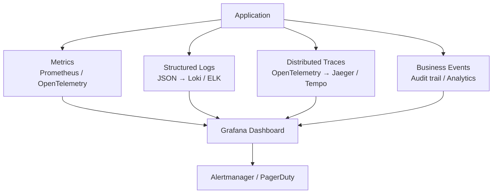
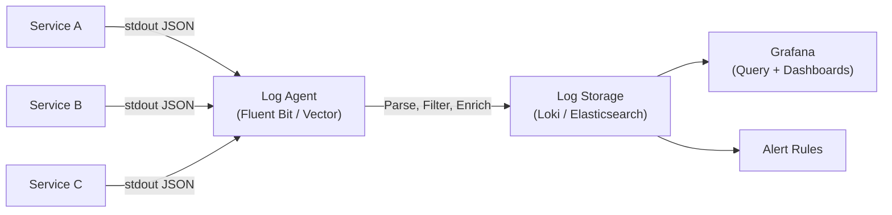

# OBSERVABILITY.md — Monitoring, Logging, Tracing & Alerting

> If you can't observe it, you can't operate it. Instrument everything, alert on symptoms (not causes), and make dashboards the first place anyone looks during an incident.

---

## 1. The Three Pillars + Events



| Pillar | What | When | Tool |
|---|---|---|---|
| **Metrics** | Numeric time-series (counters, gauges, histograms) | Trend analysis, alerting, SLO tracking | Prometheus, Datadog, CloudWatch |
| **Logs** | Structured event records (JSON) | Debugging, audit, forensics | Loki, Elasticsearch, CloudWatch Logs |
| **Traces** | Request lifecycle across services | Latency analysis, dependency mapping | Jaeger, Tempo, Datadog APM, Honeycomb |
| **Events** | Business-significant occurrences | Audit trail, analytics, compliance | Custom event store, analytics pipeline |

---

## 2. OpenTelemetry Integration

OpenTelemetry (OTel) is the **single standard** for instrumentation. Use it instead of vendor-specific SDKs.

### Node.js / TypeScript Setup
```typescript
// tracing.ts — Load BEFORE any other imports
import { NodeSDK } from '@opentelemetry/sdk-node';
import { OTLPTraceExporter } from '@opentelemetry/exporter-trace-otlp-http';
import { OTLPMetricExporter } from '@opentelemetry/exporter-metrics-otlp-http';
import { PeriodicExportingMetricReader } from '@opentelemetry/sdk-metrics';
import { HttpInstrumentation } from '@opentelemetry/instrumentation-http';
import { ExpressInstrumentation } from '@opentelemetry/instrumentation-express';
import { PgInstrumentation } from '@opentelemetry/instrumentation-pg';
import { RedisInstrumentation } from '@opentelemetry/instrumentation-redis-4';
import { Resource } from '@opentelemetry/resources';
import { ATTR_SERVICE_NAME, ATTR_SERVICE_VERSION } from '@opentelemetry/semantic-conventions';

const sdk = new NodeSDK({
  resource: new Resource({
    [ATTR_SERVICE_NAME]: process.env.SERVICE_NAME ?? 'api-server',
    [ATTR_SERVICE_VERSION]: process.env.APP_VERSION ?? '0.0.0',
    'deployment.environment': process.env.NODE_ENV ?? 'development',
  }),
  traceExporter: new OTLPTraceExporter({
    url: process.env.OTEL_EXPORTER_OTLP_ENDPOINT ?? 'http://localhost:4318/v1/traces',
  }),
  metricReader: new PeriodicExportingMetricReader({
    exporter: new OTLPMetricExporter({
      url: process.env.OTEL_EXPORTER_OTLP_ENDPOINT ?? 'http://localhost:4318/v1/metrics',
    }),
    exportIntervalMillis: 15_000,
  }),
  instrumentations: [
    new HttpInstrumentation(),
    new ExpressInstrumentation(),
    new PgInstrumentation(),
    new RedisInstrumentation(),
  ],
});

sdk.start();

process.on('SIGTERM', () => {
  sdk.shutdown().then(() => process.exit(0));
});
```

### Python (FastAPI) Setup
```python
# telemetry.py
from opentelemetry import trace, metrics
from opentelemetry.sdk.trace import TracerProvider
from opentelemetry.sdk.trace.export import BatchSpanProcessor
from opentelemetry.exporter.otlp.proto.grpc.trace_exporter import OTLPSpanExporter
from opentelemetry.sdk.metrics import MeterProvider
from opentelemetry.sdk.resources import Resource
from opentelemetry.instrumentation.fastapi import FastAPIInstrumentor
from opentelemetry.instrumentation.sqlalchemy import SQLAlchemyInstrumentor
from opentelemetry.instrumentation.redis import RedisInstrumentor
import os

resource = Resource.create({
    "service.name": os.getenv("SERVICE_NAME", "api-server"),
    "service.version": os.getenv("APP_VERSION", "0.0.0"),
    "deployment.environment": os.getenv("ENVIRONMENT", "development"),
})

# Traces
tracer_provider = TracerProvider(resource=resource)
tracer_provider.add_span_processor(BatchSpanProcessor(OTLPSpanExporter()))
trace.set_tracer_provider(tracer_provider)

def instrument_app(app):
    FastAPIInstrumentor.instrument_app(app)
    SQLAlchemyInstrumentor().instrument()
    RedisInstrumentor().instrument()
```

---

## 3. Structured Logging

### Golden Rules
1. **JSON format only** in production — never unstructured text
2. **Correlation IDs** (trace_id, span_id, request_id) in every log line
3. **Log levels used correctly**: ERROR (needs human attention), WARN (degraded but recovering), INFO (business events), DEBUG (developer-only, off in prod)
4. **Never log**: passwords, tokens, credit cards, PII, full request/response bodies in production
5. **Always log**: request_id, user_id, tenant_id, operation, duration_ms, status

### Python Structured Logging (structlog)
```python
import structlog

structlog.configure(
    processors=[
        structlog.contextvars.merge_contextvars,
        structlog.stdlib.add_log_level,
        structlog.stdlib.add_logger_name,
        structlog.processors.TimeStamper(fmt="iso"),
        structlog.processors.StackInfoRenderer(),
        structlog.processors.format_exc_info,
        structlog.processors.JSONRenderer(),  # JSON in production
    ],
    wrapper_class=structlog.stdlib.BoundLogger,
    logger_factory=structlog.stdlib.LoggerFactory(),
)

logger = structlog.get_logger()

# Usage — structured context automatically included
logger.info(
    "order.created",
    order_id="ord_abc123",
    user_id="usr_xyz789",
    total_cents=4999,
    currency="USD",
    items_count=3,
)
# Output: {"event":"order.created","order_id":"ord_abc123","user_id":"usr_xyz789",
#          "total_cents":4999,"currency":"USD","items_count":3,
#          "level":"info","timestamp":"2024-01-15T10:30:00Z"}
```

### Node.js Structured Logging (Pino)
```typescript
import pino from 'pino';

const logger = pino({
  level: process.env.LOG_LEVEL ?? 'info',
  formatters: {
    level: (label) => ({ level: label }),
  },
  timestamp: pino.stdTimeFunctions.isoTime,
  redact: {
    paths: ['req.headers.authorization', 'req.headers.cookie', '*.password', '*.token'],
    censor: '[REDACTED]',
  },
});

// Per-request child logger with correlation IDs
app.use((req, res, next) => {
  req.log = logger.child({
    requestId: req.headers['x-request-id'] ?? crypto.randomUUID(),
    traceId: req.headers['traceparent']?.split('-')[1],
    userId: req.user?.id,
  });
  next();
});
```

---

## 4. Metrics Design

### RED Method (for services)
| Metric | Description | Prometheus Type |
|---|---|---|
| **R**ate | Requests per second | Counter: `http_requests_total` |
| **E**rrors | Failed requests per second | Counter: `http_requests_total{status=~"5.."}` |
| **D**uration | Latency distribution | Histogram: `http_request_duration_seconds` |

### USE Method (for resources)
| Metric | Description | Example |
|---|---|---|
| **U**tilization | % of resource capacity used | CPU %, memory %, disk I/O % |
| **S**aturation | Work queued / backlogged | Queue depth, thread pool pending |
| **E**rrors | Resource error count | Disk errors, OOM kills, connection refused |

### Custom Business Metrics
```python
from opentelemetry import metrics

meter = metrics.get_meter("business.metrics")

# Counters for business events
orders_created = meter.create_counter(
    "orders.created.total",
    description="Total orders created",
    unit="1",
)

# Histograms for business latency
checkout_duration = meter.create_histogram(
    "checkout.duration",
    description="Time to complete checkout",
    unit="s",
)

# Usage
orders_created.add(1, {"payment_method": "stripe", "plan": "pro"})

with checkout_duration.record_duration({"step": "payment"}):
    await process_payment(order)
```

---

## 5. Alerting Strategy

### Alert on Symptoms, Not Causes

```
❌ BAD:  Alert when CPU > 80%
✅ GOOD: Alert when p99 latency > 500ms for 5 minutes

❌ BAD:  Alert when disk > 90%
✅ GOOD: Alert when disk will be full in < 4 hours (prediction)

❌ BAD:  Alert on every 500 error
✅ GOOD: Alert when error rate > 1% for 3 minutes
```

### Alert Severity Matrix
| Severity | Response | SLA | Example |
|---|---|---|---|
| **P0 — Critical** | Page on-call immediately | < 15 min ack | Service down, data loss |
| **P1 — High** | Page during business hours | < 1 hour | Error rate > 5%, degraded experience |
| **P2 — Medium** | Ticket, fix within sprint | < 1 business day | Elevated latency, non-critical feature broken |
| **P3 — Low** | Backlog item | Best effort | Warning thresholds, cost anomalies |

### SLO-Based Alerting
```yaml
# Example: 99.9% availability SLO with error budget
# Monthly error budget = 0.1% × 43,200 min = 43.2 minutes
# Alert at different burn rates:

groups:
  - name: slo-alerts
    rules:
      # Fast burn: consuming 14.4× error budget → will exhaust in 5 hours
      - alert: HighErrorBudgetBurn
        expr: |
          (
            sum(rate(http_requests_total{status=~"5.."}[5m]))
            / sum(rate(http_requests_total[5m]))
          ) > 14.4 * 0.001
        for: 2m
        labels:
          severity: critical
        annotations:
          summary: "Error budget burning too fast (P0)"
          
      # Slow burn: consuming 3× error budget → will exhaust in 3 days  
      - alert: ErrorBudgetSlowBurn
        expr: |
          (
            sum(rate(http_requests_total{status=~"5.."}[1h]))
            / sum(rate(http_requests_total[1h]))
          ) > 3 * 0.001
        for: 15m
        labels:
          severity: warning
```

---

## 6. Dashboard Design

### The Four Golden Signals Dashboard Layout

```
┌─────────────────────────────────────────────────────────┐
│  SERVICE: api-server    Environment: production          │
│  Version: 1.2.3         Uptime: 45d 3h 22m              │
├──────────────────────┬──────────────────────────────────┤
│  Request Rate (RPS)  │  Error Rate (%)                  │
│  ┌──────────────┐    │  ┌──────────────┐                │
│  │ ▂▃▄▅▆▇█▇▆▅▃▂│    │  │ ▁▁▁▁▁▂▁▁▁▁▁▁│                │
│  └──────────────┘    │  └──────────────┘                │
│  Current: 1,234 RPS  │  Current: 0.02%                  │
├──────────────────────┼──────────────────────────────────┤
│  Latency (ms)        │  Saturation                      │
│  p50: 12ms           │  CPU: 34%  Mem: 67%              │
│  p95: 48ms           │  DB Pool: 12/20                  │
│  p99: 120ms          │  Queue: 42 pending               │
└──────────────────────┴──────────────────────────────────┘
```

### Dashboard Rules
1. **Service dashboard per service** — overview of the four golden signals
2. **No dashboard without an owner** — someone is responsible for acting on what it shows
3. **Time range defaults to 6h** — enough context without information overload
4. **Alert links embedded** — click a panel to see related alerts and runbooks
5. **SLO/error budget panel** — how much budget remains this month

---

## 7. On-Call & Incident Observability

### Required Runbook Format
```markdown
# Alert: [Alert Name]

## What this means
One-sentence explanation of the symptom and its user impact.

## Likely causes (ordered by probability)
1. [Most common cause] → [Quick check command]
2. [Second most common] → [Quick check command]

## Remediation steps
1. Step one
2. Step two

## Escalation
If not resolved in 30 minutes, escalate to [team/person].

## Dashboard link
[Link to relevant Grafana dashboard]
```

---

## 8. Log Aggregation Architecture



### Log Retention Policy
| Environment | Retention | Storage |
|---|---|---|
| **Production** | 90 days hot, 1 year cold (S3/GCS) | Compressed, indexed |
| **Staging** | 30 days | Standard |
| **Development** | 7 days | Minimal |

---

## Verification Checklist

- [ ] OpenTelemetry SDK initialized for traces, metrics, and logs
- [ ] All HTTP handlers auto-instrumented (request/response metrics)
- [ ] Database, Redis, and HTTP client calls traced
- [ ] Structured JSON logging with correlation IDs (trace_id, request_id)
- [ ] Sensitive data redacted from logs (passwords, tokens, PII)
- [ ] RED metrics for every service, USE metrics for infrastructure
- [ ] SLO defined with error budget alerting
- [ ] Alerts on symptoms, not causes
- [ ] Every alert has a runbook
- [ ] Dashboards have owners and are reviewed monthly
- [ ] Log retention policy documented and enforced
- [ ] On-call rotation documented with escalation paths
