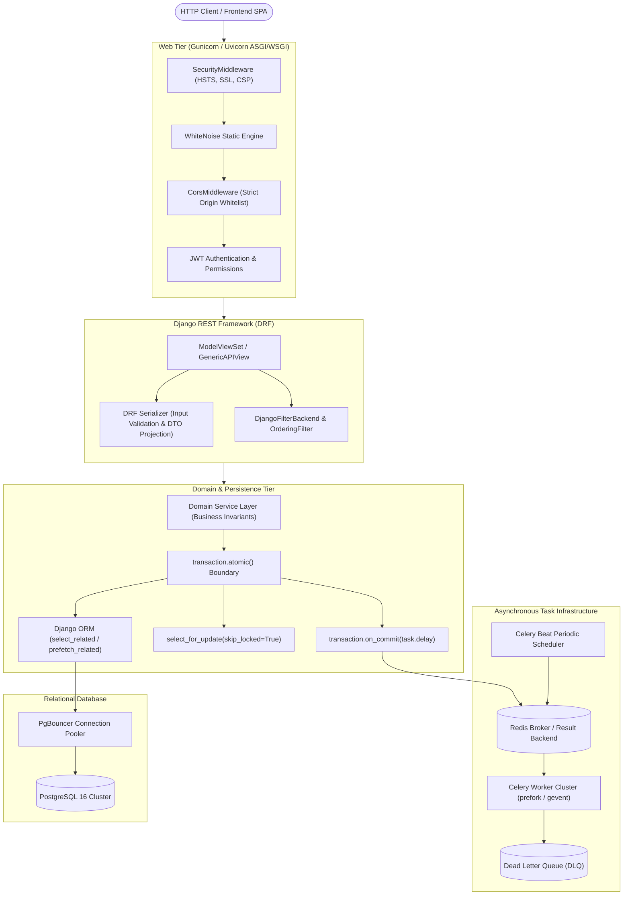

# 🐍 Django 5 & DRF Production Guide (`django.md`)

> **Purpose**: Build high-throughput, enterprise-scale backend services with Django 5.x, Django REST Framework (DRF), Async Celery, Redis, and PostgreSQL. Covers advanced ORM optimization, atomic transactions, row locking, event-driven task processing, comprehensive SecurityMiddleware hardening, and resilient production deployment.  
> **Prerequisites**: Python ≥ 3.12, Django ≥ 5.1, DRF ≥ 3.15, PostgreSQL ≥ 16, Redis ≥ 7.2, Celery ≥ 5.4

---

## 1. Core Philosophy

> **Golden Rule**: Treat the Django ORM as an explicit SQL query planner — eliminate N+1 query patterns before code review using `select_related` and `prefetch_related`, bind external side effects strictly to `transaction.on_commit()` hooks, lock mutable rows defensively with `select_for_update()`, and offload all CPU or I/O latency to asynchronous Celery worker clusters.

---

## 2. Architecture & Design Patterns

Enterprise Django services adopt a clean modular domain architecture, decoupling HTTP presentation (DRF Views & Serializers) from business services, domain models, and asynchronous workers.



### Production Project Directory Structure

```
django-enterprise/
├── manage.py
├── pyproject.toml
├── ruff.toml
├── Dockerfile
├── docker-compose.yml
├── config/
│   ├── __init__.py
│   ├── asgi.py                  # ASGI deployment entrypoint
│   ├── celery.py                # Celery app initialization & beat config
│   ├── urls.py                  # Root URL configuration & OpenAPI
│   ├── wsgi.py                  # WSGI fallback entrypoint
│   └── settings/
│       ├── __init__.py
│       ├── base.py              # Shared enterprise configuration
│       ├── local.py             # Development overrides & debug toolbar
│       └── production.py        # Hardened security & cache configs
├── apps/
│   ├── common/                  # Shared base models, pagination, utilities
│   │   ├── __init__.py
│   │   ├── exceptions.py        # RFC 9457 custom DRF exception handler
│   │   ├── models.py            # UUIDModel, TimeStampedModel abstractions
│   │   └── pagination.py        # Fast keyset / cursor pagination
│   ├── users/                   # Custom User model & authentication
│   │   ├── __init__.py
│   │   ├── admin.py
│   │   ├── models.py
│   │   ├── serializers.py
│   │   ├── services.py
│   │   ├── urls.py
│   │   └── views.py
│   └── orders/                  # Domain business module
│       ├── __init__.py
│       ├── models.py            # Optimized relational entities & indexes
│       ├── serializers.py
│       ├── services.py          # Atomic transaction workflows
│       ├── tasks.py             # Resilient Celery task definitions
│       ├── urls.py
│       └── views.py
└── tests/
    ├── conftest.py              # Pytest fixtures & db test harnesses
    ├── test_orders_orm.py
    └── test_celery_tasks.py
```

---

## 3. Concrete Implementation Standards

### 3.1 Production Settings Hardening (`config/settings/production.py`)

Never use default Django settings in production. Enforce HSTS, CSP, secure session cookies, and database connection pooling.

```python
# config/settings/production.py
import os
from pathlib import Path
import environ
from config.settings.base import *

env = environ.Env()

DEBUG = False
ALLOWED_HOSTS = env.list("DJANGO_ALLOWED_HOSTS", default=["api.enterprise.com"])

# SecurityMiddleware Strict Headers
SECURE_HSTS_SECONDS = 31536000  # 1 year HSTS
SECURE_HSTS_INCLUDE_SUBDOMAINS = True
SECURE_HSTS_PRELOAD = True
SECURE_SSL_REDIRECT = True
SECURE_PROXY_SSL_HEADER = ("HTTP_X_FORWARDED_PROTO", "https")
SESSION_COOKIE_SECURE = True
CSRF_COOKIE_SECURE = True
SESSION_COOKIE_HTTPONLY = True
CSRF_COOKIE_HTTPONLY = True
SESSION_COOKIE_SAMESITE = "Lax"
CSRF_COOKIE_SAMESITE = "Lax"
SECURE_CONTENT_TYPE_NOSNIFF = True
SECURE_BROWSER_XSS_FILTER = True
X_FRAME_OPTIONS = "DENY"

# Content Security Policy (via django-csp)
CSP_DEFAULT_SRC = ("'self'",)
CSP_SCRIPT_SRC = ("'self'",)
CSP_STYLE_SRC = ("'self'", "'unsafe-inline'")
CSP_IMG_SRC = ("'self'", "data:", "https://s3.amazonaws.com")
CSP_FONT_SRC = ("'self'", "https://fonts.gstatic.com")
CSP_CONNECT_SRC = ("'self'", "https://api.enterprise.com")

# Database Configuration with Persistent Pooling
DATABASES = {
    "default": env.db(
        "DATABASE_URL",
        default="postgresql://postgres:secret@db:5432/enterprise_prod",
    )
}
DATABASES["default"]["CONN_MAX_AGE"] = env.int("DJANGO_CONN_MAX_AGE", default=600)  # 10 minutes
DATABASES["default"]["CONN_HEALTH_CHECKS"] = True  # Django 4.1+ connection pre-ping
DATABASES["default"]["OPTIONS"] = {
    "connect_timeout": 5,
    "options": "-c statement_timeout=30000 -c lock_timeout=10000",
}

# Redis Cache Backend
CACHES = {
    "default": {
        "BACKEND": "django.core.cache.backends.redis.RedisCache",
        "LOCATION": env.str("REDIS_URL", default="redis://redis:6379/1"),
        "OPTIONS": {
            "CLIENT_CLASS": "django_redis.client.DefaultClient",
            "IGNORE_EXCEPTIONS": False,
            "SOCKET_CONNECT_TIMEOUT": 5,
            "SOCKET_TIMEOUT": 5,
        },
        "KEY_PREFIX": "ent_cache",
        "TIMEOUT": 300,
    }
}

# Static Files with WhiteNoise Compression
STATIC_ROOT = BASE_DIR / "staticfiles"
STATIC_URL = "/static/"
STORAGES = {
    "staticfiles": {
        "BACKEND": "whitenoise.storage.CompressedManifestStaticFilesStorage",
    },
}
```

---

### 3.2 Advanced ORM Optimization & Indexing (`apps/orders/models.py`)

Model domain aggregates using explicit composite indexes, constraints, and foreign key relationships that prevent full table scans.

```python
# apps/orders/models.py
from decimal import Decimal
import uuid
from django.conf import settings
from django.core.validators import MinValueValidator
from django.db import models
from django.utils.translation import gettext_lazy as _


class OrderStatus(models.TextChoices):
    PENDING = "PENDING", _("Pending")
    PROCESSING = "PROCESSING", _("Processing")
    COMPLETED = "COMPLETED", _("Completed")
    CANCELLED = "CANCELLED", _("Cancelled")
    REFUNDED = "REFUNDED", _("Refunded")


class Order(models.Model):
    id = models.UUIDField(primary_key=True, default=uuid.uuid4, editable=False)
    customer = models.ForeignKey(
        settings.AUTH_USER_MODEL,
        on_delete=models.PROTECT,
        related_name="orders",
        db_index=True,
    )
    status = models.CharField(
        max_length=20,
        choices=OrderStatus.choices,
        default=OrderStatus.PENDING,
        db_index=True,
    )
    total_amount = models.DecimalField(
        max_digits=12,
        decimal_places=2,
        validators=[MinValueValidator(Decimal("0.00"))],
        default=Decimal("0.00"),
    )
    shipping_address = models.TextField()
    tracking_number = models.CharField(max_length=100, blank=True, null=True, unique=True)
    created_at = models.DateTimeField(auto_now_add=True, db_index=True)
    updated_at = models.DateTimeField(auto_now=True)

    class Meta:
        db_table = "orders_order"
        ordering = ["-created_at"]
        indexes = [
            models.Index(fields=["customer", "status"], name="idx_order_cust_status"),
            models.Index(fields=["status", "created_at"], name="idx_order_status_created"),
        ]
        constraints = [
            models.CheckConstraint(
                condition=models.Q(total_amount__gte=0),
                name="chk_order_total_amount_positive",
            )
        ]

    def __str__(self) -> str:
        return f"Order {self.id} - {self.customer.email} ({self.status})"


class OrderItem(models.Model):
    id = models.UUIDField(primary_key=True, default=uuid.uuid4, editable=False)
    order = models.ForeignKey(
        Order,
        on_delete=models.CASCADE,
        related_name="items",
    )
    product_name = models.CharField(max_length=255)
    sku = models.CharField(max_length=50, db_index=True)
    quantity = models.PositiveIntegerField(validators=[MinValueValidator(1)])
    unit_price = models.DecimalField(
        max_digits=10,
        decimal_places=2,
        validators=[MinValueValidator(Decimal("0.01"))],
    )

    class Meta:
        db_table = "orders_orderitem"
        indexes = [
            models.Index(fields=["order", "sku"], name="idx_item_order_sku"),
        ]
```

---

### 3.3 Atomic Transactions, Row Locking & Domain Services (`apps/orders/services.py`)

Isolate critical business operations within `transaction.atomic()` boundaries. Use `select_for_update()` to prevent race conditions during inventory deductions and state transitions.

```python
# apps/orders/services.py
from decimal import Decimal
import logging
import uuid
from django.db import transaction
from django.utils import timezone
from apps.orders.models import Order, OrderItem, OrderStatus
from apps.orders.tasks import process_order_payment_task, send_order_confirmation_email_task

logger = logging.getLogger(__name__)


class InsufficientStockException(Exception):
    pass


class InvalidOrderStateException(Exception):
    pass


class OrderDomainService:
    @staticmethod
    def create_order_with_items(
        customer_id: int,
        shipping_address: str,
        items_data: list[dict],
    ) -> Order:
        """
        Atomically creates an order and its constituent line items.
        Side effects (asynchronous background jobs) are fired ONLY after successful DB commit.
        """
        with transaction.atomic():
            total = sum(Decimal(str(item["unit_price"])) * item["quantity"] for item in items_data)

            order = Order.objects.create(
                customer_id=customer_id,
                shipping_address=shipping_address,
                total_amount=total,
                status=OrderStatus.PENDING,
            )

            order_items = [
                OrderItem(
                    order=order,
                    product_name=item["product_name"],
                    sku=item["sku"],
                    quantity=item["quantity"],
                    unit_price=Decimal(str(item["unit_price"])),
                )
                for item in items_data
            ]
            OrderItem.objects.bulk_create(order_items)

            # CRITICAL: Hook Celery dispatch to post-commit event.
            # If the transaction rolls back, this callback is NEVER executed.
            order_id_str = str(order.id)
            transaction.on_commit(
                lambda: process_order_payment_task.delay(order_id=order_id_str)
            )

            logger.info("Order %s registered atomically. Dispatched payment task on commit.", order.id)
            return order

    @staticmethod
    def fulfill_order(order_id: uuid.UUID) -> Order:
        """
        Executes order fulfillment under row-level locking (SELECT ... FOR UPDATE).
        Prevents concurrent workers from double-processing or double-refunding.
        """
        with transaction.atomic():
            # select_for_update locks the selected rows until transaction finishes
            try:
                order = (
                    Order.objects.select_for_update(nowait=False)
                    .prefetch_related("items")
                    .get(id=order_id)
                )
            except Order.DoesNotExist:
                raise InvalidOrderStateException(f"Order {order_id} not found.")

            if order.status != OrderStatus.PENDING:
                raise InvalidOrderStateException(
                    f"Cannot fulfill order {order_id}: current status is {order.status}."
                )

            order.status = OrderStatus.COMPLETED
            order.save(update_fields=["status", "updated_at"])

            # Schedule confirmation email asynchronously
            order_id_str = str(order.id)
            transaction.on_commit(
                lambda: send_order_confirmation_email_task.delay(order_id=order_id_str)
            )

            return order
```

---

### 3.4 Celery Configuration & Resilient Async Tasks (`config/celery.py` & `apps/orders/tasks.py`)

Configure Celery with exponential backoff retries, dead-letter routing, and task idempotency.

```python
# config/celery.py
import os
from celery import Celery
from kombu import Exchange, Queue

os.environ.setdefault("DJANGO_SETTINGS_MODULE", "config.settings.production")

app = Celery("enterprise_django")

# Read config from Django settings namespace 'CELERY'
app.config_from_object("django.conf:settings", namespace="CELERY")

# Queue Architecture & Dead Letter Exchange (DLX)
default_exchange = Exchange("default", type="direct")
dlx_exchange = Exchange("dlx", type="direct")

app.conf.task_queues = (
    Queue("default", default_exchange, routing_key="default"),
    Queue(
        "orders",
        Exchange("orders", type="direct"),
        routing_key="orders",
        queue_arguments={
            "x-dead-letter-exchange": "dlx",
            "x-dead-letter-routing-key": "dead_letter",
        },
    ),
    Queue("dead_letter", dlx_exchange, routing_key="dead_letter"),
)

app.conf.task_default_queue = "default"
app.conf.task_default_exchange = "default"
app.conf.task_default_routing_key = "default"

# Worker Concurrency & Safety Configuration
app.conf.update(
    task_acks_late=True,                  # Ack only after execution completes
    task_reject_on_worker_lost=True,      # Re-queue task if worker abruptly dies
    worker_prefetch_multiplier=1,          # Prevent head-of-line blocking in long jobs
    task_time_limit=300,                   # Hard timeout: 5 minutes
    task_soft_time_limit=240,              # Soft timeout: 4 minutes
    result_expires=86400,                  # Expire task results after 24 hours
)

app.autodiscover_tasks()
```

```python
# apps/orders/tasks.py
import logging
from celery import shared_task
from django.core.cache import cache
from apps.orders.models import Order, OrderStatus

logger = logging.getLogger(__name__)


@shared_task(
    bind=True,
    max_retries=5,
    default_retry_delay=5,
    autoretry_for=(Exception,),
    retry_backoff=True,            # Exponential backoff: 5s, 10s, 20s, 40s, 80s
    retry_backoff_max=600,         # Cap backoff at 10 minutes
    retry_jitter=True,             # Add randomization to avoid thundering herds
    queue="orders",
)
def process_order_payment_task(self, order_id: str):
    """
    Idempotent task that processes payment for an order.
    Uses Redis distributed lock to avoid concurrent processing.
    """
    lock_id = f"lock:payment:{order_id}"
    # Acquire non-blocking distributed lock for 60 seconds
    acquired = cache.add(lock_id, "locked", timeout=60)
    if not acquired:
        logger.warning("Task %s: Payment for order %s already in progress. Skipping.", self.request.id, order_id)
        return {"status": "skipped", "reason": "lock_acquired_by_another_worker"}

    try:
        logger.info("Executing payment processing for order: %s (Attempt %d)", order_id, self.request.retries + 1)
        
        order = Order.objects.get(id=order_id)
        if order.status != OrderStatus.PENDING:
            logger.info("Order %s already processed. Status: %s", order_id, order.status)
            return {"status": "already_processed"}

        # Simulate external payment gateway integration (Stripe, Adyen)
        # In real code: stripe.PaymentIntent.create(...)
        order.status = OrderStatus.PROCESSING
        order.save(update_fields=["status", "updated_at"])

        logger.info("Payment successful for order: %s", order_id)
        return {"status": "success", "order_id": order_id}

    except Order.DoesNotExist:
        logger.error("Order %s not found. Non-recoverable error. Rejecting task.", order_id)
        # Do not retry on missing entity
        return {"status": "failed", "reason": "order_not_found"}

    except Exception as exc:
        logger.exception("Payment error on order %s: %s", order_id, exc)
        raise self.retry(exc=exc)

    finally:
        cache.delete(lock_id)


@shared_task(queue="orders")
def send_order_confirmation_email_task(order_id: str):
    """Dispatches transactional email to customer."""
    try:
        order = Order.objects.select_related("customer").get(id=order_id)
        logger.info("Sent confirmation email for order %s to %s", order.id, order.customer.email)
        return {"status": "sent", "recipient": order.customer.email}
    except Order.DoesNotExist:
        logger.error("Order %s does not exist. Email aborted.", order_id)
        return {"status": "failed"}
```

---

### 3.5 Eliminating N+1 Queries: Serializers & QuerySets (`apps/orders/views.py`)

Prevent relational explosion through deliberate `select_related` and `prefetch_related` optimizations.

```python
# apps/orders/serializers.py
from rest_framework import serializers
from apps.orders.models import Order, OrderItem


class OrderItemSerializer(serializers.ModelSerializer):
    class Meta:
        model = OrderItem
        fields = ["id", "product_name", "sku", "quantity", "unit_price"]


class OrderSerializer(serializers.ModelSerializer):
    customer_email = serializers.CharField(source="customer.email", read_only=True)
    items = OrderItemSerializer(many=True, read_only=True)

    class Meta:
        model = Order
        fields = [
            "id",
            "customer_email",
            "status",
            "total_amount",
            "shipping_address",
            "tracking_number",
            "items",
            "created_at",
            "updated_at",
        ]


class CreateOrderItemInputSerializer(serializers.Serializer):
    product_name = serializers.CharField(max_length=255)
    sku = serializers.CharField(max_length=50)
    quantity = serializers.IntegerField(min_value=1)
    unit_price = serializers.DecimalField(max_digits=10, decimal_places=2, min_value=0.01)


class CreateOrderRequestSerializer(serializers.Serializer):
    shipping_address = serializers.CharField(min_length=10)
    items = CreateOrderItemInputSerializer(many=True, allow_empty=False)
```

```python
# apps/orders/views.py
from django.db.models import Prefetch
from rest_framework import mixins, permissions, status, viewsets
from rest_framework.decorators import action
from rest_framework.response import Response
from apps.orders.models import Order, OrderItem
from apps.orders.serializers import (
    CreateOrderRequestSerializer,
    OrderSerializer,
)
from apps.orders.services import OrderDomainService


class OrderViewSet(
    mixins.ListModelMixin,
    mixins.RetrieveModelMixin,
    mixins.CreateModelMixin,
    viewsets.GenericViewSet,
):
    permission_classes = [permissions.IsAuthenticated]
    serializer_class = OrderSerializer

    def get_queryset(self):
        """
        HIGH-PERFORMANCE QUERYSET:
        1. select_related('customer') performs an INNER JOIN to fetch user data in 1 query.
        2. prefetch_related(Prefetch('items')) executes exactly 1 batch query for all line items.
        Result: Listing 100 orders executes exactly 2 SQL queries instead of 101 queries (N+1 eliminated).
        """
        user = self.request.user
        queryset = (
            Order.objects.filter(customer=user)
            .select_related("customer")
            .prefetch_related(
                Prefetch(
                    "items",
                    queryset=OrderItem.objects.order_by("sku"),
                )
            )
        )
        return queryset

    def create(self, request, *args, **kwargs):
        input_serializer = CreateOrderRequestSerializer(data=request.data)
        input_serializer.is_valid(raise_exception=True)
        validated_data = input_serializer.validated_data

        order = OrderDomainService.create_order_with_items(
            customer_id=request.user.id,
            shipping_address=validated_data["shipping_address"],
            items_data=validated_data["items"],
        )

        output_serializer = self.get_serializer(order)
        return Response(output_serializer.data, status=status.HTTP_201_CREATED)

    @action(detail=True, methods=["post"], url_path="fulfill")
    def fulfill(self, request, pk=None):
        order = OrderDomainService.fulfill_order(order_id=pk)
        return Response(self.get_serializer(order).data, status=status.HTTP_200_OK)
```

---

### 3.6 RFC 9457 DRF Custom Exception Handler (`apps/common/exceptions.py`)

```python
# apps/common/exceptions.py
from datetime import datetime, timezone
from django.core.exceptions import PermissionDenied
from django.http import Http404
from rest_framework import exceptions, status
from rest_framework.response import Response
from rest_framework.views import set_rollback


def rfc9457_exception_handler(exc: Exception, context: dict) -> Response | None:
    """
    Standardizes all DRF error responses to RFC 9457 Problem Details.
    """
    if isinstance(exc, Http404):
        exc = exceptions.NotFound()
    elif isinstance(exc, PermissionDenied):
        exc = exceptions.PermissionDenied()

    if isinstance(exc, exceptions.APIException):
        headers = {}
        if getattr(exc, "auth_header", None):
            headers["WWW-Authenticate"] = exc.auth_header
        if getattr(exc, "wait", None):
            headers["Retry-After"] = f"{int(exc.wait)}"

        set_rollback()

        status_code = exc.status_code
        request = context.get("request")
        path = request.path if request else "unknown"

        problem_data = {
            "type": f"https://httpstatuses.com/{status_code}",
            "title": exc.default_detail,
            "status": status_code,
            "detail": exc.detail if isinstance(exc.detail, str) else "Validation failed",
            "instance": path,
            "timestamp": datetime.now(timezone.utc).isoformat(),
        }

        if isinstance(exc.detail, (dict, list)):
            problem_data["invalid_params"] = exc.detail

        response = Response(problem_data, status=status_code, headers=headers)
        response["Content-Type"] = "application/problem+json"
        return response

    return None
```

---

## 4. Good vs. Bad Architectural Patterns

### Pattern 1: Side Effects and Atomic Transactions
```python
# ❌ BAD: Task fired inside transaction. If DB commit fails, task runs on phantom data!
with transaction.atomic():
    order = Order.objects.create(...)
    charge_customer_card_task.delay(order.id)  # BUG: Executes even if subsequent line fails!
    deduct_inventory(order)  # Raises StockException! Transaction rolls back!

# ✅ GOOD: Bind asynchronous dispatch explicitly to transaction.on_commit()
with transaction.atomic():
    order = Order.objects.create(...)
    deduct_inventory(order)
    transaction.on_commit(lambda: charge_customer_card_task.delay(order.id))
```

### Pattern 2: Relational Queries in Loops
```python
# ❌ BAD: Evaluates 1 query for orders + 1 query PER order for customer (N+1 query explosion)
orders = Order.objects.all()[:100]
for order in orders:
    print(order.customer.email)  # Triggers 100 individual SQL SELECT queries!

# ✅ GOOD: Join foreign table in initial SQL via select_related
orders = Order.objects.select_related("customer")[:100]
for order in orders:
    print(order.customer.email)  # Zero extra queries; loaded in single JOIN
```

---

## 5. Security & Performance Considerations

### Performance Tuning Matrix

| Metric / Parameter | Recommended Value | Engineering Rationale |
|---|---|---|
| **`CONN_MAX_AGE`** | `600` (10 minutes) | Avoids incurring SSL/TLS and TCP 3-way handshake latency on every HTTP request by keeping database sockets persistent. |
| **`CONN_HEALTH_CHECKS`** | `True` | Automatically runs a lightweight heartbeat ping before reusing an idle connection, mitigating severed RDS firewall sockets. |
| **Statement Timeout** | `30000ms` (30 seconds) | Aborts rogue queries before they monopolize Postgres buffer pools and exhaust PgBouncer client pools. |
| **WhiteNoise Caching** | `CompressedManifestStaticFilesStorage` | Hashes filenames for immutable caching headers (`Cache-Control: max-age=31536000, immutable`) and pre-compresses with gzip & Brotli. |
| **Celery Prefetch Multiplier** | `worker_prefetch_multiplier = 1` | Guarantees tasks are distributed evenly across worker processes rather than hoarded by a single busy worker. |

### Security Hardening Matrix

| Vulnerability | Mitigation Vector | Implementation Standard |
|---|---|---|
| **SQL Injection** | Parameterized ORM Queries | Never use `RawSQL()` or `extra()` with unsanitized format strings. Stick to standard ORM `.filter()` or `.raw("... WHERE id = %s", [id])`. |
| **Cross-Site Scripting (XSS)** | CSP + Secure Cookies | Enforce strict `django-csp` header directives and `SESSION_COOKIE_HTTPONLY = True` to prevent JavaScript cookie exfiltration. |
| **Clickjacking** | Frame Denial | `X_FRAME_OPTIONS = "DENY"` rejects framing attempts in iframes or objects. |
| **Session Fixation** | Automatic Session Rotation | Django rotates session keys automatically upon user authentication (`login(request, user)`). |
| **Thundering Herd / Lockouts** | Redis Distributed Locks | Use `cache.add(lock_key, val, timeout)` inside Celery tasks to prevent parallel processing collisions. |

---

## 6. Production Runtime & Deployment

### Production Multi-Stage Dockerfile

```dockerfile
# syntax=docker/dockerfile:1.7
FROM python:3.12-slim-bookworm AS builder

WORKDIR /app
ENV PYTHONUNBUFFERED=1 \
    PYTHONDONTWRITEBYTECODE=1

RUN apt-get update && apt-get install -y --no-install-recommends \
    build-essential \
    libpq-dev \
    curl \
    && rm -rf /var/lib/apt/lists/*

COPY pyproject.toml .
RUN pip install uv && uv pip install --system --no-cache .

# Final Production Runner Stage
FROM python:3.12-slim-bookworm AS runner

WORKDIR /app
ENV PYTHONUNBUFFERED=1 \
    PYTHONDONTWRITEBYTECODE=1 \
    DJANGO_SETTINGS_MODULE="config.settings.production"

RUN apt-get update && apt-get install -y --no-install-recommends \
    libpq5 \
    curl \
    && rm -rf /var/lib/apt/lists/*

RUN groupadd -g 10001 djangogroup && \
    useradd -u 10000 -g djangogroup -s /bin/bash -m djangouser

COPY --from=builder /usr/local/lib/python3.12/site-packages /usr/local/lib/python3.12/site-packages
COPY --from=builder /usr/local/bin /usr/local/bin

COPY --chown=djangouser:djangogroup . /app/

# Collect static assets into staticfiles
RUN python manage.py collectstatic --noinput --settings=config.settings.production

USER djangouser

EXPOSE 8000

HEALTHCHECK --interval=30s --timeout=5s --start-period=10s --retries=3 \
    CMD curl -f http://localhost:8000/api/healthz || exit 1

CMD ["gunicorn", "config.wsgi:application", \
     "--workers", "4", \
     "--bind", "0.0.0.0:8000", \
     "--timeout", "30", \
     "--graceful-timeout", "15", \
     "--keep-alive", "65", \
     "--access-logfile", "-", \
     "--error-logfile", "-"]
```

---

## 7. Common Pitfalls & Anti-Patterns

1. **Calling `task.delay()` inside `transaction.atomic()` without `on_commit`**: Celery tasks run immediately and query the database before the web transaction commits, resulting in `DoesNotExist` errors or phantom reads.
2. **Executing QuerySets inside Python Loops**: Iterating over related objects without `select_related` (1-to-1 or foreign keys) or `prefetch_related` (many-to-many or reverse foreign keys) causes catastrophic N+1 query storms.
3. **Using `count()` on Unindexed Columns**: Calling `.count()` on millions of unindexed rows issues full table sequential scans in PostgreSQL. Use indexed keys or approximate counts (`pg_class.reltuples`) for analytics.
4. **Mutating Model Instances in Celery Tasks**: Passing serialized model objects to Celery tasks leads to stale data overwriting recent changes. Always pass primary keys (`order_id`) and fetch fresh instances with `select_for_update()`.
5. **Leaving `DEBUG = True` in Production**: Leaks environment credentials, SQL query structures, and internal source code during unhandled exceptions.
6. **Forgetting `CONN_HEALTH_CHECKS = True` with `CONN_MAX_AGE`**: Persistent database connections dropped by intermediate stateful firewalls cause sudden 500 errors on the subsequent request.

---

## 8. Verification & Auditing Checklist

- [ ] **SecurityMiddleware Configured**: `SECURE_SSL_REDIRECT = True`, `SECURE_HSTS_SECONDS = 31536000`, and `SECURE_HSTS_PRELOAD = True` verified in production settings.
- [ ] **N+1 Query Auditing**: Django Debug Toolbar or `django-silk` confirms all list endpoints execute ≤ 3 total SQL queries.
- [ ] **Transaction Hook Safety**: All asynchronous side effects are bound strictly to `transaction.on_commit()`.
- [ ] **Pessimistic Row Locking**: Inventory or status transitions use `select_for_update(nowait=False)` within an atomic block.
- [ ] **Database Connection Pooling**: `CONN_MAX_AGE` set to ≥ 300 seconds and `CONN_HEALTH_CHECKS` enabled.
- [ ] **WhiteNoise Compression**: `CompressedManifestStaticFilesStorage` active with `collectstatic` executed during container build.
- [ ] **Celery Idempotency**: Tasks check lock states or order statuses before applying payments, and exponential backoff is configured.
- [ ] **RFC 9457 Format**: Custom exception handler maps API errors into `application/problem+json`.
- [ ] **Non-Root Execution**: Docker container runs as unprivileged `djangouser` (UID 10000).
- [ ] **Health Probe Endpoint**: Shallow `/api/healthz` endpoint responds with HTTP 200 for Kubernetes orchestrators.
