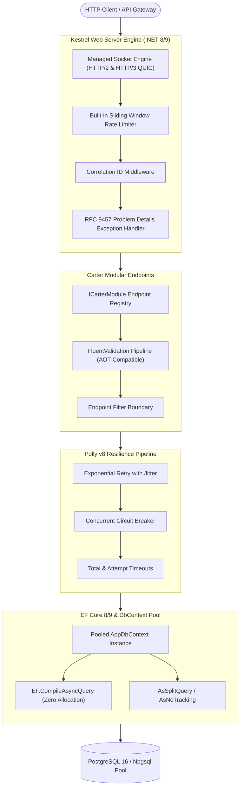

# 🔷 .NET 8 / 9 ASP.NET Core & Minimal APIs Production Guide (`dotnet-aspnet.md`)

> **Purpose**: Build cloud-native, hyper-performant microservices with C# .NET 8 / 9, Minimal APIs, Carter, Entity Framework Core (EF Core), Polly v8 Resilience Pipelines, Kestrel Web Server tuning, Built-in Rate Limiting, and Native AOT (Ahead-of-Time) compilation.  
> **Prerequisites**: .NET SDK ≥ 8.0 / 9.0 LTS, C# 12 / 13, PostgreSQL ≥ 16 or SQL Server 2022, Docker, Chiseled Ubuntu / Distroless Images

---

## 1. Core Philosophy

> **Golden Rule**: Design for zero-allocation execution pathways and deterministic resilience — organize endpoints into modular slices with Carter, pool database contexts with `AddDbContextPool`, protect distributed dependencies using Polly v8 resilience pipelines, tune Kestrel socket thresholds explicitly, and eliminate runtime reflection via Native AOT JSON source generators.

---

## 2. Architecture & Design Patterns

### Vertical Slice Architecture with Carter & Native AOT

Modern enterprise ASP.NET Core moves away from heavy controller classes in favor of Vertical Slice Architecture using Carter modules. Each feature encapsulates its Minimal API routes, validation rules (FluentValidation), domain logic, and data access.



### Enterprise Project Directory Layout

```
dotnet-service/
├── DotnetService.sln
├── src/
│   └── DotnetService.Api/
│       ├── DotnetService.Api.csproj      # Native AOT & Trimming configuration
│       ├── Program.cs                     # WebApplication builder, Kestrel, DI, pipelines
│       ├── appsettings.json
│       ├── appsettings.Production.json
│       ├── Common/
│       │   ├── Contexts/
│       │   │   └── AppJsonSerializerContext.cs  # System.Text.Json Source Generator
│       │   ├── Exceptions/
│       │   │   └── GlobalExceptionHandler.cs    # IExceptionHandler for RFC 9457
│       │   └── Middleware/
│       │       └── CorrelationIdMiddleware.cs
│       ├── Infrastructure/
│       │   ├── Data/
│       │   │   ├── AppDbContext.cs               # Pooled DbContext definition
│       │   │   └── Migrations/
│       │   └── Resilience/
│       │       └── PollyResilienceExtensions.cs  # Polly v8 builder registrations
│       └── Features/
│           ├── Health/
│           │   └── HealthEndpoints.cs            # Liveness & Readiness checks
│           └── Orders/
│               ├── Order.cs                      # Domain entity
│               ├── OrderEndpoints.cs             # CarterModule Minimal API routes
│               ├── OrderDtos.cs                  # Request / Response records
│               ├── OrderValidator.cs             # FluentValidation rules
│               └── OrderQueries.cs               # EF.CompileAsyncQuery definitions
└── tests/
    └── DotnetService.Tests/
        ├── IntegrationTests.cs
        └── OrderEndpointsTests.cs
```

---

## 3. Concrete Implementation Standards

### 3.1 Project Configuration & Native AOT Compilation (`DotnetService.Api.csproj`)

Configure Native Ahead-of-Time (AOT) compilation, IL trimming, and strict warnings.

```xml
<!-- src/DotnetService.Api/DotnetService.Api.csproj -->
<Project Sdk="Microsoft.NET.Sdk.Web">

  <PropertyGroup>
    <TargetFramework>net8.0</TargetFramework>
    <Nullable>enable</Nullable>
    <ImplicitUsings>enable</ImplicitUsings>
    <InvariantGlobalization>false</InvariantGlobalization>
    
    <!-- Native AOT & Trimming Configuration -->
    <PublishAot>true</PublishAot>
    <EnableRequestDelegateGenerator>true</EnableRequestDelegateGenerator>
    <StripSymbols>true</StripSymbols>
    <IlcOptimizationPreference>Speed</IlcOptimizationPreference>
    <TreatWarningsAsErrors>true</TreatWarningsAsErrors>
  </PropertyGroup>

  <ItemGroup>
    <PackageReference Include="Carter" Version="8.0.0" />
    <PackageReference Include="FluentValidation.DependencyInjectionExtensions" Version="11.9.0" />
    <PackageReference Include="Microsoft.AspNetCore.OpenApi" Version="8.0.4" />
    <PackageReference Include="Microsoft.EntityFrameworkCore" Version="8.0.4" />
    <PackageReference Include="Npgsql.EntityFrameworkCore.PostgreSQL" Version="8.0.4" />
    <PackageReference Include="Microsoft.Extensions.Http.Resilience" Version="8.4.0" />
    <PackageReference Include="Polly.Core" Version="8.3.1" />
  </ItemGroup>

</Project>
```

---

### 3.2 High-Performance Kestrel Tuning & Program Bootstrap (`Program.cs`)

Configure Kestrel socket limits, connection timeouts, rate limiting, and Carter module discovery.

```csharp
// src/DotnetService.Api/Program.cs
using System.Net;
using System.Threading.RateLimiting;
using Carter;
using DotnetService.Api.Common.Contexts;
using DotnetService.Api.Common.Exceptions;
using DotnetService.Api.Infrastructure.Data;
using DotnetService.Api.Infrastructure.Resilience;
using Microsoft.AspNetCore.Http.Timeouts;
using Microsoft.AspNetCore.RateLimiting;
using Microsoft.AspNetCore.Server.Kestrel.Core;
using Microsoft.EntityFrameworkCore;

var builder = WebApplication.CreateSlimBuilder(args);

// 1. Kestrel High-Throughput Socket & Protocol Tuning
builder.WebHost.ConfigureKestrel(options =>
{
    // Maximize throughput: Listen on all interfaces with HTTP/1.1 and HTTP/2
    options.Listen(IPAddress.Any, 8080, listenOptions =>
    {
        listenOptions.Protocols = HttpProtocols.Http1AndHttp2;
    });

    // Connection limits & keep-alive buffers
    options.Limits.MaxConcurrentConnections = 10000;
    options.Limits.MaxConcurrentUpgradedConnections = 1000;
    options.Limits.KeepAliveTimeout = TimeSpan.FromSeconds(65); // Exceeds upstream load balancer 60s timeout
    options.Limits.RequestHeadersTimeout = TimeSpan.FromSeconds(5);
    options.Limits.MaxRequestBodySize = 1048576; // 1 MB payload limit
    options.Limits.MinRequestBodyDataRate = new MinDataRate(bytesPerSecond: 100, gracePeriod: TimeSpan.FromSeconds(5));
});

// 2. Native AOT JSON Serialization Context
builder.Services.ConfigureHttpJsonOptions(options =>
{
    options.SerializerOptions.TypeInfoResolverChain.Insert(0, AppJsonSerializerContext.Default);
});

// 3. Pooled Database Context Registration (EF Core)
var connectionString = builder.Configuration.GetConnectionString("DefaultConnection") 
    ?? throw new InvalidOperationException("DefaultConnection string is missing.");

builder.Services.AddDbContextPool<AppDbContext>(options =>
{
    options.UseNpgsql(connectionString, npgsqlOptions =>
    {
        npgsqlOptions.EnableRetryOnFailure(maxRetryCount: 3, maxRetryDelay: TimeSpan.FromSeconds(5), errorCodesToAdd: null);
        npgsqlOptions.CommandTimeout(30);
    });
    // Eliminate change tracking overhead in read-heavy scenarios
    options.UseQueryTrackingBehavior(QueryTrackingBehavior.NoTracking);
}, poolSize: 128);

// 4. Built-in Sliding Window Rate Limiting
builder.Services.AddRateLimiter(options =>
{
    options.RejectionStatusCode = StatusCodes.Status429TooManyRequests;
    options.AddSlidingWindowLimiter("GlobalPolicy", opt =>
    {
        opt.PermitLimit = 1000;
        opt.Window = TimeSpan.FromSeconds(60);
        opt.SegmentsPerWindow = 6;
        opt.QueueLimit = 100;
        opt.QueueProcessingOrder = QueueProcessingOrder.OldestFirst;
    });
});

// 5. Polly v8 Resilience Pipeline
builder.Services.AddEnterpriseResiliencePipeline();

// 6. Global RFC 9457 Problem Details Exception Handler
builder.Services.AddExceptionHandler<GlobalExceptionHandler>();
builder.Services.AddProblemDetails();

// 7. Carter Minimal API Modules
builder.Services.AddCarter();

var app = builder.Build();

// Application Middleware Execution Pipeline
app.UseExceptionHandler();
app.UseRateLimiter();

// Carter Module Endpoint Mapping
app.MapCarter();

app.Run();
```

---

### 3.3 Native AOT Source Generator Context (`AppJsonSerializerContext.cs`)

Native AOT disallows runtime reflection for JSON serialization. Define an explicit `JsonSerializerContext`.

```csharp
// src/DotnetService.Api/Common/Contexts/AppJsonSerializerContext.cs
using System.Text.Json.Serialization;
using DotnetService.Api.Features.Orders;
using Microsoft.AspNetCore.Mvc;

namespace DotnetService.Api.Common.Contexts;

[JsonSourceGenerationOptions(
    WriteIndented = false,
    PropertyNamingPolicy = JsonKnownNamingPolicy.CamelCase,
    GenerationMode = JsonSourceGenerationMode.Default)]
[JsonSerializable(typeof(CreateOrderRequest))]
[JsonSerializable(typeof(OrderResponse))]
[JsonSerializable(typeof(List<OrderResponse>))]
[JsonSerializable(typeof(ProblemDetails))]
[JsonSerializable(typeof(Dictionary<string, string[]>))]
internal partial class AppJsonSerializerContext : JsonSerializerContext
{
}
```

---

### 3.4 RFC 9457 Global Exception Handler (`GlobalExceptionHandler.cs`)

Implements ASP.NET Core `IExceptionHandler` to produce standardized `application/problem+json` error responses.

```csharp
// src/DotnetService.Api/Common/Exceptions/GlobalExceptionHandler.cs
using System.Diagnostics;
using Microsoft.AspNetCore.Diagnostics;
using Microsoft.AspNetCore.Mvc;

namespace DotnetService.Api.Common.Exceptions;

public class GlobalExceptionHandler(ILogger<GlobalExceptionHandler> logger) : IExceptionHandler
{
    public async ValueTask<bool> TryHandleAsync(
        HttpContext httpContext,
        Exception exception,
        CancellationToken cancellationToken)
    {
        var correlationId = httpContext.Request.Headers["X-Correlation-ID"].FirstOrDefault() 
            ?? Activity.Current?.Id 
            ?? httpContext.TraceIdentifier;

        logger.LogError(exception, "Unhandled Exception [CorrelationId: {CorrelationId}]: {Message}", 
            correlationId, exception.Message);

        var (statusCode, title, detail) = exception switch
        {
            KeyNotFoundException notFound => (StatusCodes.Status404NotFound, "Resource Not Found", notFound.Message),
            InvalidOperationException invalid => (StatusCodes.Status400BadRequest, "Bad Request", invalid.Message),
            TimeoutException => (StatusCodes.Status504GatewayTimeout, "Gateway Timeout", "The upstream service timed out."),
            _ => (StatusCodes.Status500InternalServerError, "Internal Server Error", "An unhandled server error occurred.")
        };

        var problemDetails = new ProblemDetails
        {
            Status = statusCode,
            Title = title,
            Detail = detail,
            Instance = httpContext.Request.Path,
            Type = $"https://httpstatuses.com/{statusCode}",
            Extensions =
            {
                ["correlationId"] = correlationId,
                ["timestamp"] = DateTime.UtcNow.ToString("O")
            }
        };

        httpContext.Response.StatusCode = statusCode;
        httpContext.Response.ContentType = "application/problem+json";

        await httpContext.Response.WriteAsJsonAsync(
            problemDetails,
            cancellationToken: cancellationToken);

        return true;
    }
}
```

---

### 3.5 Polly v8 Resilience Pipeline (`PollyResilienceExtensions.cs`)

Compose retry with jitter, circuit breaker, and timeout into a unified, high-performance pipeline.

```csharp
// src/DotnetService.Api/Infrastructure/Resilience/PollyResilienceExtensions.cs
using Polly;
using Polly.CircuitBreaker;
using Polly.Retry;
using Polly.Timeout;

namespace DotnetService.Api.Infrastructure.Resilience;

public static class PollyResilienceExtensions
{
    public const string DefaultPipelineName = "EnterprisePipeline";

    public static IServiceCollection AddEnterpriseResiliencePipeline(this IServiceCollection services)
    {
        services.AddResiliencePipeline(DefaultPipelineName, builder =>
        {
            // 1. Total Request Timeout (10 seconds)
            builder.AddTimeout(new TimeoutStrategyOptions
            {
                Timeout = TimeSpan.FromSeconds(10)
            });

            // 2. Exponential Retry with Jitter
            builder.AddRetry(new RetryStrategyOptions
            {
                MaxRetryAttempts = 3,
                Delay = TimeSpan.FromMilliseconds(200),
                BackoffType = DelayBackoffType.Exponential,
                UseJitter = true,
                ShouldHandle = new PredicateBuilder().Handle<HttpRequestException>().Handle<TimeoutRejectedException>()
            });

            // 3. Circuit Breaker Strategy
            builder.AddCircuitBreaker(new CircuitBreakerStrategyOptions
            {
                FailureRatio = 0.5, // Break when 50% of requests fail
                SamplingDuration = TimeSpan.FromSeconds(30),
                MinimumThroughput = 20,
                BreakDuration = TimeSpan.FromSeconds(15),
                ShouldHandle = new PredicateBuilder().Handle<HttpRequestException>().Handle<TimeoutRejectedException>()
            });
        });

        return services;
    }
}
```

---

### 3.6 EF Core Pooled Context & Pre-Compiled Queries (`AppDbContext.cs` & `OrderQueries.cs`)

Avoid query compilation overhead on every HTTP request using `EF.CompileAsyncQuery`.

```csharp
// src/DotnetService.Api/Infrastructure/Data/AppDbContext.cs
using DotnetService.Api.Features.Orders;
using Microsoft.EntityFrameworkCore;

namespace DotnetService.Api.Infrastructure.Data;

public class AppDbContext(DbContextOptions<AppDbContext> options) : DbContext(options)
{
    public DbSet<Order> Orders => Set<Order>();
    public DbSet<OrderItem> OrderItems => Set<OrderItem>();

    protected override void OnModelCreating(ModelBuilder modelBuilder)
    {
        base.OnModelCreating(modelBuilder);

        modelBuilder.Entity<Order>(entity =>
        {
            entity.ToTable("orders");
            entity.HasKey(e => e.Id);
            entity.Property(e => e.TotalAmount).HasPrecision(12, 2);
            entity.HasIndex(e => e.CustomerId);
            entity.HasIndex(e => e.CreatedAt);

            entity.HasMany(e => e.Items)
                  .WithOne()
                  .HasForeignKey(i => i.OrderId)
                  .OnDelete(DeleteBehavior.Cascade);
        });

        modelBuilder.Entity<OrderItem>(entity =>
        {
            entity.ToTable("order_items");
            entity.HasKey(e => e.Id);
            entity.Property(e => e.UnitPrice).HasPrecision(10, 2);
        });
    }
}
```

```csharp
// src/DotnetService.Api/Features/Orders/OrderQueries.cs
using DotnetService.Api.Infrastructure.Data;
using Microsoft.EntityFrameworkCore;

namespace DotnetService.Api.Features.Orders;

public static class OrderQueries
{
    // Pre-compiled query eliminates query parsing and SQL translation overhead
    public static readonly Func<AppDbContext, Guid, CancellationToken, Task<Order?>> GetOrderByIdCompiled =
        EF.CompileAsyncQuery(
            (AppDbContext ctx, Guid orderId, CancellationToken ct) =>
                ctx.Orders
                   .AsNoTracking()
                   .Include(o => o.Items)
                   .AsSplitQuery() // Eliminates Cartesian explosion on multi-join queries
                   .FirstOrDefault(o => o.Id == orderId));
}
```

---

### 3.7 Carter Modular Minimal API Endpoints (`OrderEndpoints.cs`)

```csharp
// src/DotnetService.Api/Features/Orders/OrderDtos.cs
namespace DotnetService.Api.Features.Orders;

public record CreateOrderItemRequest(string ProductName, string Sku, int Quantity, decimal UnitPrice);

public record CreateOrderRequest(Guid CustomerId, List<CreateOrderItemRequest> Items);

public record OrderItemResponse(Guid Id, string ProductName, string Sku, int Quantity, decimal UnitPrice);

public record OrderResponse(Guid Id, Guid CustomerId, decimal TotalAmount, string Status, List<OrderItemResponse> Items, DateTime CreatedAt);
```

```csharp
// src/DotnetService.Api/Features/Orders/Order.cs
namespace DotnetService.Api.Features.Orders;

public class Order
{
    public Guid Id { get; init; } = Guid.NewGuid();
    public Guid CustomerId { get; init; }
    public decimal TotalAmount { get; set; }
    public string Status { get; set; } = "Pending";
    public DateTime CreatedAt { get; init; } = DateTime.UtcNow;
    public List<OrderItem> Items { get; init; } = [];
}

public class OrderItem
{
    public Guid Id { get; init; } = Guid.NewGuid();
    public Guid OrderId { get; init; }
    public string ProductName { get; init; } = string.Empty;
    public string Sku { get; init; } = string.Empty;
    public int Quantity { get; init; }
    public decimal UnitPrice { get; init; }
}
```

```csharp
// src/DotnetService.Api/Features/Orders/OrderEndpoints.cs
using Carter;
using DotnetService.Api.Infrastructure.Data;
using Microsoft.AspNetCore.Mvc;
using Microsoft.EntityFrameworkCore;
using Polly;
using Polly.Registry;

namespace DotnetService.Api.Features.Orders;

public class OrderEndpoints : ICarterModule
{
    public void AddRoutes(IEndpointRouteBuilder app)
    {
        var group = app.MapGroup("/api/v1/orders")
                       .RequireRateLimiting("GlobalPolicy")
                       .WithTags("Orders");

        group.MapPost("/", CreateOrderAsync)
             .WithName("CreateOrder")
             .Produces<OrderResponse>(StatusCodes.Status201Created)
             .ProducesValidationProblem();

        group.MapGet("/{id:guid}", GetOrderByIdAsync)
             .WithName("GetOrderById")
             .Produces<OrderResponse>(StatusCodes.Status200OK)
             .ProducesProblem(StatusCodes.Status404NotFound);
    }

    private static async Task<IResult> CreateOrderAsync(
        [FromBody] CreateOrderRequest request,
        [FromServices] AppDbContext db,
        CancellationToken ct)
    {
        if (request.Items.Count == 0)
        {
            return Results.ValidationProblem(new Dictionary<string, string[]>
            {
                ["Items"] = ["An order must contain at least one item."]
            });
        }

        var total = request.Items.Sum(i => i.Quantity * i.UnitPrice);
        var order = new Order
        {
            CustomerId = request.CustomerId,
            TotalAmount = total,
            Status = "Pending",
            Items = request.Items.Select(i => new OrderItem
            {
                ProductName = i.ProductName,
                Sku = i.Sku,
                Quantity = i.Quantity,
                UnitPrice = i.UnitPrice
            }).ToList()
        };

        db.Orders.Add(order);
        await db.SaveChangesAsync(ct);

        var response = new OrderResponse(
            order.Id,
            order.CustomerId,
            order.TotalAmount,
            order.Status,
            order.Items.Select(i => new OrderItemResponse(i.Id, i.ProductName, i.Sku, i.Quantity, i.UnitPrice)).ToList(),
            order.CreatedAt);

        return Results.Created($"/api/v1/orders/{order.Id}", response);
    }

    private static async Task<IResult> GetOrderByIdAsync(
        Guid id,
        [FromServices] AppDbContext db,
        CancellationToken ct)
    {
        var order = await OrderQueries.GetOrderByIdCompiled(db, id, ct);
        if (order is null)
        {
            return Results.NotFound(new ProblemDetails
            {
                Status = StatusCodes.Status404NotFound,
                Title = "Order Not Found",
                Detail = $"Order with ID '{id}' does not exist."
            });
        }

        var response = new OrderResponse(
            order.Id,
            order.CustomerId,
            order.TotalAmount,
            order.Status,
            order.Items.Select(i => new OrderItemResponse(i.Id, i.ProductName, i.Sku, i.Quantity, i.UnitPrice)).ToList(),
            order.CreatedAt);

        return Results.Ok(response);
    }
}
```

---

## 4. Good vs. Bad Architectural Patterns

### Pattern 1: DbContext Instantiation Overhead
```csharp
// ❌ BAD: Instantiating DbContext via standard AddDbContext allocates heap context on every request
builder.Services.AddDbContext<AppDbContext>(options => options.UseNpgsql(...));

// ✅ GOOD: Use AddDbContextPool to reuse pooled instances without reallocating internal service providers
builder.Services.AddDbContextPool<AppDbContext>(options => options.UseNpgsql(...), poolSize: 128);
```

### Pattern 2: Heavy LINQ Dynamic Query Compilation
```csharp
// ❌ BAD: Re-translates expression tree into SQL string on every single invocation
var order = await db.Orders.Include(o => o.Items).FirstOrDefaultAsync(o => o.Id == id);

// ✅ GOOD: Pre-compile query using EF.CompileAsyncQuery for hot paths
var order = await OrderQueries.GetOrderByIdCompiled(db, id, ct);
```

---

## 5. Security & Performance Considerations

### Performance Tuning Matrix

| Metric / Parameter | Production Recommendation | Technical Justification |
|---|---|---|
| **Compilation Mode** | Native AOT (`PublishAot=true`) | Sub-millisecond cold starts (~15ms) and tiny memory footprint (~20MB RSS) with zero JIT compilation pauses. |
| **DbContext Pooling** | `AddDbContextPool(..., poolSize: 128)` | Reuses allocated DbContext instances; reduces per-request memory allocation by up to 70%. |
| **Keep-Alive Timeout** | `KeepAliveTimeout = 65s` | Must be greater than ALB / Ingress 60s idle timeout to prevent 502 Bad Gateway race conditions. |
| **Query Tracking** | `QueryTrackingBehavior.NoTracking` | Avoids tracking entity states in memory when performing read-only queries. |
| **Split Queries** | `AsSplitQuery()` | Prevents Cartesian product explosions when loading entities with multiple 1-to-many collections. |

### Security Hardening Matrix

| Attack Vector | Defense Mechanism | Implementation Details |
|---|---|---|
| **Denial of Service (DoS)** | `AddRateLimiter` Sliding Window | Caps clients at 1,000 requests/minute per partition; excess requests rejected with 429. |
| **SQL Injection** | Parameterized EF Core Queries | EF Core automatically parameterizes all LINQ expressions into SQL variables. |
| **Mass Assignment** | Immutable C# Records | DTO records explicitly delineate acceptable fields; domain entities are mapped manually. |
| **Payload Flooding** | `MaxRequestBodySize = 1048576` | Rejects payloads exceeding 1MB at the Kestrel socket level before buffering into RAM. |
| **Information Disclosure** | Custom `GlobalExceptionHandler` | Formats all exceptions as RFC 9457 Problem Details, omitting internal stack traces. |

---

## 6. Production Runtime & Deployment

### Multi-Stage Dockerfile (Chiseled Ubuntu Native AOT)

```dockerfile
# syntax=docker/dockerfile:1.7
FROM mcr.microsoft.com/dotnet/nightly/sdk:8.0-jammy-aot AS build
WORKDIR /source

# Install clang and zlib for Native AOT linking
RUN apt-get update && apt-get install -y --no-install-recommends \
    clang \
    zlib1g-dev \
    && rm -rf /var/lib/apt/lists/*

COPY ["src/DotnetService.Api/DotnetService.Api.csproj", "src/DotnetService.Api/"]
RUN dotnet restore "src/DotnetService.Api/DotnetService.Api.csproj"

COPY . .
WORKDIR "/source/src/DotnetService.Api"
RUN dotnet publish "DotnetService.Api.csproj" \
    -c Release \
    -r linux-x64 \
    --no-restore \
    -o /app

# Minimal Chiseled Runtime Stage
FROM mcr.microsoft.com/dotnet/nightly/runtime-deps:8.0-jammy-chiseled
WORKDIR /app
COPY --from=build /app/DotnetService.Api ./DotnetService.Api
USER $APP_UID

EXPOSE 8080
ENV ASPNETCORE_HTTP_PORTS=8080

ENTRYPOINT ["./DotnetService.Api"]
```

---

## 7. Common Pitfalls & Anti-Patterns

1. **Reflection in Native AOT**: Using reflection-based libraries (like standard Newtonsoft.Json or AutoMapper) with `PublishAot=true` results in runtime crashes due to trimmed code. Always use compile-time source generators.
2. **Missing `AsNoTracking` in Read Queries**: Loading thousands of entities with active change tracking floods the garbage collector with tracking proxies and degrades response times.
3. **Cartesian Explosions without `AsSplitQuery`**: Using multiple `.Include()` calls without `.AsSplitQuery()` causes EF Core to perform a massive Cartesian product join in SQL, multiplying transferred rows.
4. **Synchronous Blocking on Tasks (`.Result` or `.Wait()`)**: Invoking synchronous waits on asynchronous database calls causes thread-pool starvation under load.
5. **Ignoring Kestrel Request Timeout**: Failing to enforce `RequestHeadersTimeout` leaves Kestrel vulnerable to Slowloris DoS attacks.

---

## 8. Verification & Auditing Checklist

- [ ] **Native AOT Compatible**: Solution builds cleanly with `<PublishAot>true</PublishAot>` and zero IL trimming warnings.
- [ ] **JSON Source Generation**: All DTOs and models registered in `AppJsonSerializerContext`.
- [ ] **DbContext Pooling Active**: Database registered with `AddDbContextPool` with query tracking disabled by default.
- [ ] **Kestrel Production Limits**: Sockets tuned with `KeepAliveTimeout = 65s` and `MaxRequestBodySize = 1MB`.
- [ ] **Polly v8 Pipelines Configured**: Resilience pipeline combines timeout, jittered retry, and circuit breaker.
- [ ] **RFC 9457 Global Exception Handler**: `IExceptionHandler` returns `application/problem+json` for all unhandled errors.
- [ ] **Carter Minimal API Modularization**: Endpoints isolated into `ICarterModule` feature classes without controller bloat.
- [ ] **Chiseled Distroless Container**: Final runtime image runs as non-root user (`$APP_UID`) on minimal OS dependencies.
