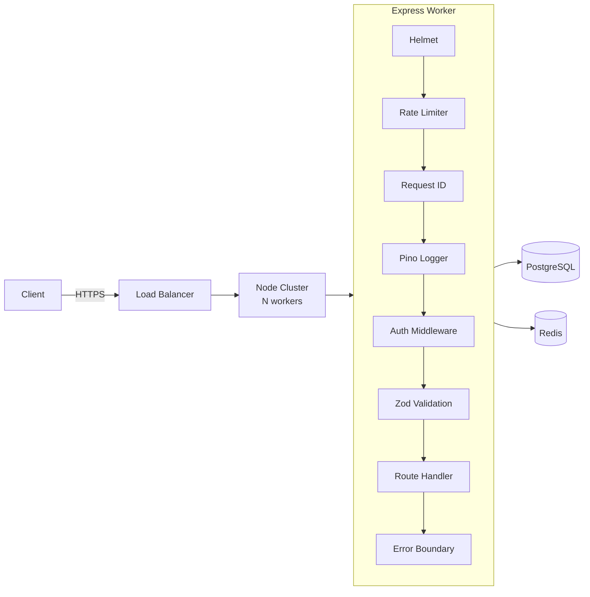

# Express.js Production Guide

> **Purpose**: Build production-grade HTTP services with Express 5.x and TypeScript — covering middleware composition, security hardening, structured logging, validation, graceful shutdown, and horizontal scaling.

> **Prerequisites**: Node.js ≥ 20 LTS, TypeScript ≥ 5.4, npm/pnpm

---

## Core Philosophy

> **Golden Rule**: Every request MUST pass through a deterministic middleware pipeline — authentication → validation → business logic → serialization → error boundary — with no unhandled promise rejections escaping to the process.

---

## Architecture Overview



---

## Project Structure

```
src/
├── server.ts              # Cluster manager + graceful shutdown
├── app.ts                 # Express app factory
├── config/
│   └── env.ts             # Validated environment config
├── middleware/
│   ├── requestId.ts
│   ├── logger.ts
│   ├── auth.ts
│   ├── validate.ts
│   └── errorHandler.ts
├── routes/
│   ├── index.ts           # Route registry
│   ├── health.ts
│   └── users/
│       ├── users.router.ts
│       ├── users.controller.ts
│       ├── users.service.ts
│       └── users.schema.ts
├── lib/
│   ├── db.ts              # Database client
│   ├── redis.ts           # Redis client
│   └── errors.ts          # Typed error classes
└── __tests__/
    ├── integration/
    └── unit/
```

---

## Environment Configuration with Zod

Validate all environment variables at startup — fail fast, not at runtime.

```typescript
// src/config/env.ts
import { z } from "zod";

const EnvSchema = z.object({
  NODE_ENV: z.enum(["development", "staging", "production"]).default("development"),
  PORT: z.coerce.number().int().min(1).max(65535).default(3000),
  DATABASE_URL: z.string().url(),
  REDIS_URL: z.string().url(),
  JWT_SECRET: z.string().min(32),
  LOG_LEVEL: z.enum(["fatal", "error", "warn", "info", "debug", "trace"]).default("info"),
  RATE_LIMIT_WINDOW_MS: z.coerce.number().default(60_000),
  RATE_LIMIT_MAX: z.coerce.number().default(100),
  CORS_ORIGINS: z
    .string()
    .transform((s) => s.split(",").map((o) => o.trim()))
    .default(""),
});

export type Env = z.infer<typeof EnvSchema>;

function loadEnv(): Env {
  const result = EnvSchema.safeParse(process.env);
  if (!result.success) {
    console.error("❌ Invalid environment variables:", result.error.flatten().fieldErrors);
    process.exit(1);
  }
  return result.data;
}

export const env = loadEnv();
```

---

## Application Factory

```typescript
// src/app.ts
import express, { type Express } from "express";
import helmet from "helmet";                     // helmet@8.x
import cors from "cors";                         // cors@2.x
import { rateLimit } from "express-rate-limit";  // express-rate-limit@7.x
import { pinoHttp } from "pino-http";            // pino-http@10.x
import { env } from "./config/env.js";
import { requestId } from "./middleware/requestId.js";
import { errorHandler, notFoundHandler } from "./middleware/errorHandler.js";
import { registerRoutes } from "./routes/index.js";

export function createApp(): Express {
  const app = express();

  // ── Security ──────────────────────────────────────────
  app.use(helmet());
  app.use(
    cors({
      origin: env.CORS_ORIGINS,
      methods: ["GET", "POST", "PUT", "PATCH", "DELETE"],
      credentials: true,
    })
  );

  // ── Rate Limiting ────────────────────────────────────
  app.use(
    rateLimit({
      windowMs: env.RATE_LIMIT_WINDOW_MS,
      max: env.RATE_LIMIT_MAX,
      standardHeaders: "draft-7",
      legacyHeaders: false,
      message: { error: "Too many requests, please try again later." },
    })
  );

  // ── Observability ────────────────────────────────────
  app.use(requestId);
  app.use(
    pinoHttp({
      level: env.LOG_LEVEL,
      redact: ["req.headers.authorization", "req.headers.cookie"],
      customProps: (req) => ({ requestId: (req as any).id }),
    })
  );

  // ── Body Parsing ─────────────────────────────────────
  app.use(express.json({ limit: "1mb" }));
  app.use(express.urlencoded({ extended: false, limit: "1mb" }));

  // ── Routes ───────────────────────────────────────────
  registerRoutes(app);

  // ── Error Handling (MUST be last) ────────────────────
  app.use(notFoundHandler);
  app.use(errorHandler);

  return app;
}
```

---

## Middleware Patterns

### Request ID Propagation

```typescript
// src/middleware/requestId.ts
import { randomUUID } from "node:crypto";
import type { Request, Response, NextFunction } from "express";

export function requestId(req: Request, _res: Response, next: NextFunction): void {
  (req as any).id = req.headers["x-request-id"]?.toString() || randomUUID();
  next();
}
```

### Zod Validation Middleware

```typescript
// src/middleware/validate.ts
import type { Request, Response, NextFunction } from "express";
import { ZodSchema, ZodError } from "zod";
import { AppError } from "../lib/errors.js";

interface ValidationTarget {
  body?: ZodSchema;
  query?: ZodSchema;
  params?: ZodSchema;
}

export function validate(schemas: ValidationTarget) {
  return (req: Request, _res: Response, next: NextFunction): void => {
    try {
      if (schemas.body) req.body = schemas.body.parse(req.body);
      if (schemas.query) req.query = schemas.query.parse(req.query) as any;
      if (schemas.params) req.params = schemas.params.parse(req.params) as any;
      next();
    } catch (err) {
      if (err instanceof ZodError) {
        next(
          new AppError(422, "Validation failed", {
            issues: err.issues.map((i) => ({
              path: i.path.join("."),
              message: i.message,
            })),
          })
        );
      } else {
        next(err);
      }
    }
  };
}
```

### Centralized Error Handler

```typescript
// src/middleware/errorHandler.ts
import type { Request, Response, NextFunction } from "express";
import type { HttpError } from "../lib/errors.js";

export function notFoundHandler(req: Request, _res: Response, next: NextFunction): void {
  next({ status: 404, message: `Route ${req.method} ${req.path} not found` });
}

export function errorHandler(
  err: HttpError | Error,
  req: Request,
  res: Response,
  _next: NextFunction
): void {
  const status = "status" in err ? err.status : 500;
  const message = status === 500 ? "Internal Server Error" : err.message;

  // Log full error for 5xx; summary for 4xx
  if (status >= 500) {
    req.log?.error({ err, requestId: (req as any).id }, "Unhandled error");
  } else {
    req.log?.warn({ status, message, requestId: (req as any).id }, "Client error");
  }

  res.status(status).json({
    error: message,
    ...("details" in err ? { details: (err as any).details } : {}),
    requestId: (req as any).id,
  });
}
```

---

## Typed Error Classes

```typescript
// src/lib/errors.ts
export interface HttpError extends Error {
  status: number;
  details?: unknown;
}

export class AppError extends Error implements HttpError {
  constructor(
    public readonly status: number,
    message: string,
    public readonly details?: unknown
  ) {
    super(message);
    this.name = "AppError";
    Error.captureStackTrace(this, AppError);
  }
}

export class NotFoundError extends AppError {
  constructor(resource: string, id: string | number) {
    super(404, `${resource} with id '${id}' not found`);
    this.name = "NotFoundError";
  }
}

export class ConflictError extends AppError {
  constructor(message: string) {
    super(409, message);
    this.name = "ConflictError";
  }
}
```

---

## Route / Controller / Service Example

### Schema

```typescript
// src/routes/users/users.schema.ts
import { z } from "zod";

export const CreateUserSchema = z.object({
  email: z.string().email().max(255),
  name: z.string().min(1).max(100),
  role: z.enum(["user", "admin"]).default("user"),
});

export const UserIdParamsSchema = z.object({
  id: z.coerce.number().int().positive(),
});

export type CreateUserDto = z.infer<typeof CreateUserSchema>;
```

### Router

```typescript
// src/routes/users/users.router.ts
import { Router } from "express";
import { validate } from "../../middleware/validate.js";
import { CreateUserSchema, UserIdParamsSchema } from "./users.schema.js";
import * as controller from "./users.controller.js";

const router = Router();

router.post("/", validate({ body: CreateUserSchema }), controller.create);
router.get("/:id", validate({ params: UserIdParamsSchema }), controller.getById);

export default router;
```

### Controller

```typescript
// src/routes/users/users.controller.ts
import type { Request, Response, NextFunction } from "express";
import * as userService from "./users.service.js";
import type { CreateUserDto } from "./users.schema.js";

export async function create(req: Request, res: Response, next: NextFunction) {
  try {
    const user = await userService.createUser(req.body as CreateUserDto);
    res.status(201).json(user);
  } catch (err) {
    next(err); // Express 5 handles async errors automatically
  }
}

export async function getById(req: Request, res: Response, next: NextFunction) {
  try {
    const user = await userService.getUserById(Number(req.params.id));
    res.json(user);
  } catch (err) {
    next(err);
  }
}
```

### Service

```typescript
// src/routes/users/users.service.ts
import { db } from "../../lib/db.js";
import { NotFoundError, ConflictError } from "../../lib/errors.js";
import type { CreateUserDto } from "./users.schema.js";

export async function createUser(dto: CreateUserDto) {
  const existing = await db.query("SELECT id FROM users WHERE email = $1", [dto.email]);
  if (existing.rowCount) throw new ConflictError(`Email '${dto.email}' already registered`);

  const result = await db.query(
    "INSERT INTO users (email, name, role) VALUES ($1, $2, $3) RETURNING *",
    [dto.email, dto.name, dto.role]
  );
  return result.rows[0];
}

export async function getUserById(id: number) {
  const result = await db.query("SELECT * FROM users WHERE id = $1", [id]);
  if (!result.rowCount) throw new NotFoundError("User", id);
  return result.rows[0];
}
```

---

## Health Check Endpoint

```typescript
// src/routes/health.ts
import { Router, type Request, type Response } from "express";
import { db } from "../lib/db.js";

const router = Router();

router.get("/healthz", (_req: Request, res: Response) => {
  res.json({ status: "ok", uptime: process.uptime() });
});

router.get("/readyz", async (_req: Request, res: Response) => {
  try {
    await db.query("SELECT 1");
    res.json({ status: "ready", db: "connected" });
  } catch {
    res.status(503).json({ status: "not ready", db: "disconnected" });
  }
});

export default router;
```

---

## Graceful Shutdown & Cluster Mode

```typescript
// src/server.ts
import cluster from "node:cluster";
import os from "node:os";
import { createApp } from "./app.js";
import { env } from "./config/env.js";
import { db } from "./lib/db.js";
import { logger } from "./lib/logger.js";

const WORKER_COUNT = env.NODE_ENV === "production" ? os.availableParallelism() : 1;
const SHUTDOWN_TIMEOUT_MS = 15_000;

if (cluster.isPrimary && env.NODE_ENV === "production") {
  logger.info(`Primary ${process.pid} starting ${WORKER_COUNT} workers`);
  for (let i = 0; i < WORKER_COUNT; i++) cluster.fork();

  cluster.on("exit", (worker, code) => {
    logger.warn(`Worker ${worker.process.pid} exited (code ${code}). Restarting…`);
    cluster.fork();
  });
} else {
  const app = createApp();
  const server = app.listen(env.PORT, () => {
    logger.info(`Worker ${process.pid} listening on :${env.PORT}`);
  });

  // ── Graceful Shutdown ─────────────────────────────────
  async function shutdown(signal: string) {
    logger.info(`${signal} received — draining connections…`);
    server.close(async () => {
      await db.end();
      logger.info("Clean shutdown complete");
      process.exit(0);
    });

    setTimeout(() => {
      logger.error("Forced shutdown after timeout");
      process.exit(1);
    }, SHUTDOWN_TIMEOUT_MS).unref();
  }

  process.on("SIGTERM", () => shutdown("SIGTERM"));
  process.on("SIGINT", () => shutdown("SIGINT"));

  // ── Unhandled Rejection Safety Net ─────────────────────
  process.on("unhandledRejection", (reason) => {
    logger.fatal({ reason }, "Unhandled rejection — shutting down");
    process.exit(1);
  });
}
```

---

## Good vs Bad Patterns

### ❌ Bad: Swallowing errors silently

```typescript
app.post("/users", async (req, res) => {
  try {
    const user = await createUser(req.body);
    res.json(user);
  } catch {
    res.status(500).json({ error: "Something went wrong" }); // No logging, no stack trace
  }
});
```

### ✅ Good: Forwarding errors to the centralized handler

```typescript
app.post("/users", async (req, res, next) => {
  try {
    const user = await createUser(req.body);
    res.status(201).json(user);
  } catch (err) {
    next(err); // Error handler logs, classifies, and responds
  }
});
```

### ❌ Bad: Inline validation with manual checks

```typescript
app.post("/users", (req, res) => {
  if (!req.body.email || !req.body.email.includes("@")) {
    return res.status(400).json({ error: "Invalid email" });
  }
  // 20 more manual checks…
});
```

### ✅ Good: Schema-driven validation via middleware

```typescript
app.post("/users", validate({ body: CreateUserSchema }), controller.create);
// All validation handled declaratively; controller receives typed, safe data
```

---

## Testing Strategy

### Unit Test (Vitest)

```typescript
// src/__tests__/unit/users.service.test.ts
import { describe, it, expect, vi } from "vitest";
import { createUser } from "../../routes/users/users.service.js";
import { db } from "../../lib/db.js";
import { ConflictError } from "../../lib/errors.js";

vi.mock("../../lib/db.js");

describe("createUser", () => {
  it("throws ConflictError when email exists", async () => {
    vi.mocked(db.query).mockResolvedValueOnce({ rowCount: 1, rows: [] } as any);
    await expect(createUser({ email: "a@b.com", name: "A", role: "user" })).rejects.toThrow(
      ConflictError
    );
  });
});
```

### Integration Test (Supertest)

```typescript
// src/__tests__/integration/users.test.ts
import { describe, it, expect, beforeAll, afterAll } from "vitest";
import request from "supertest";
import { createApp } from "../../app.js";

const app = createApp();

describe("POST /api/users", () => {
  it("returns 422 for invalid body", async () => {
    const res = await request(app).post("/api/users").send({ email: "bad" });
    expect(res.status).toBe(422);
    expect(res.body.error).toBe("Validation failed");
  });

  it("returns 201 for valid body", async () => {
    const res = await request(app)
      .post("/api/users")
      .send({ email: "test@example.com", name: "Test" });
    expect(res.status).toBe(201);
    expect(res.body).toHaveProperty("id");
  });
});
```

---

## Dockerfile (Production Multi-Stage)

```dockerfile
# syntax=docker/dockerfile:1
FROM node:20-alpine AS base
WORKDIR /app
RUN corepack enable pnpm

FROM base AS deps
COPY package.json pnpm-lock.yaml ./
RUN pnpm install --frozen-lockfile --prod

FROM base AS build
COPY package.json pnpm-lock.yaml tsconfig.json ./
RUN pnpm install --frozen-lockfile
COPY src/ src/
RUN pnpm exec tsc --build

FROM base AS runtime
ENV NODE_ENV=production
COPY --from=deps /app/node_modules ./node_modules
COPY --from=build /app/dist ./dist
COPY package.json ./

USER node
EXPOSE 3000
HEALTHCHECK --interval=30s --timeout=5s CMD wget -qO- http://localhost:3000/healthz || exit 1
CMD ["node", "dist/server.js"]
```

---

## Performance Tuning Checklist

| Lever | Recommendation |
|---|---|
| **Compression** | Use `@fastify/compress` or a reverse-proxy (Nginx/Cloudflare) — do NOT use `compression` middleware in-process for high-throughput |
| **Keep-Alive** | `server.keepAliveTimeout = 65_000` (> ALB's 60 s) |
| **JSON Parsing** | Set `express.json({ limit: '1mb' })` to reject oversized payloads |
| **Connection Pooling** | Use `pg` Pool with `max: 20`, `idleTimeoutMillis: 30_000` |
| **Cluster Workers** | `os.availableParallelism()` matches CPU cores |
| **Helmet CSP** | Enable Content-Security-Policy to mitigate XSS in API-driven SPAs |

---

## Security Considerations

| Attack Vector | Mitigation |
|---|---|
| Header injection | `helmet()` sets `X-Content-Type-Options`, `Strict-Transport-Security`, etc. |
| Brute-force auth | `express-rate-limit` per IP + per-user sliding window |
| Mass assignment | Zod schemas explicitly define allowed fields — no spread of raw body |
| SQL injection | Parameterized queries via `$1, $2` placeholders in `pg` |
| Prototype pollution | `express.json()` uses built-in `JSON.parse` (safe); avoid `qs` `allowPrototypes` |
| Denial of Service | Body size limit (`1mb`), request timeout via reverse proxy |

---

## Common Pitfalls

1. **Forgetting `next(err)` in async handlers** — Express 4 silently hangs; Express 5 auto-catches but you SHOULD still be explicit.
2. **Registering error handler before routes** — Error middleware MUST be the last `app.use()` call.
3. **Not closing DB connections on shutdown** — Leads to connection leaks in containerized restarts.
4. **Using `console.log` in production** — Use Pino for structured, leveled, JSON logging.
5. **Trusting `req.ip` without `app.set('trust proxy', …)`** — Rate limiter sees the proxy IP, not the client.
6. **Blocking the event loop** — Heavy JSON serialization or crypto should be offloaded to a worker thread.

---

## Verification Checklist

- [ ] `helmet()` applied before all routes
- [ ] Rate limiter returns `429` after threshold
- [ ] Invalid payloads return `422` with field-level errors
- [ ] `GET /healthz` returns `200`; `GET /readyz` returns `503` when DB is down
- [ ] Graceful shutdown drains in-flight requests within 15 s
- [ ] Cluster mode spawns N workers = CPU cores in production
- [ ] No secrets in logs (`redact` array includes `authorization`, `cookie`)
- [ ] Docker image runs as non-root (`USER node`)
- [ ] Integration tests achieve ≥ 80 % route coverage
- [ ] `npm audit` reports zero critical/high vulnerabilities

---

*See also*: [`../frontend/react.md`](../frontend/react.md) for full-stack patterns, [`../../testing/integration.md`](../../testing/integration.md) for E2E strategies.
