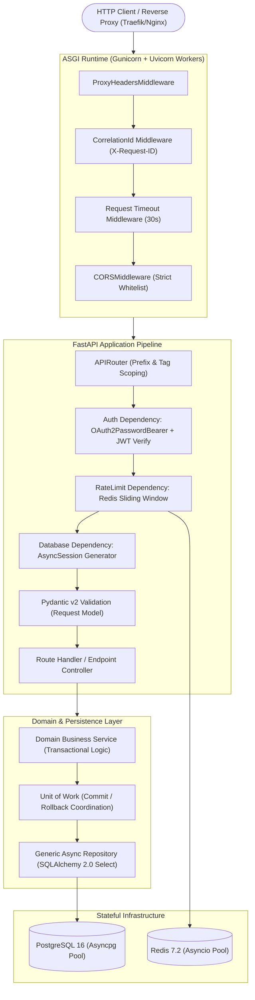

# ⚡ FastAPI Production Guide (`fastapi.md`)

> **Purpose**: Build enterprise-grade, high-concurrency microservices with FastAPI, Python 3.12+, Pydantic v2, Async SQLAlchemy 2.0, Asyncpg, Redis, and PyJWT — covering lifespan state management, structured dependency injection, zero-downtime database pooling, resilient error boundaries, and Uvicorn/Gunicorn runtime tuning.  
> **Prerequisites**: Python ≥ 3.12, Docker, PostgreSQL ≥ 16, Redis ≥ 7.2, UV or Poetry

---

## 1. Core Philosophy

> **Golden Rule**: Treat every request as a typed, transactional contract — enforce strict schema validation at the edge with Pydantic v2, manage resource lifecycles explicitly via contextmanager lifespan handlers, inject scoped sessions through async generators, and never leak unhandled exceptions or internal stack traces past the API boundary.

---

## 2. Architecture & Design Patterns

FastAPI services in enterprise production follow a layered Clean / Onion Architecture. Request flow moves inward through ASGI middleware, dependency-injected security and database sessions, down through domain services and repository abstractions, executing against PostgreSQL via asynchronous non-blocking connection pools.



### Production Project Directory Structure

```
fastapi-enterprise/
├── .env.example
├── pyproject.toml
├── ruff.toml
├── Dockerfile
├── alembic.ini
├── migrations/
│   ├── env.py
│   └── versions/
└── src/
    ├── __init__.py
    ├── main.py                     # Lifespan, FastAPI factory, middleware wiring
    ├── config/
    │   ├── __init__.py
    │   └── settings.py             # Pydantic-Settings v2 with env caching
    ├── core/
    │   ├── __init__.py
    │   ├── database.py             # Async SQLAlchemy 2.0 engine & sessionmaker
    │   ├── redis.py                # Redis connection pool & lifecycle
    │   ├── security.py             # Password hashing (Argon2), JWT token handling
    │   ├── exceptions.py           # Domain exceptions & RFC 9457 Problem Details
    │   └── logging.py              # Structlog / JSON logging configuration
    ├── middleware/
    │   ├── __init__.py
    │   ├── correlation.py          # Request ID propagation & contextvars
    │   └── error_boundary.py       # Global unhandled exception boundary
    ├── modules/
    │   └── users/
    │       ├── __init__.py
    │       ├── router.py           # Route endpoints & dependencies
    │       ├── schemas.py          # Pydantic v2 Request/Response DTOs
    │       ├── models.py           # SQLAlchemy 2.0 Declarative ORM models
    │       ├── repository.py       # Async data access layer
    │       ├── service.py          # Domain business rules
    │       └── dependencies.py     # Module-specific DI providers
    └── tests/
        ├── conftest.py             # Test fixtures with Asyncpg & SQLite in-memory
        ├── test_auth.py
        └── test_users.py
```

---

## 3. Concrete Implementation Standards

### 3.1 Strict Configuration Management (`src/config/settings.py`)

Never read `os.environ` directly in application logic. Use `pydantic-settings` with type safety, validators, and lazy cached instantiations.

```python
# src/config/settings.py
from functools import lru_cache
from typing import Literal
from pydantic import (
    Field,
    PostgresDsn,
    RedisDsn,
    computed_field,
)
from pydantic_settings import BaseSettings, SettingsConfigDict


class AppSettings(BaseSettings):
    model_config = SettingsConfigDict(
        env_file=".env",
        env_file_encoding="utf-8",
        case_sensitive=True,
        extra="forbid",
    )

    # Runtime Environment
    ENVIRONMENT: Literal["development", "staging", "production"] = "development"
    PROJECT_NAME: str = "Enterprise FastApi Service"
    API_V1_STR: str = "/api/v1"
    DEBUG: bool = False

    # Server Bindings
    HOST: str = "0.0.0.0"
    PORT: int = 8000
    WORKERS_COUNT: int = Field(default=4, ge=1, le=32)

    # Database Settings
    POSTGRES_HOST: str = "localhost"
    POSTGRES_PORT: int = 5432
    POSTGRES_USER: str = "postgres"
    POSTGRES_PASSWORD: str = Field(..., min_length=8)
    POSTGRES_DB: str = "enterprise_db"
    POSTGRES_POOL_SIZE: int = Field(default=20, ge=5, le=100)
    POSTGRES_MAX_OVERFLOW: int = Field(default=10, ge=0, le=50)
    POSTGRES_POOL_TIMEOUT: float = Field(default=30.0, ge=1.0)
    POSTGRES_POOL_RECYCLE: int = Field(default=1800, ge=300)

    # Redis Settings
    REDIS_HOST: str = "localhost"
    REDIS_PORT: int = 6379
    REDIS_PASSWORD: str | None = None
    REDIS_DB: int = 0
    REDIS_MAX_CONNECTIONS: int = 50

    # Security & Tokens
    SECRET_KEY: str = Field(..., min_length=32)
    ALGORITHM: str = "HS256"
    ACCESS_TOKEN_EXPIRE_MINUTES: int = Field(default=15, ge=1)
    REFRESH_TOKEN_EXPIRE_DAYS: int = Field(default=7, ge=1)

    # CORS Configuration
    ALLOWED_ORIGINS: list[str] = ["http://localhost:3000"]

    @computed_field  # type: ignore[misc]
    @property
    def SQLALCHEMY_DATABASE_URI(self) -> PostgresDsn:
        return PostgresDsn.build(
            scheme="postgresql+asyncpg",
            username=self.POSTGRES_USER,
            password=self.POSTGRES_PASSWORD,
            host=self.POSTGRES_HOST,
            port=self.POSTGRES_PORT,
            path=self.POSTGRES_DB,
        )

    @computed_field  # type: ignore[misc]
    @property
    def REDIS_URI(self) -> RedisDsn:
        if self.REDIS_PASSWORD:
            return RedisDsn(f"redis://:{self.REDIS_PASSWORD}@{self.REDIS_HOST}:{self.REDIS_PORT}/{self.REDIS_DB}")
        return RedisDsn(f"redis://{self.REDIS_HOST}:{self.REDIS_PORT}/{self.REDIS_DB}")


@lru_cache(maxsize=1)
def get_settings() -> AppSettings:
    """Returns a cached singleton of application settings."""
    return AppSettings()
```

---

### 3.2 Async SQLAlchemy 2.0 & Connection Pooling (`src/core/database.py`)

Configure the SQLAlchemy 2.0 Async Engine with Asyncpg driver, sessionmaker isolation, statement timeouts, and clean generator teardowns.

```python
# src/core/database.py
from collections.abc import AsyncGenerator
from contextlib import asynccontextmanager
import logging
from sqlalchemy import text
from sqlalchemy.ext.asyncio import (
    AsyncAttrs,
    AsyncSession,
    async_sessionmaker,
    create_async_engine,
)
from sqlalchemy.orm import DeclarativeBase
from src.config.settings import get_settings

logger = logging.getLogger("app.database")
settings = get_settings()

# Engine creation with production connection pool tuning
engine = create_async_engine(
    str(settings.SQLALCHEMY_DATABASE_URI),
    pool_size=settings.POSTGRES_POOL_SIZE,
    max_overflow=settings.POSTGRES_MAX_OVERFLOW,
    pool_timeout=settings.POSTGRES_POOL_TIMEOUT,
    pool_recycle=settings.POSTGRES_POOL_RECYCLE,
    pool_pre_ping=True,  # Discards stale disconnected sockets automatically
    echo=settings.DEBUG,
    connect_args={
        "server_settings": {
            "application_name": settings.PROJECT_NAME,
            "statement_timeout": "30000",  # Kill runaway queries after 30 seconds
            "idle_in_transaction_session_timeout": "10000",
        }
    },
)

async_session_factory = async_sessionmaker(
    bind=engine,
    class_=AsyncSession,
    expire_on_commit=False,  # Essential for async: prevents lazy-load errors after commit
    autoflush=False,
)


class Base(AsyncAttrs, DeclarativeBase):
    """Base declarative class for all SQLAlchemy entities."""
    pass


async def get_db_session() -> AsyncGenerator[AsyncSession, None]:
    """
    FastAPI dependency yielding a transactional AsyncSession.
    Commits automatically on exit if no exception occurred; rolls back otherwise.
    """
    async with async_session_factory() as session:
        try:
            yield session
            await session.commit()
        except Exception:
            await session.rollback()
            raise
        finally:
            await session.close()


@asynccontextmanager
async def get_standalone_session() -> AsyncGenerator[AsyncSession, None]:
    """Context manager for background workers, CLI scripts, and testing."""
    async with async_session_factory() as session:
        try:
            yield session
            await session.commit()
        except Exception:
            await session.rollback()
            raise
        finally:
            await session.close()
```

---

### 3.3 Application Lifespan State Manager (`src/main.py`)

Replace deprecated `@app.on_event("startup")` and `@app.on_event("shutdown")` with the standard `lifespan` async contextmanager.

```python
# src/main.py
from contextlib import asynccontextmanager
import logging
import sys
from fastapi import FastAPI, Request, status
from fastapi.exceptions import RequestValidationError
from fastapi.middleware.cors import CORSMiddleware
from fastapi.responses import JSONResponse
import redis.asyncio as aioredis
from sqlalchemy import text
from src.config.settings import get_settings
from src.core.database import engine
from src.core.exceptions import DomainException, rfc9457_exception_handler
from src.modules.users.router import router as users_router

logging.basicConfig(
    level=logging.INFO,
    format="%(asctime)s [%(levelname)s] %(name)s: %(message)s",
    stream=sys.stdout,
)
logger = logging.getLogger("app.main")
settings = get_settings()


@asynccontextmanager
async def lifespan(app: FastAPI):
    """
    Manages the global application lifecycle state.
    Executes startup resource initialization and graceful teardown.
    """
    logger.info("Initializing application resources...")
    
    # 1. Warm-up Database Connection Pool
    try:
        async with engine.connect() as conn:
            await conn.execute(text("SELECT 1"))
        logger.info("Database connection pool established successfully.")
    except Exception as exc:
        logger.critical(f"Database connection failure during startup: {exc}")
        raise SystemExit(f"Cannot connect to database: {exc}") from exc

    # 2. Initialize Redis Async Client
    redis_client = aioredis.from_url(
        str(settings.REDIS_URI),
        max_connections=settings.REDIS_MAX_CONNECTIONS,
        encoding="utf-8",
        decode_responses=True,
    )
    try:
        await redis_client.ping()
        app.state.redis = redis_client
        logger.info("Redis connection pool established successfully.")
    except Exception as exc:
        logger.critical(f"Redis initialization failed: {exc}")
        raise SystemExit(f"Cannot connect to Redis: {exc}") from exc

    yield  # Application processes requests here

    # Graceful Shutdown Sequence
    logger.info("Initiating graceful shutdown sequence...")
    
    # Close Redis client
    await redis_client.aclose()
    logger.info("Redis connection pool closed.")
    
    # Dispose SQLAlchemy Async Engine and close all pool connections
    await engine.dispose()
    logger.info("SQLAlchemy connection engine disposed.")


def create_application() -> FastAPI:
    app = FastAPI(
        title=settings.PROJECT_NAME,
        version="1.0.0",
        openapi_url=f"{settings.API_V1_STR}/openapi.json" if settings.DEBUG else None,
        docs_url=f"{settings.API_V1_STR}/docs" if settings.DEBUG else None,
        redoc_url=None,
        lifespan=lifespan,
    )

    # Middleware Registration (Order matters: executed bottom-to-top on request)
    app.add_middleware(
        CORSMiddleware,
        allow_origins=settings.ALLOWED_ORIGINS,
        allow_credentials=True,
        allow_methods=["GET", "POST", "PUT", "PATCH", "DELETE", "OPTIONS"],
        allow_headers=["Authorization", "Content-Type", "X-Request-ID"],
    )

    # Error Boundary Registration
    app.add_exception_handler(DomainException, rfc9457_exception_handler)
    app.add_exception_handler(RequestValidationError, rfc9457_exception_handler)

    # Health Checks (Kubernetes Liveness / Readiness)
    @app.get("/healthz", tags=["Health"], status_code=status.HTTP_200_OK)
    async def liveness() -> dict[str, str]:
        return {"status": "ok"}

    @app.get("/readyz", tags=["Health"], status_code=status.HTTP_200_OK)
    async def readiness(request: Request) -> JSONResponse:
        # Check DB connectivity
        try:
            async with engine.connect() as conn:
                await conn.execute(text("SELECT 1"))
        except Exception as exc:
            return JSONResponse(
                status_code=status.HTTP_503_SERVICE_UNAVAILABLE,
                content={"status": "unhealthy", "reason": f"Database unreachable: {exc}"},
            )

        # Check Redis connectivity
        try:
            redis_pool = request.app.state.redis
            await redis_pool.ping()
        except Exception as exc:
            return JSONResponse(
                status_code=status.HTTP_503_SERVICE_UNAVAILABLE,
                content={"status": "unhealthy", "reason": f"Redis unreachable: {exc}"},
            )

        return JSONResponse(
            status_code=status.HTTP_200_OK,
            content={"status": "ready", "database": "up", "redis": "up"},
        )

    # Routers
    app.include_router(users_router, prefix=f"{settings.API_V1_STR}/users", tags=["Users"])

    return app


app = create_application()
```

---

### 3.4 Pydantic v2 Production Schemas (`src/modules/users/schemas.py`)

Take full advantage of Pydantic v2: `model_config = ConfigDict(from_attributes=True, extra="forbid")`, `field_validator`, `model_validator`, and clear Request vs Response boundary models.

```python
# src/modules/users/schemas.py
from datetime import datetime
import re
import uuid
from pydantic import (
    BaseModel,
    ConfigDict,
    EmailStr,
    Field,
    field_validator,
    model_validator,
)


class UserBase(BaseModel):
    model_config = ConfigDict(
        from_attributes=True,
        extra="forbid",
        str_strip_whitespace=True,
    )

    email: EmailStr
    full_name: str = Field(..., min_length=2, max_length=100)
    is_active: bool = True
    role: str = Field(default="user", pattern="^(user|admin|operator)$")


class UserCreate(UserBase):
    password: str = Field(..., min_length=10, max_length=128)
    password_confirm: str = Field(..., min_length=10, max_length=128)

    @field_validator("password")
    @classmethod
    def validate_password_complexity(cls, value: str) -> str:
        if not re.search(r"[A-Z]", value):
            raise ValueError("Password must contain at least one uppercase letter.")
        if not re.search(r"[a-z]", value):
            raise ValueError("Password must contain at least one lowercase letter.")
        if not re.search(r"\d", value):
            raise ValueError("Password must contain at least one digit.")
        if not re.search(r"[@$!%*?&]", value):
            raise ValueError("Password must contain at least one special character (@$!%*?&).")
        return value

    @model_validator(mode="after")
    def verify_passwords_match(self) -> "UserCreate":
        if self.password != self.password_confirm:
            raise ValueError("Password and confirmation password do not match.")
        return self


class UserUpdate(BaseModel):
    model_config = ConfigDict(extra="forbid", str_strip_whitespace=True)

    full_name: str | None = Field(None, min_length=2, max_length=100)
    email: EmailStr | None = None
    is_active: bool | None = None


class UserResponse(UserBase):
    id: uuid.UUID
    created_at: datetime
    updated_at: datetime


class TokenResponse(BaseModel):
    access_token: str
    refresh_token: str
    token_type: str = "bearer"
    expires_in: int
```

---

### 3.5 Declarative SQLAlchemy 2.0 ORM Entity (`src/modules/users/models.py`)

Use modern Mapped annotations, explicit column types, indexed constraints, and UTC timestamps.

```python
# src/modules/users/models.py
from datetime import datetime, timezone
import uuid
from sqlalchemy import Boolean, DateTime, Index, String, Uuid
from sqlalchemy.orm import Mapped, mapped_column
from src.core.database import Base


class User(Base):
    __tablename__ = "users"

    id: Mapped[uuid.UUID] = mapped_column(
        Uuid(as_uuid=True),
        primary_column=True,
        default=uuid.uuid4,
    )
    email: Mapped[str] = mapped_column(
        String(255),
        unique=True,
        index=True,
        nullable=False,
    )
    hashed_password: Mapped[str] = mapped_column(
        String(255),
        nullable=False,
    )
    full_name: Mapped[str] = mapped_column(
        String(100),
        nullable=False,
    )
    role: Mapped[str] = mapped_column(
        String(20),
        nullable=False,
        default="user",
        server_default="user",
    )
    is_active: Mapped[bool] = mapped_column(
        Boolean,
        default=True,
        server_default="true",
        nullable=False,
    )
    created_at: Mapped[datetime] = mapped_column(
        DateTime(timezone=True),
        default=lambda: datetime.now(timezone.utc),
        nullable=False,
    )
    updated_at: Mapped[datetime] = mapped_column(
        DateTime(timezone=True),
        default=lambda: datetime.now(timezone.utc),
        onupdate=lambda: datetime.now(timezone.utc),
        nullable=False,
    )

    __table_args__ = (
        Index("ix_users_role_is_active", "role", "is_active"),
    )
```

---

### 3.6 OAuth2 Security & JWT Cryptography (`src/core/security.py`)

Enforce modern cryptography using Argon2 password hashing (recommended by OWASP) and stateless HMAC-SHA256 JWT tokens.

```python
# src/core/security.py
from datetime import datetime, timedelta, timezone
from typing import Any
import jwt
from passlib.context import CryptContext
from src.config.settings import get_settings

settings = get_settings()

pwd_context = CryptContext(
    schemes=["argon2", "bcrypt"],
    deprecated="auto",
    argon2__memory_cost=65536,
    argon2__time_cost=3,
    argon2__parallelism=4,
)


def verify_password(plain_password: str, hashed_password: str) -> bool:
    return pwd_context.verify(plain_password, hashed_password)


def get_password_hash(password: str) -> str:
    return pwd_context.hash(password)


def create_token(
    subject: str | Any,
    expires_delta: timedelta,
    token_type: str = "access",
    additional_claims: dict[str, Any] | None = None,
) -> str:
    now = datetime.now(timezone.utc)
    expire = now + expires_delta
    payload = {
        "sub": str(subject),
        "iat": now,
        "exp": expire,
        "type": token_type,
    }
    if additional_claims:
        payload.update(additional_claims)
    return jwt.encode(payload, settings.SECRET_KEY, algorithm=settings.ALGORITHM)


def decode_token(token: str) -> dict[str, Any]:
    return jwt.decode(
        token,
        settings.SECRET_KEY,
        algorithms=[settings.ALGORITHM],
        options={"require": ["exp", "iat", "sub", "type"]},
    )
```

---

### 3.7 Dependency Injection Pipeline (`src/modules/users/dependencies.py`)

Hierarchical dependency injection cleanly isolates authentication, permissions, and database operations.

```python
# src/modules/users/dependencies.py
from typing import Annotated
import uuid
from fastapi import Depends, HTTPException, Security, status
from fastapi.security import OAuth2PasswordBearer
import jwt
from sqlalchemy.ext.asyncio import AsyncSession
from src.config.settings import get_settings
from src.core.database import get_db_session
from src.core.security import decode_token
from src.modules.users.models import User
from src.modules.users.repository import UserRepository

settings = get_settings()
oauth2_scheme = OAuth2PasswordBearer(
    tokenUrl=f"{settings.API_V1_STR}/users/login",
    auto_error=True,
)

# Common Typed Dependencies
DbSession = Annotated[AsyncSession, Depends(get_db_session)]
OAuthToken = Annotated[str, Depends(oauth2_scheme)]


async def get_user_repository(session: DbSession) -> UserRepository:
    return UserRepository(session)


UserRepoDep = Annotated[UserRepository, Depends(get_user_repository)]


async def get_current_user(token: OAuthToken, repo: UserRepoDep) -> User:
    credentials_exception = HTTPException(
        status_code=status.HTTP_401_UNAUTHORIZED,
        detail="Could not validate credentials",
        headers={"WWW-Authenticate": "Bearer"},
    )
    try:
        payload = decode_token(token)
        if payload.get("type") != "access":
            raise credentials_exception
        user_id_str: str = payload.get("sub")
        if not user_id_str:
            raise credentials_exception
        user_id = uuid.UUID(user_id_str)
    except (jwt.PyJWTError, ValueError):
        raise credentials_exception

    user = await repo.get_by_id(user_id)
    if user is None:
        raise credentials_exception
    if not user.is_active:
        raise HTTPException(
            status_code=status.HTTP_403_FORBIDDEN,
            detail="Inactive user account",
        )
    return user


CurrentUser = Annotated[User, Depends(get_current_user)]


class RequireRole:
    """RBAC Guard Dependency."""
    def __init__(self, allowed_roles: list[str]):
        self.allowed_roles = allowed_roles

    def __call__(self, user: CurrentUser) -> User:
        if user.role not in self.allowed_roles:
            raise HTTPException(
                status_code=status.HTTP_403_FORBIDDEN,
                detail=f"Operation not permitted. Required roles: {self.allowed_roles}",
            )
        return user
```

---

### 3.8 Async Repository & Service Implementation

Encapsulate SQLAlchemy 2.0 query building inside a testable, decoupled repository.

```python
# src/modules/users/repository.py
import uuid
from collections.abc import Sequence
from sqlalchemy import select, update
from sqlalchemy.ext.asyncio import AsyncSession
from src.modules.users.models import User
from src.modules.users.schemas import UserCreate, UserUpdate


class UserRepository:
    def __init__(self, session: AsyncSession):
        self.session = session

    async def get_by_id(self, user_id: uuid.UUID) -> User | None:
        stmt = select(User).where(User.id == user_id)
        result = await self.session.execute(stmt)
        return result.scalar_one_or_none()

    async def get_by_email(self, email: str) -> User | None:
        stmt = select(User).where(User.email == email.lower())
        result = await self.session.execute(stmt)
        return result.scalar_one_or_none()

    async def list_users(self, offset: int = 0, limit: int = 50) -> Sequence[User]:
        stmt = select(User).order_by(User.created_at.desc()).offset(offset).limit(limit)
        result = await self.session.execute(stmt)
        return result.scalars().all()

    async def create(self, user_in: UserCreate, hashed_password: str) -> User:
        user = User(
            email=user_in.email.lower(),
            hashed_password=hashed_password,
            full_name=user_in.full_name,
            role=user_in.role,
            is_active=user_in.is_active,
        )
        self.session.add(user)
        await self.session.flush()  # Populates user.id without premature commit
        return user

    async def update(self, user: User, update_data: UserUpdate) -> User:
        data = update_data.model_dump(exclude_unset=True)
        if "email" in data:
            data["email"] = data["email"].lower()
        for field, value in data.items():
            setattr(user, field, value)
        await self.session.flush()
        return user
```

---

### 3.9 Error Boundaries & RFC 9457 Problem Details (`src/core/exceptions.py`)

Do not allow raw Python stack traces, database uniqueness errors, or unexpected internal states to leak to consumers. Map all errors to the RFC 9457 standard.

```python
# src/core/exceptions.py
from datetime import datetime, timezone
from typing import Any
from fastapi import Request, status
from fastapi.exceptions import RequestValidationError
from fastapi.responses import JSONResponse


class DomainException(Exception):
    def __init__(
        self,
        title: str,
        detail: str,
        status_code: int = status.HTTP_400_BAD_REQUEST,
        type_uri: str = "about:blank",
        extra: dict[str, Any] | None = None,
    ):
        super().__init__(detail)
        self.title = title
        self.detail = detail
        self.status_code = status_code
        self.type_uri = type_uri
        self.extra = extra or {}


class EntityNotFoundException(DomainException):
    def __init__(self, entity_name: str, identifier: Any):
        super().__init__(
            title="Entity Not Found",
            detail=f"{entity_name} identified by '{identifier}' was not found.",
            status_code=status.HTTP_404_NOT_FOUND,
            type_uri="https://api.example.com/errors/not-found",
        )


class ConflictException(DomainException):
    def __init__(self, detail: str):
        super().__init__(
            title="Conflict Detected",
            detail=detail,
            status_code=status.HTTP_409_CONFLICT,
            type_uri="https://api.example.com/errors/conflict",
        )


async def rfc9457_exception_handler(request: Request, exc: Exception) -> JSONResponse:
    timestamp = datetime.now(timezone.utc).isoformat()

    if isinstance(exc, DomainException):
        content = {
            "type": exc.type_uri,
            "title": exc.title,
            "status": exc.status_code,
            "detail": exc.detail,
            "instance": request.url.path,
            "timestamp": timestamp,
            **exc.extra,
        }
        return JSONResponse(
            status_code=exc.status_code,
            content=content,
            headers={"Content-Type": "application/problem+json"},
        )

    if isinstance(exc, RequestValidationError):
        errors = [
            {"loc": list(err["loc"]), "msg": err["msg"], "type": err["type"]}
            for err in exc.errors()
        ]
        content = {
            "type": "https://api.example.com/errors/validation-failed",
            "title": "Unprocessable Request Entity",
            "status": status.HTTP_422_UNPROCESSABLE_ENTITY,
            "detail": "Input validation failed. Inspect invalid_params for details.",
            "instance": request.url.path,
            "timestamp": timestamp,
            "invalid_params": errors,
        }
        return JSONResponse(
            status_code=status.HTTP_422_UNPROCESSABLE_ENTITY,
            content=content,
            headers={"Content-Type": "application/problem+json"},
        )

    # Catch-all fallback
    return JSONResponse(
        status_code=status.HTTP_500_INTERNAL_SERVER_ERROR,
        content={
            "type": "about:blank",
            "title": "Internal Server Error",
            "status": 500,
            "detail": "An unexpected error occurred. Please contact system support.",
            "instance": request.url.path,
            "timestamp": timestamp,
        },
        headers={"Content-Type": "application/problem+json"},
    )
```

---

### 3.10 APIRouter Controller Endpoints (`src/modules/users/router.py`)

```python
# src/modules/users/router.py
from datetime import timedelta
import uuid
from fastapi import APIRouter, Depends, Query, status
from fastapi.security import OAuth2PasswordRequestForm
from src.config.settings import get_settings
from src.core.exceptions import ConflictException, EntityNotFoundException
from src.core.security import create_token, get_password_hash, verify_password
from src.modules.users.dependencies import (
    CurrentUser,
    RequireRole,
    UserRepoDep,
)
from src.modules.users.models import User
from src.modules.users.schemas import (
    TokenResponse,
    UserCreate,
    UserResponse,
    UserUpdate,
)

router = APIRouter()
settings = get_settings()


@router.post(
    "",
    response_model=UserResponse,
    status_code=status.HTTP_201_CREATED,
    summary="Register a new user",
)
async def create_user(user_in: UserCreate, repo: UserRepoDep):
    existing = await repo.get_by_email(user_in.email)
    if existing:
        raise ConflictException(f"User with email '{user_in.email}' already exists.")
    
    hashed_pwd = get_password_hash(user_in.password)
    user = await repo.create(user_in, hashed_pwd)
    return user


@router.post(
    "/login",
    response_model=TokenResponse,
    summary="Authenticate user and issue JWT tokens",
)
async def login(
    form_data: OAuth2PasswordRequestForm = Depends(),
    repo: UserRepoDep = None,
):
    user = await repo.get_by_email(form_data.username)
    if not user or not verify_password(form_data.password, user.hashed_password):
        from fastapi import HTTPException
        raise HTTPException(
            status_code=status.HTTP_401_UNAUTHORIZED,
            detail="Incorrect username or password",
            headers={"WWW-Authenticate": "Bearer"},
        )
    if not user.is_active:
        from fastapi import HTTPException
        raise HTTPException(status_code=status.HTTP_403_FORBIDDEN, detail="Account disabled")

    access_delta = timedelta(minutes=settings.ACCESS_TOKEN_EXPIRE_MINUTES)
    refresh_delta = timedelta(days=settings.REFRESH_TOKEN_EXPIRE_DAYS)

    access_token = create_token(
        subject=str(user.id),
        expires_delta=access_delta,
        token_type="access",
        additional_claims={"role": user.role},
    )
    refresh_token = create_token(
        subject=str(user.id),
        expires_delta=refresh_delta,
        token_type="refresh",
    )

    return TokenResponse(
        access_token=access_token,
        refresh_token=refresh_token,
        expires_in=int(access_delta.total_seconds()),
    )


@router.get(
    "/me",
    response_model=UserResponse,
    summary="Retrieve authenticated user profile",
)
async def get_my_profile(current_user: CurrentUser):
    return current_user


@router.get(
    "",
    response_model=list[UserResponse],
    summary="List all users (Admin only)",
    dependencies=[Depends(RequireRole(["admin"]))],
)
async def list_users(
    repo: UserRepoDep,
    offset: int = Query(0, ge=0),
    limit: int = Query(20, ge=1, le=100),
):
    return await repo.list_users(offset=offset, limit=limit)


@router.get(
    "/{user_id}",
    response_model=UserResponse,
    summary="Get user by UUID",
    dependencies=[Depends(RequireRole(["admin", "operator"]))],
)
async def get_user_by_id(user_id: uuid.UUID, repo: UserRepoDep):
    user = await repo.get_by_id(user_id)
    if not user:
        raise EntityNotFoundException(entity_name="User", identifier=user_id)
    return user


@router.patch(
    "/{user_id}",
    response_model=UserResponse,
    summary="Update user details",
)
async def update_user(
    user_id: uuid.UUID,
    user_update: UserUpdate,
    repo: UserRepoDep,
    current_user: CurrentUser,
):
    if current_user.role != "admin" and current_user.id != user_id:
        from fastapi import HTTPException
        raise HTTPException(
            status_code=status.HTTP_403_FORBIDDEN,
            detail="Cannot update another user's profile",
        )
    user = await repo.get_by_id(user_id)
    if not user:
        raise EntityNotFoundException(entity_name="User", identifier=user_id)
    
    return await repo.update(user, user_update)
```

---

## 4. Good vs. Bad Architectural Patterns

### Pattern 1: Async vs Sync Handlers
```python
# ❌ BAD: Blocking operations inside async def freeze the entire single-threaded event loop!
@router.post("/export-pdf")
async def bad_export_pdf(data: ReportData):
    import time
    time.sleep(5)  # 500 concurrent users will cause 2500s latency degradation!
    pdf_bytes = generate_heavy_report_sync(data)
    return Response(content=pdf_bytes, media_type="application/pdf")

# ✅ GOOD: Offload CPU-bound or sync I/O via run_in_threadpool or use standard def
from fastapi.concurrency import run_in_threadpool

@router.post("/export-pdf")
async def good_export_pdf(data: ReportData):
    # Runs safely in Starlette's AnyIO worker threadpool without stalling event loop
    pdf_bytes = await run_in_threadpool(generate_heavy_report_sync, data)
    return Response(content=pdf_bytes, media_type="application/pdf")
```

### Pattern 2: Database Session Handling
```python
# ❌ BAD: Session created globally or kept open without transaction boundaries
db_session = async_session_factory()  # Concurrency leak! Shared across requests!

@router.get("/items")
async def get_items():
    result = await db_session.execute(select(Item))
    return result.scalars().all()

# ✅ GOOD: Scoped dependency injection yielding exactly one session per request
@router.get("/items")
async def get_items(db: AsyncSession = Depends(get_db_session)):
    result = await db.execute(select(Item))
    return result.scalars().all()
```

---

## 5. Security & Performance Considerations

### Performance Tuning Matrix

| Parameter / Lever | Production Recommendation | Technical Justification |
|---|---|---|
| **ASGI Engine** | Gunicorn master + `uvicorn.workers.UvicornWorker` | Gunicorn handles worker process recycling, heartbeats, and zero-downtime reloads; Uvicorn executes async loop via `uvloop` and `httptools`. |
| **Worker Count** | `(2 x $NUM_CORES) + 1` | Maximizes throughput for async I/O without incurring excessive memory footprint or OS context-switch thrashing. |
| **SQLAlchemy Pool** | `pool_size=20, max_overflow=10` per worker | With 4 workers, max DB connections = `(20+10)*4 = 120`. Ensure PostgreSQL `max_connections` is sized accordingly. |
| **Connection Pre-ping** | `pool_pre_ping=True` | Executes a fast `SELECT 1` ping test before handing out pool connection, mitigating AWS RDS / PgBouncer TCP dropouts. |
| **JSON Serialization** | OrjsonResponse | 3-5x faster parsing and serialization than standard Python `json`. Built-in native support for Datetime and UUID. |
| **HTTP Keep-Alive** | `keepalive=65` seconds | Must exceed AWS Application Load Balancer / Nginx 60s idle timeout to prevent 502 Bad Gateway race conditions. |

### Security Hardening Matrix

| Threat Vector | Mitigation Strategy | Implementation Details |
|---|---|---|
| **SQL Injection** | Parameterized AST queries via SQLAlchemy 2.0 | Disallow raw string concatenation with `text()`. Always bind parameters via `text("... WHERE id = :id").bindparams(id=val)`. |
| **Slowloris DoS** | Reverse proxy timeouts + Uvicorn header limits | Gunicorn `--timeout 30`, `--graceful-timeout 15`, `--limit-request-line 4094`, `--limit-request-field_size 8190`. |
| **CORS Misconfiguration** | Strict origin whitelist | Do NOT use `allow_origins=["*"]` when `allow_credentials=True`. Enforce explicit client domains. |
| **Secret Token Forgery** | Argon2id + HS256/RS256 JWT validation | Enforce token `exp`, `iat`, and `type` verification. Expire access tokens in 15 minutes; revoke via Redis blacklisting. |
| **Sensitive Field Leakage** | Pydantic response models | Always define explicit `response_model=UserResponse` on routes. Never return raw ORM entities directly. |

---

## 6. Production Runtime & Deployment

### Production Multi-Stage Dockerfile

```dockerfile
# syntax=docker/dockerfile:1.7
FROM python:3.12-slim-bookworm AS builder

WORKDIR /app
ENV PYTHONUNBUFFERED=1 \
    PYTHONDONTWRITEBYTECODE=1 \
    PIP_NO_CACHE_DIR=1 \
    PIP_DISABLE_PIP_VERSION_CHECK=1

RUN apt-get update && apt-get install -y --no-install-recommends \
    build-essential \
    libpq-dev \
    curl \
    && rm -rf /var/lib/apt/lists/*

COPY pyproject.toml .
RUN pip install uv && uv pip install --system --no-cache .

# Final Distroless/Minimal Runtime Stage
FROM python:3.12-slim-bookworm AS runner

WORKDIR /app
ENV PYTHONUNBUFFERED=1 \
    PYTHONDONTWRITEBYTECODE=1 \
    PATH="/app/.venv/bin:$PATH"

RUN groupadd -g 10001 appgroup && \
    useradd -u 10000 -g appgroup -s /bin/bash -m appuser

COPY --from=builder /usr/local/lib/python3.12/site-packages /usr/local/lib/python3.12/site-packages
COPY --from=builder /usr/local/bin /usr/local/bin

COPY src/ /app/src/
COPY alembic.ini /app/
COPY migrations/ /app/migrations/

USER appuser

EXPOSE 8000

HEALTHCHECK --interval=30s --timeout=5s --start-period=10s --retries=3 \
    CMD curl -f http://localhost:8000/healthz || exit 1

ENTRYPOINT ["gunicorn", "src.main:app", \
            "-w", "4", \
            "-k", "uvicorn.workers.UvicornWorker", \
            "-b", "0.0.0.0:8000", \
            "--timeout", "30", \
            "--graceful-timeout", "15", \
            "--keep-alive", "65", \
            "--access-logfile", "-", \
            "--error-logfile", "-"]
```

---

## 7. Common Pitfalls & Anti-Patterns

1. **Blocking the Asyncio Event Loop**: Calling `time.sleep()`, synchronous database drivers (`psycopg2`), or `requests.get()` inside `async def` routes. Use `asyncio.sleep()`, `asyncpg`, and `httpx.AsyncClient`.
2. **Missing `expire_on_commit=False` in Sessionmaker**: Results in `sqlalchemy.orm.exc.DetachedInstanceError` when accessing model attributes after an async commit.
3. **Overriding Response Status via Dependency**: Modifying `response.status_code` inside a sub-dependency without raising an `HTTPException` can cause caching and streaming mismatches.
4. **Permissive CORS with Credentials**: Combining `allow_origins=["*"]` with `allow_credentials=True` violates the CORS specification and exposes session tokens to unauthorized third parties.
5. **Neglecting Lifespan Engine Disposal**: Failing to call `await engine.dispose()` on shutdown leaves open sockets in PostgreSQL, causing resource starvation upon container restarts.
6. **Validating in Controllers Instead of Pydantic**: Writing manual regex checks or conditional checks inside endpoint functions instead of leveraging Pydantic v2 `field_validator` / `model_validator`.
7. **Using Mutable Defaults in Dependencies**: Writing `def get_items(filter: list = [])` leads to state leaks across requests. Always use `None` and initialize inside the callable.

---

## 8. Verification & Auditing Checklist

- [ ] **Lifespan Contextmanager**: Application startup and shutdown managed via `@asynccontextmanager async def lifespan(app: FastAPI)` with `engine.dispose()` on exit.
- [ ] **Pydantic v2 Strictness**: All DTOs use `ConfigDict(from_attributes=True, extra="forbid")` and explicit field types.
- [ ] **Async Database Protocol**: Driver is `postgresql+asyncpg://` with `pool_pre_ping=True` and connection pooling sized to worker constraints.
- [ ] **No Event Loop Blockers**: Automated static analysis (e.g., `flake8-async`) confirms no synchronous I/O inside `async def` functions.
- [ ] **Transactional Unit of Work**: Database sessions provided via dependency with automatic rollback on unhandled exceptions.
- [ ] **RFC 9457 Problem Details**: Custom exceptions return `application/problem+json` formatted responses with error correlation IDs.
- [ ] **Argon2 Password Hashing**: Passwords hashed with `passlib` or `argon2-cffi` using minimum 64MB memory cost.
- [ ] **Token Expiration & Revocation**: Short-lived access tokens (≤ 15 mins) coupled with refresh token rotation and Redis invalidation.
- [ ] **Liveness & Readiness Probes**: Separate `/healthz` (shallow) and `/readyz` (deep database + cache probe) endpoints returning HTTP 503 on degradation.
- [ ] **Non-Root Containerization**: Dockerfile executes as unprivileged `appuser` (UID 10000) with a multi-stage slim footprint.
