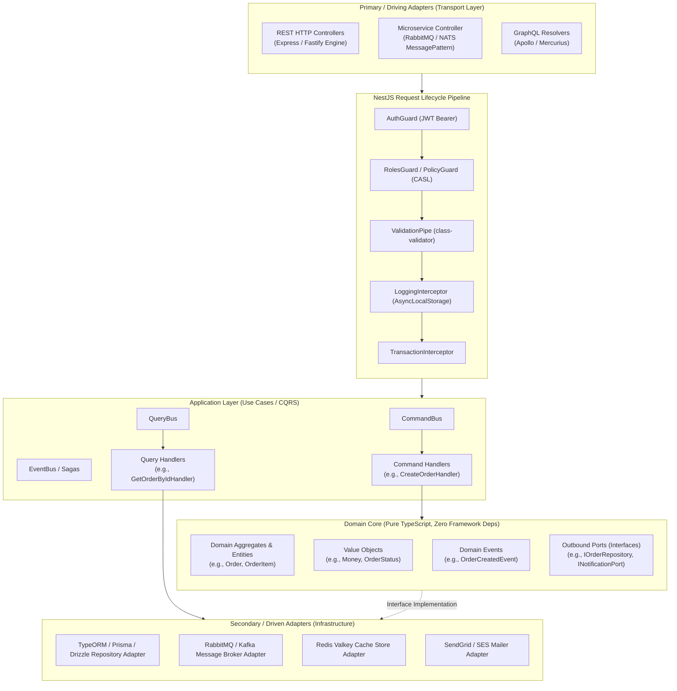

# 🦁 NestJS Enterprise Architecture Guide (`nestjs.md`)

> **Purpose**: Build enterprise-grade, highly maintainable backend microservices and modular monoliths with NestJS, TypeScript, Hexagonal (Ports & Adapters) Architecture, CQRS, Dynamic Modules, Event-Driven Microservices, and strict security guards.  
> **Prerequisites**: Node.js ≥ 20 LTS, TypeScript ≥ 5.4, NestJS CLI ≥ 10.x, PostgreSQL ≥ 16, Redis ≥ 7.2, RabbitMQ or NATS

---

## 1. Core Philosophy

> **Golden Rule**: Strictly enforce architectural boundaries — isolate domain business rules completely from framework transport mechanics using Hexagonal Ports & Adapters, encapsulate external integrations via async dynamic modules, enforce zero-trust security across guards and interceptors, and treat all state mutations as transactional CQRS commands.

---

## 2. Architecture & Design Patterns

### Hexagonal Architecture (Ports & Adapters) in NestJS

In an enterprise NestJS service, dependencies point inward. Domain entities and business logic have zero framework dependencies. The Application layer orchestrates use cases via Commands and Queries. The Infrastructure layer implements external adapters (PostgreSQL repositories, Redis caches, RabbitMQ brokers, Stripe billing) that satisfy ports defined by inner layers.



### Enterprise Project Directory Layout

```
nestjs-enterprise/
├── nest-cli.json
├── package.json
├── tsconfig.json
├── tsconfig.build.json
├── Dockerfile
├── src/
│   ├── main.ts                          # Bootstrap, Global Pipes, Filters, Swagger
│   ├── app.module.ts                    # Root Application Orchestrator
│   ├── common/                          # Cross-cutting framework utilities
│   │   ├── constants/
│   │   │   └── tokens.ts                # Injection tokens for interfaces/ports
│   │   ├── decorators/
│   │   │   ├── current-user.decorator.ts
│   │   │   ├── public.decorator.ts
│   │   │   └── roles.decorator.ts
│   │   ├── filters/
│   │   │   ├── http-exception.filter.ts # RFC 9457 Problem Details Filter
│   │   │   └── rpc-exception.filter.ts
│   │   ├── guards/
│   │   │   ├── jwt-auth.guard.ts
│   │   │   └── roles.guard.ts
│   │   ├── interceptors/
│   │   │   ├── logging.interceptor.ts   # Request tracing with AsyncLocalStorage
│   │   │   ├── timeout.interceptor.ts
│   │   │   └── transform.interceptor.ts
│   │   └── pipes/
│   │       └── strict-validation.pipe.ts
│   ├── config/                          # Validated ConfigModule setup
│   │   ├── app.config.ts
│   │   ├── database.config.ts
│   │   └── env.validation.ts
│   ├── infrastructure/                  # Reusable Dynamic Infrastructure Modules
│   │   ├── database/
│   │   │   ├── database.module.ts       # Dynamic async TypeORM/Kysely module
│   │   │   └── database.interface.ts
│   │   └── messaging/
│   │       ├── messaging.module.ts      # RabbitMQ / NATS ClientProxy module
│   │       └── messaging.service.ts
│   └── modules/
│       └── orders/                      # Domain Module (Hexagonal Slice)
│           ├── orders.module.ts
│           ├── domain/                  # Pure Business Logic
│           │   ├── models/
│           │   │   ├── order.entity.ts
│           │   │   └── order-status.enum.ts
│           │   ├── ports/
│           │   │   ├── order-repository.port.ts
│           │   │   └── notification.port.ts
│           │   └── events/
│           │       └── order-created.event.ts
│           ├── application/             # Use Cases / CQRS
│           │   ├── commands/
│           │   │   ├── create-order.command.ts
│           │   │   └── create-order.handler.ts
│           │   ├── queries/
│           │   │   ├── get-order.query.ts
│           │   │   └── get-order.handler.ts
│           │   └── sagas/
│           │       └── order.sagas.ts
│           └── infrastructure/          # Driving & Driven Adapters
│               ├── controllers/
│               │   ├── orders.http.controller.ts
│               │   └── orders.message.controller.ts
│               ├── dto/
│               │   ├── create-order.dto.ts
│               │   └── order-response.dto.ts
│               └── persistence/
│                   ├── order.typeorm.entity.ts
│                   └── order.repository.adapter.ts
└── test/
    ├── app.e2e-spec.ts
    └── orders.e2e-spec.ts
```

---

## 3. Concrete Implementation Standards

### 3.1 Bootstrap, Pipes, and RFC 9457 Global Filter (`src/main.ts`)

Enforce strict validation, global security headers via Helmet, and deterministic HTTP exception mapping.

```typescript
// src/main.ts
import { Logger, ValidationPipe } from '@nestjs/common';
import { NestFactory } from '@nestjs/core';
import { FastifyAdapter, NestFastifyApplication } from '@nestjs/platform-fastify';
import helmet from '@fastify/helmet';
import compression from '@fastify/compress';
import { AppModule } from './app.module';
import { HttpExceptionFilter } from './common/filters/http-exception.filter';
import { LoggingInterceptor } from './common/interceptors/logging.interceptor';
import { TimeoutInterceptor } from './common/interceptors/timeout.interceptor';

async function bootstrap() {
  const logger = new Logger('Bootstrap');

  // Fastify adapter for maximum high-throughput performance
  const app = await NestFactory.create<NestFastifyApplication>(
    AppModule,
    new FastifyAdapter({
      logger: false,
      trustProxy: true,
      bodyLimit: 1048576, // 1MB payload ceiling
    }),
  );

  // Security Headers
  await app.register(helmet, {
    contentSecurityPolicy: {
      directives: {
        defaultSrc: [`'self'`],
        styleSrc: [`'self'`, `'unsafe-inline'`],
        imgSrc: [`'self'`, 'data:', 'validator.swagger.io'],
        scriptSrc: [`'self'`],
      },
    },
  });

  // Compression
  await app.register(compression, { encodings: ['gzip', 'deflate'] });

  // CORS Policy
  app.enableCors({
    origin: process.env.ALLOWED_ORIGINS?.split(',') || ['http://localhost:3000'],
    methods: ['GET', 'POST', 'PUT', 'PATCH', 'DELETE', 'OPTIONS'],
    credentials: true,
    allowedHeaders: ['Authorization', 'Content-Type', 'X-Correlation-ID'],
  });

  // Global Exception Filter
  app.useGlobalFilters(new HttpExceptionFilter());

  // Global Interceptors
  app.useGlobalInterceptors(
    new LoggingInterceptor(),
    new TimeoutInterceptor(15000), // 15-second request timeout
  );

  // Global Strict Validation Pipe
  app.useGlobalPipes(
    new ValidationPipe({
      whitelist: true,                  // Strip undeclared incoming properties
      forbidNonWhitelisted: true,       // Reject payloads with unknown properties with 400
      transform: true,                  // Automatically convert primitives & objects to DTO classes
      transformOptions: {
        enableImplicitConversion: false, // Disallow arbitrary type casting
      },
      validationError: {
        target: false,                  // Prevent leaking full object graph in error payload
        value: false,
      },
    }),
  );

  // Graceful Shutdown Hooks
  app.enableShutdownHooks();

  const port = process.env.PORT ? parseInt(process.env.PORT, 10) : 3000;
  await app.listen(port, '0.0.0.0');
  logger.log(`🚀 Application operational and listening on port ${port}`);
}

bootstrap().catch((err) => {
  console.error('Fatal application startup error:', err);
  process.exit(1);
});
```

---

### 3.2 RFC 9457 HTTP Exception Filter (`src/common/filters/http-exception.filter.ts`)

Converts any `HttpException` or unexpected process error into standardized `application/problem+json` format.

```typescript
// src/common/filters/http-exception.filter.ts
import {
  ArgumentsHost,
  Catch,
  ExceptionFilter,
  HttpException,
  HttpStatus,
  Logger,
} from '@nestjs/common';
import { FastifyReply, FastifyRequest } from 'fastify';

@Catch()
export class HttpExceptionFilter implements ExceptionFilter {
  private readonly logger = new Logger(HttpExceptionFilter.name);

  catch(exception: unknown, host: ArgumentsHost): void {
    const ctx = host.switchToHttp();
    const response = ctx.getResponse<FastifyReply>();
    const request = ctx.getRequest<FastifyRequest>();

    const correlationId = (request.headers['x-correlation-id'] as string) || 'none';
    const timestamp = new Date().toISOString();

    let status = HttpStatus.INTERNAL_SERVER_ERROR;
    let title = 'Internal Server Error';
    let detail = 'An unexpected internal error occurred. Please contact system support.';
    let invalidParams: unknown = undefined;

    if (exception instanceof HttpException) {
      status = exception.getStatus();
      const exceptionResponse = exception.getResponse();

      if (typeof exceptionResponse === 'string') {
        detail = exceptionResponse;
      } else if (typeof exceptionResponse === 'object' && exceptionResponse !== null) {
        const resObj = exceptionResponse as Record<string, any>;
        title = resObj.error || exception.name;
        detail = Array.isArray(resObj.message) ? 'Validation failed' : resObj.message || detail;
        if (Array.isArray(resObj.message)) {
          invalidParams = resObj.message;
        }
      }
    } else if (exception instanceof Error) {
      this.logger.error(
        `Unhandled Exception [Correlation: ${correlationId}]: ${exception.message}`,
        exception.stack,
      );
    }

    const problemDetails = {
      type: `https://httpstatuses.com/${status}`,
      title,
      status,
      detail,
      instance: request.url,
      correlationId,
      timestamp,
      ...(invalidParams ? { invalidParams } : {}),
    };

    response
      .status(status)
      .header('Content-Type', 'application/problem+json')
      .send(problemDetails);
  }
}
```

---

### 3.3 Dynamic Asynchronous Module Architecture (`src/infrastructure/database/database.module.ts`)

Implement enterprise `forRoot` and `forRootAsync` dynamic modules using symbol-based injection tokens and async factory providers.

```typescript
// src/common/constants/tokens.ts
export const DATABASE_OPTIONS = Symbol('DATABASE_OPTIONS');
export const DATABASE_CONNECTION = Symbol('DATABASE_CONNECTION');
export const ORDER_REPOSITORY_PORT = Symbol('ORDER_REPOSITORY_PORT');
export const MESSAGE_BROKER_PORT = Symbol('MESSAGE_BROKER_PORT');
```

```typescript
// src/infrastructure/database/database.interface.ts
import { ModuleMetadata, Type } from '@nestjs/common';

export interface DatabaseModuleOptions {
  host: string;
  port: number;
  username: string;
  password: string;
  database: string;
  poolSize: number;
  ssl?: boolean;
}

export interface DatabaseOptionsFactory {
  createDatabaseOptions(): Promise<DatabaseModuleOptions> | DatabaseModuleOptions;
}

export interface DatabaseModuleAsyncOptions extends Pick<ModuleMetadata, 'imports'> {
  useExisting?: Type<DatabaseOptionsFactory>;
  useClass?: Type<DatabaseOptionsFactory>;
  useFactory?: (...args: any[]) => Promise<DatabaseModuleOptions> | DatabaseModuleOptions;
  inject?: any[];
}
```

```typescript
// src/infrastructure/database/database.module.ts
import { DynamicModule, Global, Module, Provider } from '@nestjs/common';
import { Pool } from 'pg';
import { DATABASE_CONNECTION, DATABASE_OPTIONS } from '../../common/constants/tokens';
import {
  DatabaseModuleAsyncOptions,
  DatabaseModuleOptions,
  DatabaseOptionsFactory,
} from './database.interface';

@Global()
@Module({})
export class DatabaseModule {
  static forRoot(options: DatabaseModuleOptions): DynamicModule {
    const optionsProvider: Provider = {
      provide: DATABASE_OPTIONS,
      useValue: options,
    };

    const connectionProvider: Provider = {
      provide: DATABASE_CONNECTION,
      useFactory: async (opts: DatabaseModuleOptions): Promise<Pool> => {
        const pool = new Pool({
          host: opts.host,
          port: opts.port,
          user: opts.username,
          password: opts.password,
          database: opts.database,
          max: opts.poolSize,
          idleTimeoutMillis: 30000,
          connectionTimeoutMillis: 5000,
          ssl: opts.ssl ? { rejectUnauthorized: false } : false,
        });
        // Test connection
        const client = await pool.connect();
        client.release();
        return pool;
      },
      inject: [DATABASE_OPTIONS],
    };

    return {
      module: DatabaseModule,
      providers: [optionsProvider, connectionProvider],
      exports: [connectionProvider],
    };
  }

  static forRootAsync(options: DatabaseModuleAsyncOptions): DynamicModule {
    const asyncProviders = this.createAsyncProviders(options);

    const connectionProvider: Provider = {
      provide: DATABASE_CONNECTION,
      useFactory: async (opts: DatabaseModuleOptions): Promise<Pool> => {
        const pool = new Pool({
          host: opts.host,
          port: opts.port,
          user: opts.username,
          password: opts.password,
          database: opts.database,
          max: opts.poolSize,
          idleTimeoutMillis: 30000,
          connectionTimeoutMillis: 5000,
        });
        return pool;
      },
      inject: [DATABASE_OPTIONS],
    };

    return {
      module: DatabaseModule,
      imports: options.imports || [],
      providers: [...asyncProviders, connectionProvider],
      exports: [connectionProvider],
    };
  }

  private static createAsyncProviders(options: DatabaseModuleAsyncOptions): Provider[] {
    if (options.useFactory) {
      return [
        {
          provide: DATABASE_OPTIONS,
          useFactory: options.useFactory,
          inject: options.inject || [],
        },
      ];
    }

    const target = options.useExisting || options.useClass;
    if (!target) {
      throw new Error('Invalid DatabaseModuleAsyncOptions configuration');
    }

    return [
      {
        provide: DATABASE_OPTIONS,
        useFactory: async (factory: DatabaseOptionsFactory) => factory.createDatabaseOptions(),
        inject: [target],
      },
      ...(options.useClass ? [{ provide: target, useClass: options.useClass }] : []),
    ];
  }
}
```

---

### 3.4 Strict DTOs & Validation Decorators (`src/modules/orders/infrastructure/dto/create-order.dto.ts`)

Combine `class-validator` and `class-transformer` with nested object trees and strict assertions.

```typescript
// src/modules/orders/infrastructure/dto/create-order.dto.ts
import { Type } from 'class-transformer';
import {
  ArrayMinSize,
  IsArray,
  IsEnum,
  IsInt,
  IsNotEmpty,
  IsNumber,
  IsPositive,
  IsString,
  IsUUID,
  Min,
  ValidateNested,
} from 'class-validator';

export enum PaymentMethod {
  CREDIT_CARD = 'CREDIT_CARD',
  BANK_TRANSFER = 'BANK_TRANSFER',
  CRYPTO = 'CRYPTO',
}

export class OrderItemDto {
  @IsUUID('4', { message: 'productId must be a valid RFC 4122 UUID v4' })
  @IsNotEmpty()
  readonly productId: string;

  @IsInt({ message: 'quantity must be an integer' })
  @Min(1, { message: 'quantity must be at least 1 unit' })
  readonly quantity: number;

  @IsNumber({ maxDecimalPlaces: 2 }, { message: 'unitPrice must be a valid decimal amount' })
  @IsPositive({ message: 'unitPrice must be greater than zero' })
  readonly unitPrice: number;
}

export class CreateOrderDto {
  @IsUUID('4', { message: 'customerId must be a valid UUID v4' })
  @IsNotEmpty()
  readonly customerId: string;

  @IsArray({ message: 'items must be an array' })
  @ArrayMinSize(1, { message: 'An order must contain at least one item' })
  @ValidateNested({ each: true })
  @Type(() => OrderItemDto)
  readonly items: OrderItemDto[];

  @IsEnum(PaymentMethod, { message: 'paymentMethod must be CREDIT_CARD, BANK_TRANSFER, or CRYPTO' })
  @IsNotEmpty()
  readonly paymentMethod: PaymentMethod;

  @IsString()
  @IsNotEmpty()
  readonly shippingAddress: string;
}
```

---

### 3.5 Role-Based & Policy Guards (`src/common/guards/roles.guard.ts`)

Leverage NestJS Reflector and ExecutionContext to enforce enterprise RBAC across HTTP routes and RPC microservice handlers.

```typescript
// src/common/decorators/roles.decorator.ts
import { SetMetadata } from '@nestjs/common';

export const ROLES_KEY = 'roles';
export const Roles = (...roles: string[]) => SetMetadata(ROLES_KEY, roles);
```

```typescript
// src/common/guards/roles.guard.ts
import {
  CanActivate,
  ExecutionContext,
  ForbiddenException,
  Injectable,
  UnauthorizedException,
} from '@nestjs/common';
import { Reflector } from '@nestjs/core';
import { ROLES_KEY } from '../decorators/roles.decorator';

export interface AuthenticatedUser {
  id: string;
  email: string;
  roles: string[];
}

@Injectable()
export class RolesGuard implements CanActivate {
  constructor(private readonly reflector: Reflector) {}

  canActivate(context: ExecutionContext): boolean {
    const requiredRoles = this.reflector.getAllAndOverride<string[]>(ROLES_KEY, [
      context.getHandler(),
      context.getClass(),
    ]);

    // Route does not mandate specific roles
    if (!requiredRoles || requiredRoles.length === 0) {
      return true;
    }

    const request = context.switchToHttp().getRequest();
    const user: AuthenticatedUser | undefined = request.user;

    if (!user) {
      throw new UnauthorizedException('Authentication token missing or invalid');
    }

    const hasRole = user.roles.some((role) => requiredRoles.includes(role));
    if (!hasRole) {
      throw new ForbiddenException(
        `Access denied. Requires one of the following roles: [${requiredRoles.join(', ')}]`,
      );
    }

    return true;
  }
}
```

---

### 3.6 AsyncLocalStorage Tracing & Logging Interceptor (`src/common/interceptors/logging.interceptor.ts`)

Propagate correlation IDs through all downstream asynchronous calls without passing request contexts manually.

```typescript
// src/common/interceptors/logging.interceptor.ts
import {
  CallHandler,
  ExecutionContext,
  Injectable,
  Logger,
  NestInterceptor,
} from '@nestjs/common';
import { Observable } from 'rxjs';
import { tap } from 'rxjs/operators';
import { AsyncLocalStorage } from 'async_hooks';

export interface RequestContextStore {
  correlationId: string;
  userId?: string;
}

export const requestContext = new AsyncLocalStorage<RequestContextStore>();

@Injectable()
export class LoggingInterceptor implements NestInterceptor {
  private readonly logger = new Logger('HTTP');

  intercept(context: ExecutionContext, next: CallHandler): Observable<any> {
    const ctx = context.switchToHttp();
    const req = ctx.getRequest();
    const res = ctx.getResponse();

    const correlationId =
      (req.headers['x-correlation-id'] as string) ||
      `req-${Math.random().toString(36).substring(2, 11)}`;

    // Ensure response returns the correlation header to caller
    if (res.header) {
      res.header('X-Correlation-ID', correlationId);
    }

    const start = performance.now();
    const { method, url } = req;

    const store: RequestContextStore = {
      correlationId,
      userId: req.user?.id,
    };

    return new Observable((subscriber) => {
      requestContext.run(store, () => {
        next
          .handle()
          .pipe(
            tap({
              next: () => {
                const duration = Math.round(performance.now() - start);
                const statusCode = res.statusCode || 200;
                this.logger.log(
                  `[${correlationId}] ${method} ${url} ${statusCode} +${duration}ms`,
                );
              },
              error: (err) => {
                const duration = Math.round(performance.now() - start);
                this.logger.error(
                  `[${correlationId}] ${method} ${url} FAILED +${duration}ms - ${err.message}`,
                );
              },
            }),
          )
          .subscribe(subscriber);
      });
    });
  }
}
```

---

### 3.7 CQRS Handlers & Domain Events (`src/modules/orders/application/`)

Decompose mutations into Commands and reads into Queries via `@nestjs/cqrs`.

#### Command Definition & Handler
```typescript
// src/modules/orders/application/commands/create-order.command.ts
import { ICommand } from '@nestjs/cqrs';
import { CreateOrderDto } from '../../infrastructure/dto/create-order.dto';

export class CreateOrderCommand implements ICommand {
  constructor(
    public readonly orderDto: CreateOrderDto,
    public readonly initiatorId: string,
  ) {}
}
```

```typescript
// src/modules/orders/application/commands/create-order.handler.ts
import { Inject, Logger } from '@nestjs/common';
import { CommandHandler, EventBus, ICommandHandler } from '@nestjs/cqrs';
import { ORDER_REPOSITORY_PORT } from '../../../../common/constants/tokens';
import { Order } from '../../domain/models/order.entity';
import { OrderRepositoryPort } from '../../domain/ports/order-repository.port';
import { OrderCreatedEvent } from '../../domain/events/order-created.event';
import { CreateOrderCommand } from './create-order.command';

@CommandHandler(CreateOrderCommand)
export class CreateOrderCommandHandler implements ICommandHandler<CreateOrderCommand> {
  private readonly logger = new Logger(CreateOrderCommandHandler.name);

  constructor(
    @Inject(ORDER_REPOSITORY_PORT)
    private readonly orderRepository: OrderRepositoryPort,
    private readonly eventBus: EventBus,
  ) {}

  async execute(command: CreateOrderCommand): Promise<string> {
    const { orderDto, initiatorId } = command;
    this.logger.log(`Processing CreateOrderCommand for customer: ${orderDto.customerId}`);

    // Domain Entity construction & invariant checking
    const order = Order.create({
      customerId: orderDto.customerId,
      items: orderDto.items.map((i) => ({
        productId: i.productId,
        quantity: i.quantity,
        unitPrice: i.unitPrice,
      })),
      paymentMethod: orderDto.paymentMethod,
      shippingAddress: orderDto.shippingAddress,
      createdBy: initiatorId,
    });

    // Persist via secondary adapter port
    await this.orderRepository.save(order);

    // Publish domain event to local EventBus or external broker
    this.eventBus.publish(
      new OrderCreatedEvent(order.id, order.customerId, order.calculateTotal()),
    );

    return order.id;
  }
}
```

#### Query Definition & Handler
```typescript
// src/modules/orders/application/queries/get-order.query.ts
import { IQuery } from '@nestjs/cqrs';

export class GetOrderByIdQuery implements IQuery {
  constructor(public readonly orderId: string) {}
}
```

```typescript
// src/modules/orders/application/queries/get-order.handler.ts
import { Inject, NotFoundException } from '@nestjs/common';
import { IQueryHandler, QueryHandler } from '@nestjs/cqrs';
import { ORDER_REPOSITORY_PORT } from '../../../../common/constants/tokens';
import { OrderRepositoryPort } from '../../domain/ports/order-repository.port';
import { OrderResponseDto } from '../../infrastructure/dto/order-response.dto';
import { GetOrderByIdQuery } from './get-order.query';

@QueryHandler(GetOrderByIdQuery)
export class GetOrderByIdQueryHandler implements IQueryHandler<GetOrderByIdQuery, OrderResponseDto> {
  constructor(
    @Inject(ORDER_REPOSITORY_PORT)
    private readonly orderRepository: OrderRepositoryPort,
  ) {}

  async execute(query: GetOrderByIdQuery): Promise<OrderResponseDto> {
    const order = await this.orderRepository.findById(query.orderId);
    if (!order) {
      throw new NotFoundException(`Order with id '${query.orderId}' does not exist.`);
    }

    return {
      id: order.id,
      customerId: order.customerId,
      status: order.status,
      totalAmount: order.calculateTotal(),
      items: order.items,
      createdAt: order.createdAt,
    };
  }
}
```

---

### 3.8 Microservices Transport & Event Publishing (`src/modules/orders/infrastructure/`)

Handle asynchronous messages from RabbitMQ / NATS with explicit acknowledgment patterns and idempotency.

```typescript
// src/modules/orders/infrastructure/controllers/orders.message.controller.ts
import { Controller, Logger } from '@nestjs/common';
import { Ctx, EventPattern, MessagePattern, Payload, RmqContext } from '@nestjs/microservices';
import { CommandBus } from '@nestjs/cqrs';

@Controller()
export class OrdersMessageController {
  private readonly logger = new Logger(OrdersMessageController.name);

  constructor(private readonly commandBus: CommandBus) {}

  @EventPattern('order.payment.completed')
  async handlePaymentCompleted(
    @Payload() data: { orderId: string; transactionId: string },
    @Ctx() context: RmqContext,
  ) {
    const channel = context.getChannelRef();
    const originalMsg = context.getMessage();

    try {
      this.logger.log(`Received payment confirmation for order: ${data.orderId}`);
      // Process business event...
      
      // Explicit manual acknowledgment
      channel.ack(originalMsg);
    } catch (error) {
      this.logger.error(`Error handling payment confirmation: ${error.message}`);
      // Reject and send to Dead Letter Exchange (DLX), do not requeue endlessly
      channel.nack(originalMsg, false, false);
    }
  }

  @MessagePattern({ cmd: 'get_order_summary' })
  async getOrderSummary(@Payload() data: { orderId: string }) {
    this.logger.log(`RPC query received for order summary: ${data.orderId}`);
    return {
      orderId: data.orderId,
      status: 'CONFIRMED',
      syncedAt: new Date().toISOString(),
    };
  }
}
```

---

### 3.9 REST Controller with RBAC & CQRS (`src/modules/orders/infrastructure/controllers/orders.http.controller.ts`)

```typescript
// src/modules/orders/infrastructure/controllers/orders.http.controller.ts
import {
  Body,
  Controller,
  Get,
  HttpCode,
  HttpStatus,
  Param,
  ParseUUIDPipe,
  Post,
  UseGuards,
} from '@nestjs/common';
import { CommandBus, QueryBus } from '@nestjs/cqrs';
import { Roles } from '../../../../common/decorators/roles.decorator';
import { RolesGuard } from '../../../../common/guards/roles.guard';
import { CreateOrderDto } from '../dto/create-order.dto';
import { OrderResponseDto } from '../dto/order-response.dto';
import { CreateOrderCommand } from '../../application/commands/create-order.command';
import { GetOrderByIdQuery } from '../../application/queries/get-order.query';

@Controller('api/v1/orders')
@UseGuards(RolesGuard)
export class OrdersHttpController {
  constructor(
    private readonly commandBus: CommandBus,
    private readonly queryBus: QueryBus,
  ) {}

  @Post()
  @HttpCode(HttpStatus.CREATED)
  @Roles('customer', 'admin')
  async createOrder(@Body() dto: CreateOrderDto): Promise<{ id: string }> {
    const initiatorId = 'mock-user-uuid'; // In real app, extract via @CurrentUser() decorator
    const orderId = await this.commandBus.execute(
      new CreateOrderCommand(dto, initiatorId),
    );
    return { id: orderId };
  }

  @Get(':id')
  @Roles('customer', 'admin', 'auditor')
  async getOrder(
    @Param('id', new ParseUUIDPipe({ version: '4' })) id: string,
  ): Promise<OrderResponseDto> {
    return this.queryBus.execute(new GetOrderByIdQuery(id));
  }
}
```

---

## 4. Good vs. Bad Architectural Patterns

### Pattern 1: Circular Dependencies in Inversion of Control
```typescript
// ❌ BAD: Circular dependency between modules using forwardRef() as a crutch
@Module({
  imports: [forwardRef(() => UsersModule)],
  providers: [OrdersService],
})
export class OrdersModule {}

// ✅ GOOD: Decouple with Events or dedicated Shared/Core domain service
@Module({
  imports: [CqrsModule],
  providers: [
    CreateOrderCommandHandler,
    {
      provide: ORDER_REPOSITORY_PORT,
      useClass: OrderTypeOrmRepositoryAdapter,
    },
  ],
})
export class OrdersModule {}
```

### Pattern 2: Heavy Logic in Controllers
```typescript
// ❌ BAD: Controller orchestrates database transactions, third-party APIs, and HTTP formatting
@Controller('orders')
export class BadOrdersController {
  @Post()
  async create(@Body() body: any) {
    if (!body.items || body.items.length === 0) throw new BadRequestException();
    const order = await this.db.query('INSERT INTO orders...');
    await this.stripe.charges.create(...);
    await this.mailer.sendEmail(...);
    return order;
  }
}

// ✅ GOOD: Thin controller delegates strictly to CommandBus; pipeline handles validation & error bounds
@Controller('orders')
export class GoodOrdersController {
  constructor(private readonly commandBus: CommandBus) {}

  @Post()
  async create(@Body() dto: CreateOrderDto, @CurrentUser() user: UserEntity) {
    const orderId = await this.commandBus.execute(new CreateOrderCommand(dto, user.id));
    return { id: orderId };
  }
}
```

---

## 5. Security & Performance Considerations

### Performance Tuning Matrix

| Tuning Dimension | Production Recommendation | Technical Rationale |
|---|---|---|
| **Underlying HTTP Adapter** | Fastify (`FastifyAdapter`) | Yields up to 2x higher requests/sec than Express by reducing JSON serialization overhead and avoiding duplicate middleware allocations. |
| **Database Pool Sizing** | `max: 20`, `idleTimeout: 30000ms` | Prevents exhausting Postgres backend worker processes while maintaining warm connection availability. |
| **Validation Overhead** | `ValidationPipe({ whitelist: true })` | Avoids expensive deep recursive object transformations by stripping undeclared properties immediately at ingress. |
| **Request Timeout** | `TimeoutInterceptor(15000)` | Halts zombie async tasks that fail to complete within 15 seconds, releasing memory and active sockets back to the OS. |
| **JSON Serialization** | Fastify native `fast-json-stringify` | Pre-compiles JSON schemas to native JavaScript functions for ultra-fast response serialization. |

### Security Hardening Matrix

| Security Threat | Defense Mechanism | Implementation Standard |
|---|---|---|
| **Mass Assignment** | `ValidationPipe({ forbidNonWhitelisted: true })` | Throws `400 Bad Request` if unknown parameters (e.g. `isAdmin: true`) are included in client JSON payloads. |
| **Broken Object Level Auth (BOLA)** | Casl / Reflector Policy Guards | Verifies resource ownership against the target entity's `tenantId` or `ownerId` before entering handler logic. |
| **Event Loop Starvation** | Worker Threads / BullMQ / NATS | CPU-heavy cryptographic operations or batch report generation MUST be dispatched to background workers. |
| **Information Disclosure** | Custom `HttpExceptionFilter` | Strips internal stack traces and database constraint error codes in production environments. |
| **Brute-Force DoS** | `@nestjs/throttler` with Redis Store | Limits endpoints to 100 requests per minute per IP address, returning RFC-standard `429 Too Many Requests`. |

---

## 6. Production Runtime & Deployment

### Multi-Stage Dockerfile (Alpine Node.js)

```dockerfile
# syntax=docker/dockerfile:1.7
FROM node:20-alpine AS base
WORKDIR /app
RUN corepack enable pnpm

# Dependencies Cache Stage
FROM base AS dependencies
COPY package.json pnpm-lock.yaml ./
RUN pnpm install --frozen-lockfile

# Build Stage
FROM base AS builder
COPY package.json pnpm-lock.yaml tsconfig*.json nest-cli.json ./
COPY --from=dependencies /app/node_modules ./node_modules
COPY src/ ./src/
RUN pnpm build && pnpm prune --prod

# Production Runner Stage
FROM node:20-alpine AS runner
WORKDIR /app
ENV NODE_ENV=production \
    PORT=3000

RUN addgroup -g 10001 nestgroup && \
    adduser -u 10000 -G nestgroup -s /bin/sh -D nestuser

COPY --from=builder --chown=nestuser:nestgroup /app/node_modules ./node_modules
COPY --from=builder --chown=nestuser:nestgroup /app/dist ./dist
COPY --from=builder --chown=nestuser:nestgroup /app/package.json ./package.json

USER nestuser

EXPOSE 3000

HEALTHCHECK --interval=30s --timeout=5s --start-period=15s --retries=3 \
    CMD wget --quiet --tries=1 --spider http://localhost:3000/healthz || exit 1

CMD ["node", "dist/main.js"]
```

---

## 7. Common Pitfalls & Anti-Patterns

1. **Overusing `forwardRef()`**: Masking architectural smells by coupling modules circularly. Instead, redesign domain boundaries or introduce shared events.
2. **Missing `enableShutdownHooks()`**: Failing to call `app.enableShutdownHooks()` in `main.ts` prevents `OnModuleDestroy` hooks from executing, leaking active database connections and message broker consumers during rolling container deployments.
3. **Leaking ORM Entities past the Repository Port**: Returning TypeORM or Prisma entities directly from controllers couples the API contract to the relational database schema. Always project entities to DTOs or pure domain models.
4. **Throwing Generic Errors in Services**: Throwing `new Error("Not found")` instead of NestJS `NotFoundException` bypasses HTTP exception filters and results in opaque 500 status codes.
5. **Synchronous Blocking in Microservice Controllers**: Forgetting to manually `ack` or `nack` RabbitMQ messages leaves unacknowledged messages hanging in the broker queue, blocking message delivery across the entire worker cluster.
6. **Neglecting Implicit Conversion Warnings**: Leaving `enableImplicitConversion: true` in `ValidationPipe` allows string queries like `"0"` or `"false"` to convert unpredictably into truthy booleans or numbers.

---

## 8. Verification & Auditing Checklist

- [ ] **Fastify Engine Configured**: App initialized via `FastifyAdapter` with payload size limits and proxy trust enabled.
- [ ] **Strict Global Pipes**: `ValidationPipe` configured with `whitelist: true` and `forbidNonWhitelisted: true`.
- [ ] **RFC 9457 Error Filter**: `HttpExceptionFilter` bound globally, returning `application/problem+json` formatted responses.
- [ ] **Hexagonal Port Isolation**: Domain entities have zero dependencies on `@nestjs/common`, TypeORM, or Prisma decorators.
- [ ] **Injection Tokens for Interfaces**: Dynamic modules and repositories bound via `Symbol('PORT_NAME')` injection tokens.
- [ ] **Correlation Tracing**: `AsyncLocalStorage` integrated into an interceptor to maintain trace IDs across asynchronous microtasks.
- [ ] **CQRS Decoupling**: State changes handled via `CommandBus`; read operations dispatched via `QueryBus`.
- [ ] **Microservices Ack Protocol**: Message consumers explicitly call `channel.ack()` and route failed payloads to dead-letter queues.
- [ ] **Graceful Shutdown**: `app.enableShutdownHooks()` registered in bootstrap to ensure clean teardown of socket and database pools.
- [ ] **Container Security**: Multi-stage Docker build producing an unprivileged runtime container (`USER nestuser`).
