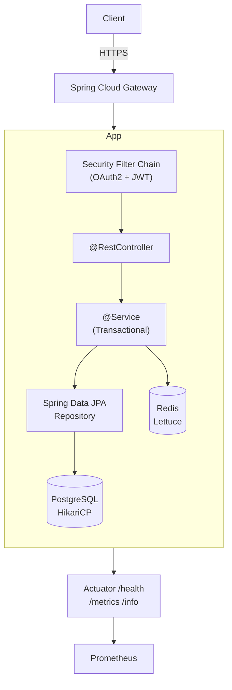

# Spring Boot 3 Production Guide

> **Purpose**: Build production-grade Java services with Spring Boot 3.3+, Java 21 LTS, Spring Security 6, JPA/Hibernate, Virtual Threads (Project Loom), and GraalVM native compilation.

> **Prerequisites**: Java 21 LTS (Temurin/GraalVM), Maven 3.9+ or Gradle 8.5+, Docker

---

## Core Philosophy

> **Golden Rule**: Favour convention over configuration — but explicitly configure security, database migrations, and observability; Spring Boot's sensible defaults MUST NOT be mistaken for production-ready defaults.

---

## Architecture Overview



---

## Project Structure (Maven)

```
src/
├── main/
│   ├── java/com/example/api/
│   │   ├── ApiApplication.java
│   │   ├── config/
│   │   │   ├── SecurityConfig.java
│   │   │   ├── JpaConfig.java
│   │   │   └── WebConfig.java
│   │   ├── user/
│   │   │   ├── UserController.java
│   │   │   ├── UserService.java
│   │   │   ├── UserRepository.java
│   │   │   ├── User.java               # JPA entity
│   │   │   └── dto/
│   │   │       ├── CreateUserRequest.java
│   │   │       └── UserResponse.java
│   │   ├── common/
│   │   │   ├── exception/
│   │   │   │   ├── GlobalExceptionHandler.java
│   │   │   │   └── ResourceNotFoundException.java
│   │   │   └── audit/
│   │   │       └── AuditListener.java
│   │   └── health/
│   │       └── ReadinessIndicator.java
│   └── resources/
│       ├── application.yml
│       ├── application-prod.yml
│       └── db/migration/
│           ├── V1__create_users.sql
│           └── V2__add_user_roles.sql
└── test/
    ├── java/com/example/api/
    │   ├── user/
    │   │   ├── UserControllerTest.java
    │   │   └── UserServiceIntegrationTest.java
    │   └── TestcontainersConfig.java
    └── resources/
        └── application-test.yml
```

---

## Application Configuration

### `application.yml`

```yaml
server:
  port: 8080
  shutdown: graceful                        # Drain in-flight requests
  tomcat:
    threads:
      max: 200
      min-spare: 10

spring:
  application:
    name: api-service
  threads:
    virtual:
      enabled: true                         # Project Loom virtual threads (Java 21)

  datasource:
    url: jdbc:postgresql://${DB_HOST:localhost}:5432/${DB_NAME:api}
    username: ${DB_USER:api}
    password: ${DB_PASS}
    hikari:
      maximum-pool-size: 20
      minimum-idle: 5
      idle-timeout: 30000
      connection-timeout: 5000
      max-lifetime: 1800000
      leak-detection-threshold: 10000       # Log warning if connection held > 10s

  jpa:
    open-in-view: false                     # MUST be false in production
    hibernate:
      ddl-auto: validate                    # Flyway handles schema
    properties:
      hibernate:
        jdbc.batch_size: 25
        order_inserts: true
        order_updates: true
        generate_statistics: false

  flyway:
    enabled: true
    locations: classpath:db/migration
    baseline-on-migrate: false

  security:
    oauth2:
      resourceserver:
        jwt:
          issuer-uri: ${OIDC_ISSUER_URI}

management:
  endpoints:
    web:
      exposure:
        include: health,info,metrics,prometheus
  endpoint:
    health:
      show-details: when-authorized
      probes:
        enabled: true                       # /health/liveness + /health/readiness
  metrics:
    tags:
      application: ${spring.application.name}

logging:
  level:
    root: INFO
    com.example.api: DEBUG
    org.hibernate.SQL: WARN
  pattern:
    console: "%d{ISO8601} [%thread] %-5level %logger{36} - %msg%n"
```

---

## Spring Security 6 Configuration (OAuth2 / JWT)

```java
// src/main/java/com/example/api/config/SecurityConfig.java
package com.example.api.config;

import org.springframework.context.annotation.Bean;
import org.springframework.context.annotation.Configuration;
import org.springframework.http.HttpMethod;
import org.springframework.security.config.annotation.method.configuration.EnableMethodSecurity;
import org.springframework.security.config.annotation.web.builders.HttpSecurity;
import org.springframework.security.config.annotation.web.configuration.EnableWebSecurity;
import org.springframework.security.config.http.SessionCreationPolicy;
import org.springframework.security.oauth2.server.resource.authentication.JwtAuthenticationConverter;
import org.springframework.security.oauth2.server.resource.authentication.JwtGrantedAuthoritiesConverter;
import org.springframework.security.web.SecurityFilterChain;

@Configuration
@EnableWebSecurity
@EnableMethodSecurity
public class SecurityConfig {

    @Bean
    public SecurityFilterChain filterChain(HttpSecurity http) throws Exception {
        return http
            .csrf(csrf -> csrf.disable())                                // API-only; no browser sessions
            .sessionManagement(sm -> sm.sessionCreationPolicy(SessionCreationPolicy.STATELESS))
            .authorizeHttpRequests(auth -> auth
                .requestMatchers("/actuator/health/**").permitAll()
                .requestMatchers("/actuator/prometheus").permitAll()
                .requestMatchers(HttpMethod.GET, "/api/public/**").permitAll()
                .anyRequest().authenticated()
            )
            .oauth2ResourceServer(oauth2 -> oauth2
                .jwt(jwt -> jwt.jwtAuthenticationConverter(jwtAuthConverter()))
            )
            .build();
    }

    private JwtAuthenticationConverter jwtAuthConverter() {
        var grantedAuthoritiesConverter = new JwtGrantedAuthoritiesConverter();
        grantedAuthoritiesConverter.setAuthoritiesClaimName("roles");
        grantedAuthoritiesConverter.setAuthorityPrefix("ROLE_");

        var converter = new JwtAuthenticationConverter();
        converter.setJwtGrantedAuthoritiesConverter(grantedAuthoritiesConverter);
        return converter;
    }
}
```

---

## JPA Entity, Repository, Service, Controller

### Entity

```java
// src/main/java/com/example/api/user/User.java
package com.example.api.user;

import jakarta.persistence.*;
import java.time.Instant;

@Entity
@Table(name = "users", indexes = @Index(name = "idx_users_email", columnList = "email", unique = true))
public class User {
    @Id
    @GeneratedValue(strategy = GenerationType.IDENTITY)
    private Long id;

    @Column(nullable = false, length = 255)
    private String email;

    @Column(nullable = false, length = 100)
    private String name;

    @Enumerated(EnumType.STRING)
    @Column(nullable = false, length = 20)
    private Role role = Role.USER;

    @Column(name = "created_at", nullable = false, updatable = false)
    private Instant createdAt = Instant.now();

    // Getters, setters, equals/hashCode on id omitted for brevity
    public enum Role { USER, ADMIN }
}
```

### DTO Records (Java 21)

```java
// src/main/java/com/example/api/user/dto/CreateUserRequest.java
package com.example.api.user.dto;

import jakarta.validation.constraints.*;

public record CreateUserRequest(
    @NotBlank @Email @Size(max = 255) String email,
    @NotBlank @Size(min = 1, max = 100) String name,
    String role   // optional — defaults to USER
) {}

// src/main/java/com/example/api/user/dto/UserResponse.java
package com.example.api.user.dto;

import java.time.Instant;

public record UserResponse(Long id, String email, String name, String role, Instant createdAt) {}
```

### Repository

```java
// src/main/java/com/example/api/user/UserRepository.java
package com.example.api.user;

import org.springframework.data.jpa.repository.JpaRepository;
import java.util.Optional;

public interface UserRepository extends JpaRepository<User, Long> {
    Optional<User> findByEmail(String email);
    boolean existsByEmail(String email);
}
```

### Service

```java
// src/main/java/com/example/api/user/UserService.java
package com.example.api.user;

import com.example.api.common.exception.ResourceNotFoundException;
import com.example.api.user.dto.*;
import org.springframework.stereotype.Service;
import org.springframework.transaction.annotation.Transactional;

@Service
public class UserService {
    private final UserRepository repo;

    public UserService(UserRepository repo) {
        this.repo = repo;
    }

    @Transactional
    public UserResponse create(CreateUserRequest req) {
        if (repo.existsByEmail(req.email())) {
            throw new IllegalArgumentException("Email already registered: " + req.email());
        }
        var user = new User();
        user.setEmail(req.email());
        user.setName(req.name());
        if (req.role() != null) user.setRole(User.Role.valueOf(req.role().toUpperCase()));
        var saved = repo.save(user);
        return toResponse(saved);
    }

    @Transactional(readOnly = true)
    public UserResponse findById(Long id) {
        return repo.findById(id)
            .map(this::toResponse)
            .orElseThrow(() -> new ResourceNotFoundException("User", id));
    }

    private UserResponse toResponse(User u) {
        return new UserResponse(u.getId(), u.getEmail(), u.getName(), u.getRole().name(), u.getCreatedAt());
    }
}
```

### Controller

```java
// src/main/java/com/example/api/user/UserController.java
package com.example.api.user;

import com.example.api.user.dto.*;
import jakarta.validation.Valid;
import org.springframework.http.HttpStatus;
import org.springframework.web.bind.annotation.*;

@RestController
@RequestMapping("/api/users")
public class UserController {
    private final UserService service;

    public UserController(UserService service) {
        this.service = service;
    }

    @PostMapping
    @ResponseStatus(HttpStatus.CREATED)
    public UserResponse create(@Valid @RequestBody CreateUserRequest req) {
        return service.create(req);
    }

    @GetMapping("/{id}")
    public UserResponse getById(@PathVariable Long id) {
        return service.findById(id);
    }
}
```

---

## Global Exception Handler

```java
// src/main/java/com/example/api/common/exception/GlobalExceptionHandler.java
package com.example.api.common.exception;

import org.springframework.http.*;
import org.springframework.validation.FieldError;
import org.springframework.web.bind.MethodArgumentNotValidException;
import org.springframework.web.bind.annotation.*;

import java.time.Instant;
import java.util.*;

@RestControllerAdvice
public class GlobalExceptionHandler {

    public record ErrorBody(Instant timestamp, int status, String error, Object details) {}

    @ExceptionHandler(ResourceNotFoundException.class)
    public ResponseEntity<ErrorBody> handleNotFound(ResourceNotFoundException ex) {
        return ResponseEntity.status(404)
            .body(new ErrorBody(Instant.now(), 404, ex.getMessage(), null));
    }

    @ExceptionHandler(MethodArgumentNotValidException.class)
    public ResponseEntity<ErrorBody> handleValidation(MethodArgumentNotValidException ex) {
        List<Map<String, String>> issues = ex.getBindingResult().getFieldErrors().stream()
            .map(fe -> Map.of("field", fe.getField(), "message", Objects.requireNonNullElse(fe.getDefaultMessage(), "")))
            .toList();
        return ResponseEntity.status(422)
            .body(new ErrorBody(Instant.now(), 422, "Validation failed", issues));
    }

    @ExceptionHandler(IllegalArgumentException.class)
    public ResponseEntity<ErrorBody> handleConflict(IllegalArgumentException ex) {
        return ResponseEntity.status(409)
            .body(new ErrorBody(Instant.now(), 409, ex.getMessage(), null));
    }

    @ExceptionHandler(Exception.class)
    public ResponseEntity<ErrorBody> handleAll(Exception ex) {
        return ResponseEntity.status(500)
            .body(new ErrorBody(Instant.now(), 500, "Internal Server Error", null));
    }
}
```

---

## Flyway Database Migrations

```sql
-- src/main/resources/db/migration/V1__create_users.sql
CREATE TABLE users (
    id          BIGSERIAL PRIMARY KEY,
    email       VARCHAR(255) NOT NULL,
    name        VARCHAR(100) NOT NULL,
    role        VARCHAR(20)  NOT NULL DEFAULT 'USER',
    created_at  TIMESTAMPTZ  NOT NULL DEFAULT now(),
    CONSTRAINT uq_users_email UNIQUE (email)
);

CREATE INDEX idx_users_role ON users (role);
```

---

## Good vs Bad Patterns

### ❌ Bad: `open-in-view: true` (default!)

```yaml
spring:
  jpa:
    open-in-view: true   # Holds DB connection for entire HTTP request — resource leak
```

### ✅ Good: Explicit transaction boundaries

```yaml
spring:
  jpa:
    open-in-view: false   # Connection returned to pool after @Transactional method exits
```

### ❌ Bad: N+1 queries with lazy loading

```java
List<User> users = repo.findAll();           // 1 query
users.forEach(u -> u.getOrders().size());    // N additional queries
```

### ✅ Good: Fetch join or entity graph

```java
@Query("SELECT u FROM User u LEFT JOIN FETCH u.orders")
List<User> findAllWithOrders();
```

### ❌ Bad: Using `ddl-auto: update` in production

```yaml
hibernate:
  ddl-auto: update  # Uncontrolled schema changes — no rollback, no audit trail
```

### ✅ Good: Flyway versioned migrations + `validate`

```yaml
hibernate:
  ddl-auto: validate  # Startup fails if schema doesn't match entities
flyway:
  enabled: true
```

---

## Testing with Testcontainers

```java
// src/test/java/com/example/api/TestcontainersConfig.java
package com.example.api;

import org.springframework.boot.test.context.TestConfiguration;
import org.springframework.boot.testcontainers.service.connection.ServiceConnection;
import org.springframework.context.annotation.Bean;
import org.testcontainers.containers.PostgreSQLContainer;

@TestConfiguration(proxyBeanMethods = false)
public class TestcontainersConfig {

    @Bean
    @ServiceConnection
    public PostgreSQLContainer<?> postgres() {
        return new PostgreSQLContainer<>("postgres:16-alpine")
            .withDatabaseName("test")
            .withUsername("test")
            .withPassword("test");
    }
}
```

### Integration Test

```java
// src/test/java/com/example/api/user/UserServiceIntegrationTest.java
package com.example.api.user;

import com.example.api.TestcontainersConfig;
import com.example.api.user.dto.CreateUserRequest;
import org.junit.jupiter.api.Test;
import org.springframework.beans.factory.annotation.Autowired;
import org.springframework.boot.test.context.SpringBootTest;
import org.springframework.context.annotation.Import;

import static org.assertj.core.api.Assertions.*;

@SpringBootTest
@Import(TestcontainersConfig.class)
class UserServiceIntegrationTest {

    @Autowired UserService service;

    @Test
    void createAndFindUser() {
        var req = new CreateUserRequest("test@example.com", "Test User", null);
        var created = service.create(req);
        assertThat(created.id()).isPositive();

        var found = service.findById(created.id());
        assertThat(found.email()).isEqualTo("test@example.com");
        assertThat(found.role()).isEqualTo("USER");
    }

    @Test
    void duplicateEmailThrows() {
        var req = new CreateUserRequest("dup@example.com", "Dup", null);
        service.create(req);
        assertThatThrownBy(() -> service.create(req))
            .isInstanceOf(IllegalArgumentException.class);
    }
}
```

---

## GraalVM Native Compilation

```xml
<!-- pom.xml profile -->
<profiles>
  <profile>
    <id>native</id>
    <build>
      <plugins>
        <plugin>
          <groupId>org.graalvm.buildtools</groupId>
          <artifactId>native-maven-plugin</artifactId>
          <configuration>
            <buildArgs>
              <arg>--no-fallback</arg>
              <arg>-H:+ReportExceptionStackTraces</arg>
            </buildArgs>
          </configuration>
        </plugin>
      </plugins>
    </build>
  </profile>
</profiles>
```

Build: `./mvnw -Pnative native:compile`

| Metric | JVM (Temurin 21) | GraalVM Native |
|---|---|---|
| Startup time | ~2.5 s | ~0.08 s |
| Memory (RSS) | ~250 MB | ~60 MB |
| Peak throughput | Higher (JIT) | ~85% of JIT |

> **Trade-off**: Native images start faster and use less memory but have lower peak throughput due to absence of JIT optimisation. Use native for serverless/scale-to-zero; JVM for long-running high-throughput services.

---

## Virtual Threads (Project Loom)

With `spring.threads.virtual.enabled: true`, every request handler runs on a virtual thread. This eliminates the need for WebFlux in most I/O-bound workloads.

**When to use Virtual Threads vs WebFlux**:

| Scenario | Recommendation |
|---|---|
| Traditional CRUD APIs with JDBC | Virtual Threads ✅ |
| Streaming / SSE / WebSocket | WebFlux ✅ |
| CPU-intensive processing | Platform threads (default) |
| Existing blocking libraries | Virtual Threads ✅ |

---

## Dockerfile (Multi-Stage, Layered JARs)

```dockerfile
# syntax=docker/dockerfile:1
FROM eclipse-temurin:21-jre-alpine AS runtime
WORKDIR /app
RUN addgroup -S app && adduser -S app -G app

COPY --chown=app:app target/*.jar app.jar

USER app
EXPOSE 8080
HEALTHCHECK --interval=30s --timeout=5s \
  CMD wget -qO- http://localhost:8080/actuator/health/liveness || exit 1

ENTRYPOINT ["java", \
  "-XX:MaxRAMPercentage=75.0", \
  "-XX:+UseZGC", \
  "-XX:+ZGenerational", \
  "-Djava.security.egd=file:/dev/./urandom", \
  "-jar", "app.jar"]
```

---

## Performance Tuning

| Lever | Setting |
|---|---|
| **GC** | ZGC Generational (`-XX:+UseZGC -XX:+ZGenerational`) for low-latency |
| **HikariCP** | `maximum-pool-size` = 2 × CPU cores + disk spindles |
| **Hibernate Batching** | `jdbc.batch_size: 25`, `order_inserts: true` |
| **Connection Validation** | HikariCP validates on borrow by default — do NOT add extra validation queries |
| **Spring Cache** | `@Cacheable` with Redis/Caffeine for hot read paths |
| **Response Compression** | Enable at reverse-proxy level, not Tomcat |

---

## Security Considerations

| Attack Vector | Mitigation |
|---|---|
| CSRF | Disabled for stateless APIs; use CORS + JWT |
| SQL Injection | JPA parameterised queries; never concatenate input into `@Query` |
| JWT Forgery | Validate `iss`, `aud`, `exp` claims via `issuer-uri` |
| Mass Assignment | DTOs use Java `record` — only declared fields accepted |
| Actuator Exposure | Restrict `/actuator/**` to internal network; expose only `health`, `prometheus` |
| Dependency Vulnerabilities | `./mvnw org.owasp:dependency-check-maven:check` in CI |

---

## Common Pitfalls

1. **`open-in-view: true`** — Holds a JDBC connection for the entire request lifecycle. ALWAYS set to `false`.
2. **`ddl-auto: update` in production** — Flyway/Liquibase MUST manage schema evolution.
3. **Missing `@Transactional(readOnly = true)`** on read methods — Prevents Hibernate dirty-checking overhead.
4. **Not setting `max-lifetime`** on HikariCP — Stale connections after DB failover.
5. **Using `@Autowired` field injection** — Constructor injection is testable, immutable, and explicit.
6. **Forgetting to index foreign keys** — JPA doesn't auto-create indexes on `@ManyToOne` columns.

---

## Verification Checklist

- [ ] Application starts with `ddl-auto: validate` + Flyway on a clean DB
- [ ] `/actuator/health/readiness` returns `UP` with DB connected
- [ ] JWT authentication rejects unsigned tokens with `401`
- [ ] `@Valid` rejects malformed input with `422` and field-level errors
- [ ] HikariCP pool size ≤ `max_connections / number_of_instances`
- [ ] No N+1 queries — verify with `hibernate.generate_statistics: true` in tests
- [ ] Testcontainers integration tests pass in CI without external DB
- [ ] GraalVM native image builds and starts in < 200 ms (if using native profile)
- [ ] Docker image runs as non-root user
- [ ] `./mvnw dependency:tree` shows no conflicting transitive dependencies

---

*See also*: [`./express.md`](./express.md) for Node.js comparison, [`../../sections/database/postgresql-mastery.md`](../../sections/database/postgresql-mastery.md) for advanced PostgreSQL patterns.
