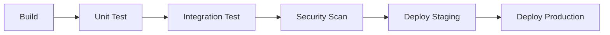
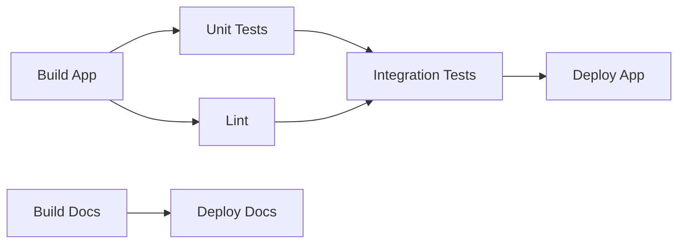

# GitLab CI/CD Production Pipeline Guide

> **Purpose**: Define production-grade GitLab CI/CD pipeline architectures, configuration patterns, security scanning integration, and deployment strategies for reliable, scalable software delivery.

> **Prerequisites**: Git fundamentals, Docker basics, YAML syntax, familiarity with CI/CD concepts (stages, jobs, artifacts), GitLab account with CI/CD enabled.

---

## Core Philosophy

**Every pipeline MUST be deterministic, hermetic, and auditable** — the same commit produces the same artifacts, runs the same security gates, and records the same deployment provenance regardless of when or where it executes.

---

## 1. `.gitlab-ci.yml` Structure Fundamentals

### Anatomy of a Job

```yaml
# .gitlab-ci.yml — minimal production skeleton
stages:
  - build
  - test
  - security
  - deploy

variables:
  DOCKER_BUILDKIT: "1"
  PIP_CACHE_DIR: "$CI_PROJECT_DIR/.pip-cache"

build-app:
  stage: build
  image: docker:27.3
  services:
    - docker:27.3-dind
  variables:
    DOCKER_TLS_CERTDIR: "/certs"
  script:
    - docker build
        --cache-from "$CI_REGISTRY_IMAGE:latest"
        --tag "$CI_REGISTRY_IMAGE:$CI_COMMIT_SHA"
        --tag "$CI_REGISTRY_IMAGE:latest"
        .
    - docker push "$CI_REGISTRY_IMAGE:$CI_COMMIT_SHA"
    - docker push "$CI_REGISTRY_IMAGE:latest"
  rules:
    - if: $CI_COMMIT_BRANCH == $CI_DEFAULT_BRANCH
    - if: $CI_PIPELINE_SOURCE == "merge_request_event"
```

### Key Configuration Keywords

| Keyword | Purpose | Scope |
|---------|---------|-------|
| `stages` | Define ordered execution phases | Global |
| `variables` | Set environment variables | Global or per-job |
| `image` | Docker image for the job executor | Per-job |
| `services` | Sidecar containers (databases, DinD) | Per-job |
| `script` | Commands to execute | Per-job (required) |
| `before_script` | Commands before `script` | Global or per-job |
| `after_script` | Commands after `script` (always runs) | Global or per-job |
| `artifacts` | Files to persist between jobs/stages | Per-job |
| `cache` | Files to reuse across pipelines | Per-job |
| `rules` | Conditional job execution | Per-job |
| `needs` | DAG dependency declaration | Per-job |
| `environment` | Deployment target declaration | Per-job |
| `trigger` | Trigger child/multi-project pipeline | Per-job |

---

## 2. Pipeline Architectures

### Basic Linear Pipeline



```yaml
stages:
  - build
  - test
  - security
  - deploy-staging
  - deploy-production
```

### DAG (Directed Acyclic Graph) Pipeline

Use `needs` to run jobs as soon as their dependencies complete, bypassing stage ordering:



```yaml
stages:
  - build
  - validate
  - integration
  - deploy

build-app:
  stage: build
  script: make build
  artifacts:
    paths: [dist/]

build-docs:
  stage: build
  script: make docs
  artifacts:
    paths: [site/]

unit-tests:
  stage: validate
  needs: [build-app]
  script: make test-unit

lint:
  stage: validate
  needs: [build-app]
  script: make lint

integration-tests:
  stage: integration
  needs: [unit-tests, lint]
  script: make test-integration

deploy-docs:
  stage: deploy
  needs: [build-docs]
  script: make deploy-docs
  # Runs as soon as build-docs finishes — doesn't wait for tests

deploy-app:
  stage: deploy
  needs: [integration-tests]
  script: make deploy-app
```

> [!TIP]
> DAG pipelines can reduce total pipeline time by 40–60% for large projects by parallelizing independent job chains. Always prefer `needs` over implicit stage ordering.

### Parent-Child Pipelines

Split large monorepo pipelines into focused child pipelines:

```yaml
# .gitlab-ci.yml (parent)
stages:
  - triggers

trigger-backend:
  stage: triggers
  trigger:
    include: backend/.gitlab-ci.yml
    strategy: depend          # Parent waits for child to finish
  rules:
    - changes:
        - backend/**/*

trigger-frontend:
  stage: triggers
  trigger:
    include: frontend/.gitlab-ci.yml
    strategy: depend
  rules:
    - changes:
        - frontend/**/*

trigger-infra:
  stage: triggers
  trigger:
    include: infra/.gitlab-ci.yml
    strategy: depend
  rules:
    - changes:
        - terraform/**/*
```

### Multi-Project Pipelines

Trigger pipelines in other repositories:

```yaml
deploy-microservice-b:
  stage: deploy
  trigger:
    project: myorg/microservice-b
    branch: main
    strategy: depend
  variables:
    UPSTREAM_COMMIT: $CI_COMMIT_SHA
    UPSTREAM_PROJECT: $CI_PROJECT_PATH
```

---

## 3. Cache and Artifacts Management

### Cache vs Artifacts

| Aspect | Cache | Artifacts |
|--------|-------|-----------|
| Purpose | Speed up jobs across pipelines | Pass data between jobs/stages |
| Persistence | Best-effort (may be evicted) | Guaranteed within pipeline |
| Scope | Per-branch by default | Per-pipeline |
| Typical use | Dependencies (`node_modules`, `.pip-cache`) | Build outputs, test reports |

### Cache Configuration

```yaml
variables:
  PIP_CACHE_DIR: "$CI_PROJECT_DIR/.pip-cache"
  NPM_CONFIG_CACHE: "$CI_PROJECT_DIR/.npm-cache"

# Global cache policy
cache: &global-cache
  key:
    files:
      - requirements.txt
      - package-lock.json
  paths:
    - .pip-cache/
    - .npm-cache/
    - node_modules/
  policy: pull-push

# Read-only cache for test jobs (don't waste time uploading)
test-unit:
  cache:
    <<: *global-cache
    policy: pull
  script: pytest tests/unit/
```

### Artifacts Configuration

```yaml
build-app:
  stage: build
  script: make build
  artifacts:
    paths:
      - dist/
    exclude:
      - dist/**/*.map     # Exclude source maps from artifacts
    expire_in: 1 week
    when: on_success

test-unit:
  stage: test
  script: pytest --junitxml=report.xml --cov=src --cov-report=html
  artifacts:
    reports:
      junit: report.xml         # Parsed by GitLab for MR widgets
      coverage_report:
        coverage_format: cobertura
        path: coverage.xml
    paths:
      - htmlcov/
    when: always                # Keep reports even on failure
    expire_in: 30 days
```

> [!IMPORTANT]
> Set `expire_in` on ALL artifacts. Unbounded artifacts consume storage rapidly — GitLab's default is 30 days, but production deploy artifacts SHOULD be kept for 90+ days for audit trails.

---

## 4. Docker Image Builds: DinD vs Kaniko

### Docker-in-Docker (DinD)

```yaml
build-image-dind:
  stage: build
  image: docker:27.3
  services:
    - docker:27.3-dind
  variables:
    DOCKER_TLS_CERTDIR: "/certs"
    DOCKER_HOST: "tcp://docker:2376"
    DOCKER_TLS_VERIFY: "1"
    DOCKER_CERT_PATH: "/certs/client"
  before_script:
    - echo "$CI_REGISTRY_PASSWORD" | docker login -u "$CI_REGISTRY_USER" --password-stdin "$CI_REGISTRY"
  script:
    - docker build --tag "$CI_REGISTRY_IMAGE:$CI_COMMIT_SHA" .
    - docker push "$CI_REGISTRY_IMAGE:$CI_COMMIT_SHA"
```

### Kaniko (Rootless, No Privileged Mode)

```yaml
build-image-kaniko:
  stage: build
  image:
    name: gcr.io/kaniko-project/executor:v1.23.2-debug
    entrypoint: [""]
  script:
    - mkdir -p /kaniko/.docker
    - |
      cat > /kaniko/.docker/config.json <<EOF
      {
        "auths": {
          "${CI_REGISTRY}": {
            "auth": "$(echo -n "${CI_REGISTRY_USER}:${CI_REGISTRY_PASSWORD}" | base64)"
          }
        }
      }
      EOF
    - /kaniko/executor
        --context "$CI_PROJECT_DIR"
        --dockerfile "$CI_PROJECT_DIR/Dockerfile"
        --destination "$CI_REGISTRY_IMAGE:$CI_COMMIT_SHA"
        --destination "$CI_REGISTRY_IMAGE:latest"
        --cache=true
        --cache-repo="$CI_REGISTRY_IMAGE/cache"
```

| Aspect | DinD | Kaniko |
|--------|------|--------|
| Privileged mode | Required | Not required |
| Layer caching | Docker cache, BuildKit | Registry-based cache |
| Multi-stage builds | Full support | Full support |
| Security posture | Higher risk (privileged) | Lower risk (rootless) |
| Build speed | Faster with warm cache | Comparable with registry cache |
| Compatibility | Full Docker CLI available | Kaniko-specific flags only |

> [!WARNING]
> DinD requires `privileged: true` on the runner, which gives the job container full host access. Use Kaniko for shared/public runners. Reserve DinD for dedicated, trusted runners only.

---

## 5. Environment Deployments & Manual Gates

```yaml
deploy-staging:
  stage: deploy-staging
  image: bitnami/kubectl:1.31
  environment:
    name: staging
    url: https://staging.example.com
    on_stop: stop-staging
  script:
    - kubectl set image deployment/app app="$CI_REGISTRY_IMAGE:$CI_COMMIT_SHA" -n staging
    - kubectl rollout status deployment/app -n staging --timeout=300s
  rules:
    - if: $CI_COMMIT_BRANCH == $CI_DEFAULT_BRANCH

stop-staging:
  stage: deploy-staging
  environment:
    name: staging
    action: stop
  script:
    - kubectl delete namespace staging-$CI_COMMIT_REF_SLUG || true
  when: manual
  rules:
    - if: $CI_COMMIT_BRANCH == $CI_DEFAULT_BRANCH
      when: manual

deploy-production:
  stage: deploy-production
  image: bitnami/kubectl:1.31
  environment:
    name: production
    url: https://app.example.com
  script:
    - kubectl set image deployment/app app="$CI_REGISTRY_IMAGE:$CI_COMMIT_SHA" -n production
    - kubectl rollout status deployment/app -n production --timeout=600s
  rules:
    - if: $CI_COMMIT_BRANCH == $CI_DEFAULT_BRANCH
      when: manual         # Require manual approval for production
  allow_failure: false     # Pipeline stays blocked until approved
```

### Review Apps

```yaml
deploy-review:
  stage: deploy
  environment:
    name: review/$CI_COMMIT_REF_SLUG
    url: https://$CI_COMMIT_REF_SLUG.review.example.com
    on_stop: stop-review
    auto_stop_in: 1 week
  script:
    - helm upgrade --install "review-$CI_COMMIT_REF_SLUG"
        ./chart
        --set image.tag="$CI_COMMIT_SHA"
        --set ingress.host="$CI_COMMIT_REF_SLUG.review.example.com"
        --namespace review
        --create-namespace
  rules:
    - if: $CI_PIPELINE_SOURCE == "merge_request_event"

stop-review:
  stage: deploy
  environment:
    name: review/$CI_COMMIT_REF_SLUG
    action: stop
  script:
    - helm uninstall "review-$CI_COMMIT_REF_SLUG" --namespace review
  when: manual
  rules:
    - if: $CI_PIPELINE_SOURCE == "merge_request_event"
      when: manual
```

---

## 6. Security Scanning

GitLab provides built-in security scanning templates. Include them for defense-in-depth:

```yaml
include:
  - template: Security/SAST.gitlab-ci.yml
  - template: Security/Dependency-Scanning.gitlab-ci.yml
  - template: Security/Container-Scanning.gitlab-ci.yml
  - template: Security/Secret-Detection.gitlab-ci.yml
  - template: Security/DAST.gitlab-ci.yml

# Override DAST to target the review app
dast:
  stage: security
  variables:
    DAST_WEBSITE: "https://$CI_COMMIT_REF_SLUG.review.example.com"
  needs: [deploy-review]
  rules:
    - if: $CI_PIPELINE_SOURCE == "merge_request_event"
```

### Scanner Overview

| Scanner | What It Finds | When It Runs | Tool |
|---------|--------------|--------------|------|
| **SAST** | Code vulnerabilities (SQLi, XSS, buffer overflows) | Every commit | Semgrep, SpotBugs, Gosec |
| **Dependency Scanning** | Known CVEs in dependencies | Every commit | Gemnasium |
| **Container Scanning** | OS-level vulnerabilities in Docker images | After image build | Trivy, Grype |
| **Secret Detection** | Hardcoded credentials, API keys, tokens | Every commit | Gitleaks |
| **DAST** | Runtime vulnerabilities (XSS, injection, misconfig) | Against running app | OWASP ZAP |

### Enforcing Security Gates

```yaml
# Block merge requests with critical/high vulnerabilities
# Requires GitLab Ultimate
approval_rules:
  - name: Security Approval
    approvals_required: 1
    user_ids: []
    group_ids: [security-team-group-id]
    vulnerability_attributes:
      severity_levels: [critical, high]
      vulnerability_states: [detected]
```

> [!CAUTION]
> Secret Detection scans commit history. If a secret is detected, rotating the credential is mandatory — simply removing it from HEAD does NOT remove it from git history. Use `git filter-branch` or BFG Repo-Cleaner, then rotate.

---

## 7. Rules and Conditional Execution

### `rules` (Preferred) vs `only/except` (Deprecated)

```yaml
# GOOD: rules-based conditional execution
deploy-staging:
  rules:
    - if: $CI_COMMIT_BRANCH == $CI_DEFAULT_BRANCH
      when: on_success
    - if: $CI_PIPELINE_SOURCE == "merge_request_event"
      when: never
    - when: never  # Explicit default deny

# BAD: only/except (deprecated, do not use in new pipelines)
deploy-staging:
  only:
    - main
  except:
    - merge_requests
```

### Common Rules Patterns

```yaml
# Run on MR pipelines only
rules:
  - if: $CI_PIPELINE_SOURCE == "merge_request_event"

# Run on default branch only
rules:
  - if: $CI_COMMIT_BRANCH == $CI_DEFAULT_BRANCH

# Run on tags matching semver
rules:
  - if: $CI_COMMIT_TAG =~ /^v\d+\.\d+\.\d+$/

# Run when specific files change (monorepo)
rules:
  - changes:
      - backend/**/*
      - shared-libs/**/*

# Run on schedule (nightly builds)
rules:
  - if: $CI_PIPELINE_SOURCE == "schedule"

# Manual job with blocking behavior
rules:
  - if: $CI_COMMIT_BRANCH == $CI_DEFAULT_BRANCH
    when: manual
    allow_failure: false    # Pipeline stays "blocked", not "passed"
```

---

## 8. Variables and Secrets

### Variable Hierarchy (Precedence: high → low)

1. Trigger variables
2. Job-level `variables`
3. Global `variables` in `.gitlab-ci.yml`
4. Project CI/CD variables (Settings → CI/CD)
5. Group CI/CD variables
6. Instance CI/CD variables

### Secrets Management

```yaml
variables:
  # Non-sensitive — fine to commit
  APP_ENV: "production"
  REPLICAS: "3"

deploy-production:
  script:
    # Sensitive values come from project/group CI/CD variables
    # Set in GitLab UI with "Masked" and "Protected" enabled
    - kubectl create secret generic app-secrets
        --from-literal=db-password="$DB_PASSWORD"
        --from-literal=api-key="$STRIPE_API_KEY"
        --dry-run=client -o yaml | kubectl apply -f -
```

| Variable Setting | Purpose |
|-----------------|---------|
| **Protected** | Only available on protected branches/tags |
| **Masked** | Hidden in job logs (value must meet masking requirements) |
| **Expanded** | Allows `$VARIABLE` reference expansion |
| **Environment scope** | Limit variable to specific environments (e.g., `production`) |

> [!IMPORTANT]
> NEVER store secrets in `.gitlab-ci.yml`. Use GitLab CI/CD variables with "Protected" + "Masked" flags, or integrate with HashiCorp Vault using GitLab's native `secrets:vault` keyword (Premium+).

### Vault Integration (GitLab Premium+)

```yaml
deploy-production:
  secrets:
    DB_PASSWORD:
      vault:
        engine:
          name: kv-v2
          path: secret
        path: production/database
        field: password
  script:
    - echo "Password is available as $DB_PASSWORD"
```

---

## 9. Runners: Shared vs Group vs Project

| Runner Type | Scope | Use Case | Cost Model |
|-------------|-------|----------|------------|
| **Shared** (SaaS) | All projects in instance | General-purpose CI | GitLab compute minutes |
| **Group** | All projects in a group | Team-specific tooling, private registries | Self-managed infrastructure |
| **Project** | Single project | Specialized hardware (GPU, ARM), sensitive workloads | Self-managed infrastructure |

### Runner Tags for Job Routing

```yaml
# Route GPU-intensive jobs to specific runners
train-model:
  tags:
    - gpu
    - cuda-12
  image: nvidia/cuda:12.3.0-runtime-ubuntu22.04
  script: python train.py

# Route to ARM runners for multi-arch builds
build-arm64:
  tags:
    - arm64
    - docker
  script: docker buildx build --platform linux/arm64 .
```

### Runner Configuration Best Practices

```toml
# /etc/gitlab-runner/config.toml
concurrent = 10
check_interval = 3

[[runners]]
  name = "production-runner"
  url = "https://gitlab.example.com/"
  token = "REDACTED"
  executor = "docker"
  
  [runners.docker]
    image = "alpine:3.20"
    privileged = false                  # Set true ONLY for DinD
    volumes = ["/cache", "/certs/client"]
    shm_size = 268435456                # 256MB shared memory
    pull_policy = ["if-not-present"]    # Reduce registry load
    
  [runners.cache]
    Type = "s3"
    Shared = true
    [runners.cache.s3]
      ServerAddress = "minio.internal:9000"
      BucketName = "gitlab-runner-cache"
      BucketLocation = "us-east-1"
```

---

## 10. DRY Configuration: `include` and `extends`

### `include` Patterns

```yaml
# Include from the same project
include:
  - local: ci/templates/docker-build.yml

# Include from another project
include:
  - project: devops/ci-templates
    ref: v2.5.0              # Pin to a version tag!
    file:
      - /templates/docker.yml
      - /templates/deploy.yml

# Include from a URL
include:
  - remote: https://raw.githubusercontent.com/org/ci-templates/main/python.yml

# Include official GitLab templates
include:
  - template: Security/SAST.gitlab-ci.yml
```

> [!WARNING]
> ALWAYS pin `include` references to a specific `ref` (tag or SHA). Using `main` or `HEAD` means your pipeline behavior can change without any commit to your repo, breaking reproducibility.

### `extends` for Job Templates

```yaml
# ci/templates/base.yml
.deploy-base:
  image: bitnami/kubectl:1.31
  before_script:
    - kubectl config use-context "$KUBE_CONTEXT"
  retry:
    max: 2
    when:
      - runner_system_failure
      - stuck_or_timeout_failure

.test-base:
  image: python:3.12-slim
  before_script:
    - pip install -r requirements.txt
  cache:
    key:
      files: [requirements.txt]
    paths: [.pip-cache/]
  artifacts:
    reports:
      junit: report.xml
    when: always

# .gitlab-ci.yml
include:
  - local: ci/templates/base.yml

test-unit:
  extends: .test-base
  stage: test
  script: pytest tests/unit/ --junitxml=report.xml

test-integration:
  extends: .test-base
  stage: test
  script: pytest tests/integration/ --junitxml=report.xml
  services:
    - postgres:16-alpine

deploy-staging:
  extends: .deploy-base
  stage: deploy
  environment:
    name: staging
  script:
    - kubectl set image deployment/app app="$CI_REGISTRY_IMAGE:$CI_COMMIT_SHA" -n staging
```

---

## 11. Deployment Tracking & Rollback Procedures

### Deployment Tracking

GitLab automatically tracks deployments when jobs declare `environment`:

```yaml
deploy-production:
  environment:
    name: production
    url: https://app.example.com
    deployment_tier: production     # Affects dashboard ordering
  script:
    - deploy.sh
```

### Rollback Procedures

```yaml
# Manual rollback job — re-deploys a previous artifact
rollback-production:
  stage: deploy-production
  image: bitnami/kubectl:1.31
  environment:
    name: production
  script:
    - |
      if [ -z "$ROLLBACK_COMMIT_SHA" ]; then
        echo "ERROR: Set ROLLBACK_COMMIT_SHA variable to the target commit"
        exit 1
      fi
    - echo "Rolling back to $ROLLBACK_COMMIT_SHA"
    - kubectl set image deployment/app
        app="$CI_REGISTRY_IMAGE:$ROLLBACK_COMMIT_SHA"
        -n production
    - kubectl rollout status deployment/app -n production --timeout=600s
  rules:
    - if: $CI_COMMIT_BRANCH == $CI_DEFAULT_BRANCH
      when: manual
      allow_failure: true
```

**Kubernetes-native rollback:**

```yaml
rollback-k8s-native:
  stage: deploy-production
  image: bitnami/kubectl:1.31
  script:
    - kubectl rollout undo deployment/app -n production
    - kubectl rollout status deployment/app -n production --timeout=600s
  environment:
    name: production
  when: manual
```

---

## 12. Merge Request Pipelines

```yaml
# Optimize MR pipelines — run only relevant jobs
workflow:
  rules:
    - if: $CI_PIPELINE_SOURCE == "merge_request_event"
    - if: $CI_COMMIT_BRANCH == $CI_DEFAULT_BRANCH
    - if: $CI_COMMIT_TAG

# MR-specific jobs
code-quality:
  stage: validate
  image: registry.gitlab.com/gitlab-org/ci-cd/codequality:0.96.0
  script: /analyzer run
  artifacts:
    reports:
      codequality: gl-code-quality-report.json
  rules:
    - if: $CI_PIPELINE_SOURCE == "merge_request_event"
```

---

## 13. Security & Performance Considerations

### Security

| Attack Vector | Mitigation |
|---------------|------------|
| Secret leakage in logs | Mark variables as "Masked"; avoid `echo $SECRET` in scripts |
| Dependency confusion | Pin all image tags to digest or version; use private registries |
| Pipeline injection via MR | Protect CI config; use `rules` to restrict who triggers production jobs |
| Privileged runner escape | Limit privileged mode to dedicated runners; prefer Kaniko over DinD |
| Forked MR secret access | Disable "Run pipelines for fork MRs" or restrict to protected variables only |

### Performance

| Optimization | Impact |
|-------------|--------|
| DAG with `needs` | 40–60% pipeline time reduction |
| S3/GCS distributed cache | Consistent cache hits across runners |
| `interruptible: true` on non-deploy jobs | Auto-cancel superseded pipelines |
| `resource_group` on deploy jobs | Prevent concurrent deployments |
| Shallow clone `GIT_DEPTH: 20` | Faster git fetch on large repos |

```yaml
# Performance-optimized global defaults
default:
  interruptible: true        # Cancel running jobs when new commits push
  retry:
    max: 2
    when:
      - runner_system_failure
      - stuck_or_timeout_failure

variables:
  GIT_DEPTH: 20              # Shallow clone
  FF_USE_FASTZIP: "true"     # Faster artifact compression

deploy-production:
  interruptible: false        # NEVER cancel deploy jobs
  resource_group: production  # Only one deploy at a time
```

---

## 14. Common Pitfalls & Anti-Patterns

| Anti-Pattern | Why It's Dangerous | Correct Approach |
|-------------|-------------------|-----------------|
| Using `only/except` | Deprecated; inconsistent behavior with merge trains | Use `rules` exclusively |
| Unpinned `include` refs | Pipeline behavior changes without code change | Pin to tag or SHA |
| No `expire_in` on artifacts | Storage costs grow unbounded | Set explicit expiration for all artifacts |
| Hardcoded secrets in YAML | Secrets visible in repo history | Use CI/CD variables with Protected + Masked |
| `when: manual` + `allow_failure: true` (default) | Pipeline shows "passed" even though manual step hasn't run | Set `allow_failure: false` for blocking gates |
| Running DAST against production | Risk of data corruption or outages | DAST targets review apps or staging only |
| Monolithic `.gitlab-ci.yml` | Unmaintainable; merge conflicts on CI changes | Use `include` + `extends` with template repos |
| No `resource_group` on deploys | Concurrent deploys cause race conditions | Set `resource_group` for each environment |
| Privileged runners for all jobs | Expands attack surface unnecessarily | Restrict privileged mode to image-build jobs only |
| Not using `interruptible` | Wastes compute on superseded pipelines | Set `interruptible: true` on all non-deploy jobs |

---

## 15. Auto DevOps

For teams that want zero-config CI/CD, GitLab Auto DevOps provides automatic build, test, scan, and deploy:

```yaml
# Enable Auto DevOps (can also be enabled in project settings)
include:
  - template: Auto-DevOps.gitlab-ci.yml

variables:
  AUTO_DEVOPS_PLATFORM_TARGET: ECS    # or KUBERNETES (default)
  POSTGRES_ENABLED: "false"           # Disable auto-provisioned DB
  TEST_DISABLED: "true"               # Skip if using custom test suite
```

> [!NOTE]
> Auto DevOps is a starting point, not a production best practice. Most teams outgrow it and SHOULD migrate to explicit pipeline definitions for full control over job behavior, caching, and deployment strategies.

---

## 16. Verification Checklist

Before merging any `.gitlab-ci.yml` change, verify:

- [ ] All `include` references are pinned to a specific version tag or commit SHA
- [ ] All artifacts have `expire_in` set explicitly
- [ ] Sensitive variables use CI/CD settings with "Protected" and "Masked" flags — not YAML
- [ ] Production deploy jobs have `when: manual`, `allow_failure: false`, and `resource_group`
- [ ] `rules` are used exclusively — no `only/except` in any job
- [ ] Non-deploy jobs have `interruptible: true`
- [ ] Security scanning templates are included (SAST, dependency scanning, secret detection at minimum)
- [ ] DinD jobs run only on dedicated runners with explicit `privileged: true` justification
- [ ] `GIT_DEPTH` is set to reduce clone time (20–50 for most projects)
- [ ] Cache keys use `files` hash (e.g., `requirements.txt`, `package-lock.json`)
- [ ] Review apps have `auto_stop_in` configured to prevent resource leaks
- [ ] Pipeline validates successfully with `gitlab-ci-lint` or the GitLab CI Lint API before merge
- [ ] Rollback procedure is documented and tested for each deployment environment

---

## Related Resources

- [GitLab CI/CD YAML Reference](https://docs.gitlab.com/ee/ci/yaml/)
- [GitLab CI/CD Best Practices](https://docs.gitlab.com/ee/ci/pipelines/pipeline_efficiency.html)
- Cross-reference: `../workflows/feature-flags.md` for integrating feature flag evaluation into deployment gates
