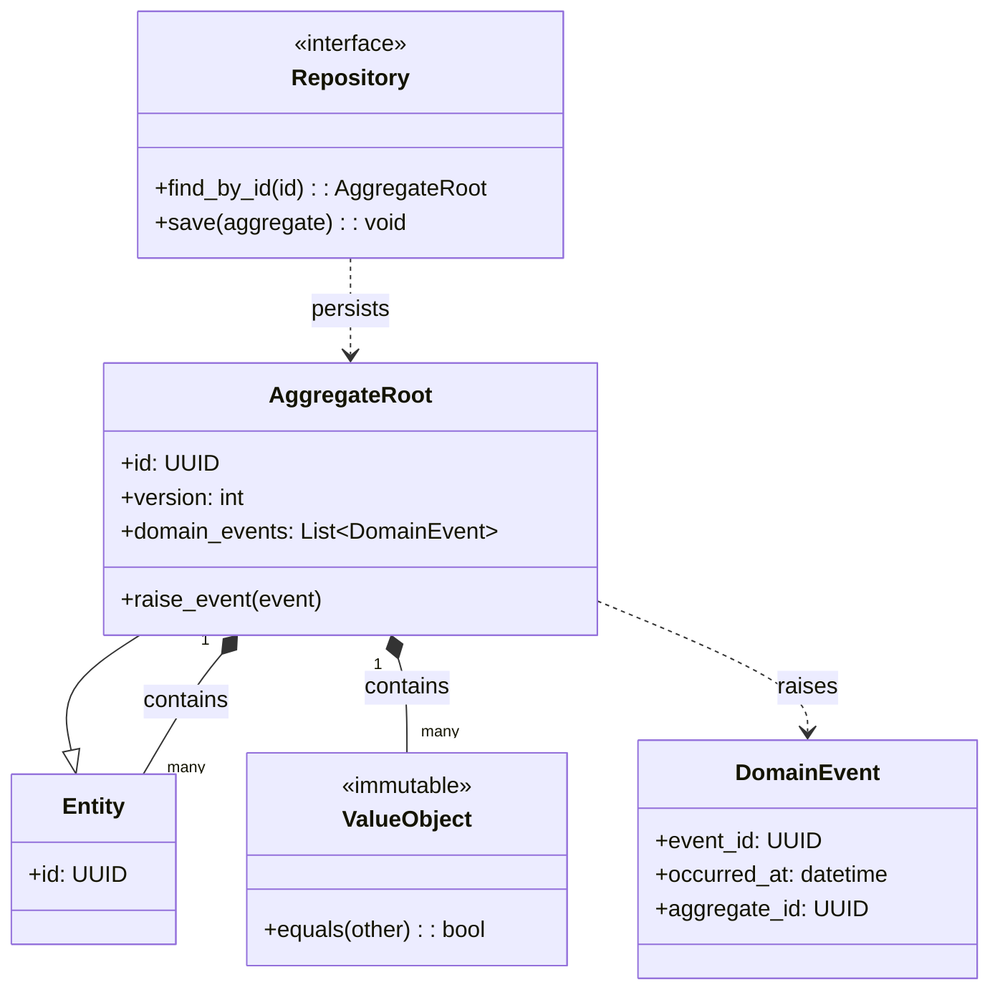
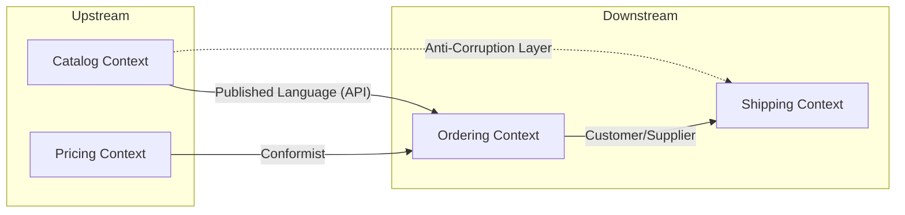
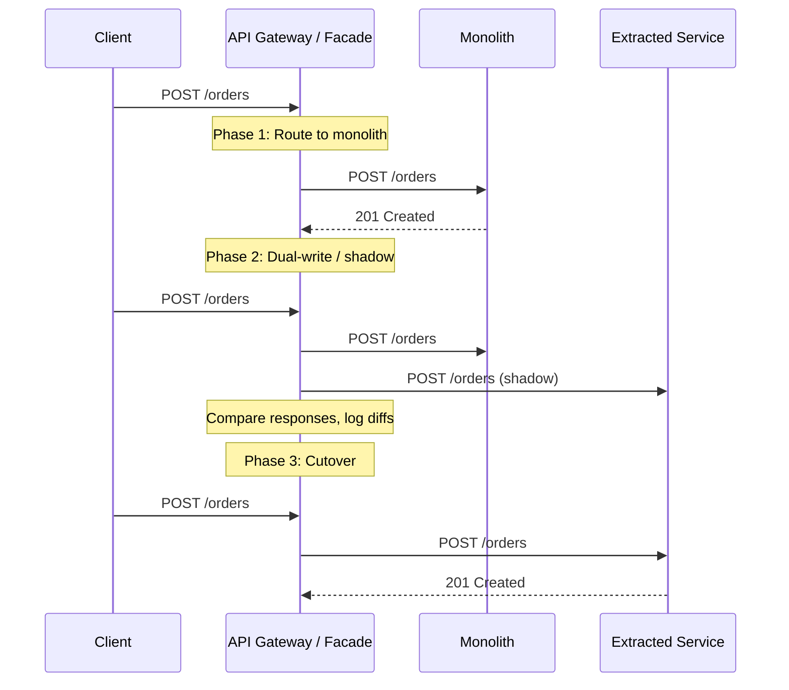
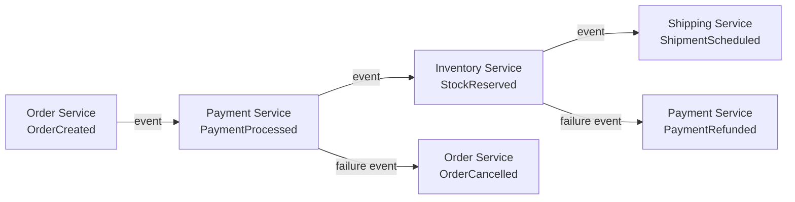

# Microservices vs Monolith Architecture Decision Guide

> **Purpose**: Provide a rigorous, evidence-based framework for deciding between monolithic and microservices architectures—and the pragmatic middle ground of the modular monolith. This guide covers Domain-Driven Design tactical patterns, bounded contexts, distributed system challenges, migration strategies, and a concrete decision matrix.

## Prerequisites

| Skill | Level |
|---|---|
| System design fundamentals | Intermediate |
| At least one backend framework (Django, Spring Boot, Express, Rails) | Working proficiency |
| SQL and basic data modeling | Intermediate |
| Docker / container basics | Familiarity |

**Related devskill files:**
- [Background Jobs & Message Queues](./background-jobs-queues.md)
- [Web Performance & Core Web Vitals](../frontend/web-performance.md)

---

## Golden Rule

> **Start with a well-structured modular monolith; extract microservices only when you can articulate the specific, measurable benefit that outweighs the operational cost.**

---

## 1. Architecture Spectrum

Architecture choice is not binary. The industry has converged on a spectrum:

```
┌────────────┐    ┌──────────────────┐    ┌────────────────┐
│  Big Ball   │    │    Modular        │    │  Microservices  │
│  of Mud     │ →  │    Monolith       │ →  │  (distributed)  │
│  (avoid)    │    │  (start here)     │    │  (extract when  │
│             │    │                    │    │   justified)    │
└────────────┘    └──────────────────┘    └────────────────┘
     Chaos              Order               Distributed Order
```

### 1.1 Architecture Comparison Matrix

| Dimension | Monolith (unstructured) | Modular Monolith | Microservices |
|---|---|---|---|
| Deployment unit | Single artifact | Single artifact, module boundaries | Many artifacts |
| Team scalability | ≤ 5 devs | 5–30 devs | 30+ devs (Conway's Law) |
| Data model | Shared DB, no boundaries | Shared DB, schema-per-module | Database-per-service |
| Latency overhead | In-process calls | In-process calls | Network hops (1–10 ms each) |
| Operational cost | Low | Low | High (observability, service mesh, CI/CD per service) |
| Fault isolation | Low | Medium (module-level circuit breakers) | High (bulkhead pattern) |
| Technology diversity | Homogeneous | Homogeneous | Polyglot possible |

---

## 2. The Modular Monolith Pattern

A modular monolith enforces **explicit module boundaries** at the code level while deploying as a single unit. Each module owns its domain logic, exposes a public API (interface), and hides internal implementation details.

### 2.1 Module Structure

```
src/
├── modules/
│   ├── ordering/
│   │   ├── api/              # Public interface (DTOs, service contracts)
│   │   │   ├── __init__.py
│   │   │   ├── ordering_service.py
│   │   │   └── dtos.py
│   │   ├── domain/           # Domain model (Aggregates, Entities, VOs)
│   │   │   ├── order.py
│   │   │   ├── line_item.py
│   │   │   └── events.py
│   │   ├── infrastructure/   # Repositories, external adapters
│   │   │   ├── order_repository.py
│   │   │   └── payment_gateway.py
│   │   └── internal/         # Private implementation
│   │       └── pricing_engine.py
│   ├── inventory/
│   │   ├── api/
│   │   ├── domain/
│   │   ├── infrastructure/
│   │   └── internal/
│   └── shipping/
│       └── ...
├── shared_kernel/            # Truly shared value objects (Money, Address)
└── infrastructure/           # Cross-cutting (logging, auth middleware)
```

### 2.2 Enforcing Module Boundaries

Modules MUST NOT import from each other's `domain/` or `internal/` packages. Communication flows through `api/` only.

```python
# ✅ GOOD — Module communicates through the public API
from modules.inventory.api.inventory_service import InventoryService

class OrderingService:
    def __init__(self, inventory: InventoryService):
        self._inventory = inventory

    def place_order(self, cart: Cart) -> Order:
        for item in cart.items:
            if not self._inventory.check_availability(item.sku, item.qty):
                raise InsufficientStockError(item.sku)
        order = Order.create(cart)
        return order
```

```python
# ❌ BAD — Reaching into another module's internals
from modules.inventory.domain.warehouse import Warehouse
from modules.inventory.infrastructure.stock_repo import StockRepository

class OrderingService:
    def place_order(self, cart: Cart) -> Order:
        repo = StockRepository()
        warehouse = repo.find_nearest(cart.shipping_address)
        # Tight coupling: ordering knows about warehouse internals
```

**Enforcement tooling:**
- **Python**: Use `import-linter` (v2.x) with contract rules
- **Java/Kotlin**: ArchUnit (`com.tngtech.archunit:archunit-junit5:1.2.x`)
- **TypeScript**: ESLint `no-restricted-imports` or `eslint-plugin-boundaries`

```yaml
# .importlinter configuration
[importlinter]
root_package = src

[importlinter:contract:module-isolation]
name = Modules must not import internals of other modules
type = forbidden
source_modules =
    modules.ordering
forbidden_modules =
    modules.inventory.domain
    modules.inventory.internal
    modules.shipping.domain
    modules.shipping.internal
```

---

## 3. Domain-Driven Design (DDD) Tactical Patterns

DDD provides the vocabulary and patterns for modeling complex domains inside each module (or service).

### 3.1 Building Blocks



### 3.2 Aggregate Design Rules

1. **Protect invariants inside the aggregate boundary.** External code MUST NOT modify child entities directly.
2. **Reference other aggregates by ID only** — never hold object references across aggregate boundaries.
3. **Keep aggregates small.** Prefer eventual consistency between aggregates over large transactional boundaries.

```python
# Aggregate Root example
from __future__ import annotations
import uuid
from dataclasses import dataclass, field
from datetime import datetime, timezone
from typing import List


@dataclass(frozen=True)
class Money:
    """Value Object — immutable, equality by value."""
    amount: int  # cents
    currency: str = "USD"

    def __post_init__(self):
        if self.amount < 0:
            raise ValueError("Money amount cannot be negative")

    def add(self, other: Money) -> Money:
        if self.currency != other.currency:
            raise ValueError(f"Cannot add {self.currency} and {other.currency}")
        return Money(amount=self.amount + other.amount, currency=self.currency)


@dataclass
class LineItem:
    """Entity — identity within the aggregate."""
    id: uuid.UUID
    product_id: uuid.UUID  # Reference by ID, not object
    quantity: int
    unit_price: Money

    @property
    def subtotal(self) -> Money:
        return Money(amount=self.unit_price.amount * self.quantity,
                     currency=self.unit_price.currency)


class OrderPlaced:
    """Domain Event."""
    def __init__(self, order_id: uuid.UUID, total: Money):
        self.event_id = uuid.uuid4()
        self.occurred_at = datetime.now(timezone.utc)
        self.order_id = order_id
        self.total = total


class Order:
    """Aggregate Root — all mutations go through methods that enforce invariants."""

    MAX_LINE_ITEMS = 50

    def __init__(self, order_id: uuid.UUID, customer_id: uuid.UUID):
        self.id = order_id
        self.customer_id = customer_id
        self.line_items: List[LineItem] = []
        self.status: str = "draft"
        self.version: int = 0
        self._domain_events: List = []

    def add_line_item(self, product_id: uuid.UUID, qty: int, unit_price: Money) -> None:
        if len(self.line_items) >= self.MAX_LINE_ITEMS:
            raise ValueError(f"Order cannot exceed {self.MAX_LINE_ITEMS} line items")
        if qty <= 0:
            raise ValueError("Quantity must be positive")
        item = LineItem(id=uuid.uuid4(), product_id=product_id,
                        quantity=qty, unit_price=unit_price)
        self.line_items.append(item)

    def place(self) -> None:
        if not self.line_items:
            raise ValueError("Cannot place an empty order")
        if self.status != "draft":
            raise ValueError(f"Cannot place order in status '{self.status}'")
        self.status = "placed"
        self._domain_events.append(OrderPlaced(self.id, self.total))

    @property
    def total(self) -> Money:
        if not self.line_items:
            return Money(amount=0)
        result = self.line_items[0].subtotal
        for item in self.line_items[1:]:
            result = result.add(item.subtotal)
        return result

    def collect_events(self) -> List:
        events = list(self._domain_events)
        self._domain_events.clear()
        return events
```

### 3.3 Repository Interface

```python
from abc import ABC, abstractmethod
import uuid

class OrderRepository(ABC):
    """Repository — abstracts persistence. Implementation lives in infrastructure/."""

    @abstractmethod
    def find_by_id(self, order_id: uuid.UUID) -> Order:
        """MUST raise OrderNotFoundError if not found."""
        ...

    @abstractmethod
    def save(self, order: Order) -> None:
        """Persists the aggregate. MUST use optimistic locking on order.version."""
        ...
```

---

## 4. Bounded Contexts & Context Mapping

### 4.1 What Is a Bounded Context?

A Bounded Context is a linguistic and model boundary. The same real-world concept (e.g., "Product") has different meaning in different contexts:

| Context | "Product" means |
|---|---|
| **Catalog** | Name, description, images, categories |
| **Pricing** | SKU, base price, discount rules |
| **Inventory** | SKU, warehouse location, quantity on hand |
| **Shipping** | Weight, dimensions, hazardous material flag |

### 4.2 Context Map Relationships



**Key relationship types:**

| Relationship | When to use |
|---|---|
| **Shared Kernel** | Two contexts co-own a small model subset. Use sparingly. |
| **Customer/Supplier** | Upstream team accommodates downstream needs. Requires governance. |
| **Conformist** | Downstream accepts upstream's model as-is. Low effort. |
| **Anti-Corruption Layer (ACL)** | Downstream translates upstream's model to protect its own. RECOMMENDED for legacy integration. |
| **Published Language** | Upstream exposes a well-documented API/schema (OpenAPI, Protobuf). RECOMMENDED for microservices. |

---

## 5. When to Extract Microservices

### 5.1 Extraction Triggers (All MUST Be True)

| # | Trigger | Evidence Required |
|---|---|---|
| 1 | **Independent deploy cadence** | Module X deploys 10x more frequently than the rest |
| 2 | **Different scaling profile** | Module X requires 20x more compute than others |
| 3 | **Team autonomy** | Dedicated team (≥ 3 people) owns the module |
| 4 | **Clear bounded context** | Module communicates with ≤ 3 other modules via well-defined API |
| 5 | **Organizational readiness** | Team has observability, CI/CD, and on-call for the new service |

### 5.2 The Strangler Fig Migration



**Steps:**

1. **Identify the seam** — the module boundary in your modular monolith.
2. **Introduce an API Gateway / reverse proxy** (Kong, Envoy, AWS ALB) in front of the monolith.
3. **Deploy the new service** alongside the monolith. Route a percentage of traffic (canary).
4. **Dual-write phase** — both systems process requests; compare outputs. Fix discrepancies.
5. **Cutover** — route 100% to the new service. Keep the monolith code for rollback (≥ 2 weeks).
6. **Decommission** — remove dead code from the monolith.

---

## 6. Distributed System Challenges

### 6.1 CAP Theorem in Practice

> In the presence of a network **P**artition, a distributed system must choose between **C**onsistency and **A**vailability.

| System | Choice | Implication |
|---|---|---|
| PostgreSQL (single node) | CA (no partitions) | Strong consistency, but no horizontal scale |
| DynamoDB (default) | AP | Eventually consistent reads; use `ConsistentRead=true` for CP |
| CockroachDB | CP | Strongly consistent, but writes stall during partitions |

**Practical guidance:** Most microservices systems choose **AP with eventual consistency** and design around it.

### 6.2 Eventual Consistency — Saga Pattern

When a business operation spans multiple services, you MUST NOT use distributed transactions (2PC). Use the **Saga pattern** instead.

#### Choreography-Based Saga



**Pros:** Loose coupling, no central coordinator.
**Cons:** Hard to debug, implicit workflow, potential event storms.

#### Orchestration-Based Saga

```python
# Saga Orchestrator — explicit step sequencing
class PlaceOrderSaga:
    """Orchestrates the multi-service order placement workflow."""

    def __init__(self, payment_client, inventory_client, shipping_client):
        self.payment = payment_client
        self.inventory = inventory_client
        self.shipping = shipping_client

    async def execute(self, order: Order) -> SagaResult:
        compensation_stack = []
        try:
            # Step 1: Charge payment
            payment_id = await self.payment.charge(order.customer_id, order.total)
            compensation_stack.append(lambda: self.payment.refund(payment_id))

            # Step 2: Reserve inventory
            reservation_id = await self.inventory.reserve(order.line_items)
            compensation_stack.append(lambda: self.inventory.release(reservation_id))

            # Step 3: Schedule shipment
            shipment_id = await self.shipping.schedule(order.id, order.shipping_address)
            compensation_stack.append(lambda: self.shipping.cancel(shipment_id))

            return SagaResult.success(order_id=order.id)

        except SagaStepFailure as e:
            # Compensate in reverse order
            for compensate in reversed(compensation_stack):
                try:
                    await compensate()
                except Exception as comp_error:
                    logger.error(f"Compensation failed: {comp_error}")
                    # Alert on-call — manual intervention required
            return SagaResult.failure(order_id=order.id, reason=str(e))
```

**Prefer orchestration** when the workflow has > 3 steps or complex branching.

### 6.3 Transactional Outbox Pattern

To reliably publish domain events when the database and message broker are separate systems:

```
┌─────────────────────────────────────────────┐
│  Service Database (single transaction)       │
│                                              │
│  1. UPDATE orders SET status = 'placed'      │
│  2. INSERT INTO outbox_events (              │
│       id, aggregate_type, aggregate_id,      │
│       event_type, payload, created_at        │
│     )                                        │
│  COMMIT;                                     │
└─────────────────────┬───────────────────────┘
                      │
          ┌───────────▼────────────┐
          │  Outbox Relay Process   │
          │  (Debezium CDC / poller)│
          └───────────┬────────────┘
                      │
          ┌───────────▼────────────┐
          │  Message Broker         │
          │  (Kafka / RabbitMQ)     │
          └────────────────────────┘
```

```sql
-- Outbox table schema (PostgreSQL)
CREATE TABLE outbox_events (
    id            UUID PRIMARY KEY DEFAULT gen_random_uuid(),
    aggregate_type VARCHAR(100) NOT NULL,
    aggregate_id   UUID NOT NULL,
    event_type     VARCHAR(100) NOT NULL,
    payload        JSONB NOT NULL,
    created_at     TIMESTAMPTZ NOT NULL DEFAULT now(),
    published_at   TIMESTAMPTZ,  -- NULL until relay publishes
    CONSTRAINT idx_outbox_unpublished
        CHECK (published_at IS NULL)  -- partial index candidate
);

CREATE INDEX idx_outbox_pending
    ON outbox_events (created_at)
    WHERE published_at IS NULL;
```

**Relay options:**
- **Debezium** (CDC via PostgreSQL WAL / MySQL binlog) — RECOMMENDED for production
- **Polling relay** — simpler but adds latency (poll interval ≥ 100 ms)

---

## 7. Inter-Service Communication

### 7.1 Synchronous: gRPC vs REST

| Dimension | REST (HTTP/JSON) | gRPC (HTTP/2 + Protobuf) |
|---|---|---|
| Payload size | ~2–10x larger (JSON) | Compact binary |
| Latency | Higher (text parsing) | Lower (~30% less on average) |
| Streaming | Limited (SSE, WebSocket) | Native bidirectional streaming |
| Browser support | Native | Requires grpc-web proxy |
| Tooling | Ubiquitous (curl, Postman) | Needs protoc, reflection |
| Schema evolution | OpenAPI (optional) | Protobuf (built-in backward compat) |

**Guidance:** Use **gRPC** for internal service-to-service calls. Use **REST** for public-facing APIs and browser clients.

### 7.2 Asynchronous: Event-Driven Communication

```python
# Publishing an event (using Kafka via confluent-kafka 2.x)
from confluent_kafka import Producer
import json
import uuid

producer = Producer({
    "bootstrap.servers": "kafka:9092",
    "acks": "all",                    # Wait for all ISR replicas
    "enable.idempotence": True,       # Exactly-once producer
    "max.in.flight.requests.per.connection": 5,
})

def publish_order_placed(order_id: str, total_cents: int) -> None:
    event = {
        "event_id": str(uuid.uuid4()),
        "event_type": "order.placed",
        "aggregate_id": order_id,
        "payload": {"total_cents": total_cents},
    }
    producer.produce(
        topic="orders.events",
        key=order_id.encode("utf-8"),   # Partition by order ID for ordering
        value=json.dumps(event).encode("utf-8"),
    )
    producer.flush(timeout=5)
```

### 7.3 Service Mesh (Istio / Linkerd)

A service mesh handles cross-cutting concerns at the infrastructure layer:

| Concern | Without mesh | With mesh (sidecar proxy) |
|---|---|---|
| mTLS between services | Manual cert management | Automatic, zero-code |
| Retries / circuit breaker | Application code | Declarative policy |
| Observability (traces) | SDK per language | Automatic span injection |
| Traffic shifting (canary) | Custom load balancer | `VirtualService` resource |

**When to adopt:** SHOULD adopt when you have > 10 services. MAY skip for < 5 services.

---

## 8. Data Ownership Patterns

### 8.1 Database-Per-Service

Each service owns its database schema. Other services MUST NOT access it directly.

```
┌──────────────┐     ┌──────────────┐     ┌──────────────┐
│ Order Service │     │ Payment Svc  │     │ Inventory Svc│
│   ┌────────┐ │     │  ┌────────┐  │     │  ┌────────┐  │
│   │orders  │ │     │  │payments│  │     │  │stock   │  │
│   │line_   │ │     │  │refunds │  │     │  │warehou │  │
│   │items   │ │     │  │        │  │     │  │ses     │  │
│   └────────┘ │     │  └────────┘  │     │  └────────┘  │
└──────────────┘     └──────────────┘     └──────────────┘
```

### 8.2 CQRS — Command Query Responsibility Segregation

When read and write patterns diverge significantly:

- **Write side**: Normalized domain model with aggregates.
- **Read side**: Denormalized projections optimized for queries.

```python
# Read model projection — subscribes to domain events
class OrderSummaryProjection:
    """Builds a denormalized read model from domain events."""

    def __init__(self, read_db):
        self.read_db = read_db

    async def handle_order_placed(self, event: dict) -> None:
        await self.read_db.execute("""
            INSERT INTO order_summaries (order_id, customer_id, total_cents, status, placed_at)
            VALUES ($1, $2, $3, 'placed', $4)
            ON CONFLICT (order_id) DO UPDATE SET status = 'placed', total_cents = $3
        """, event["order_id"], event["customer_id"],
             event["total_cents"], event["occurred_at"])

    async def handle_order_shipped(self, event: dict) -> None:
        await self.read_db.execute("""
            UPDATE order_summaries SET status = 'shipped', shipped_at = $2
            WHERE order_id = $1
        """, event["order_id"], event["occurred_at"])
```

---

## 9. Security & Performance Considerations

### 9.1 Security

| Threat | Mitigation |
|---|---|
| Unauthenticated service-to-service calls | mTLS via service mesh or JWT with short expiry (5 min) |
| Data leakage across service boundaries | Schema-per-service, network policies (Kubernetes `NetworkPolicy`) |
| Event tampering | Sign events with HMAC; verify on consumption |
| Secrets in environment variables | Use Vault / AWS Secrets Manager; rotate every 90 days |

### 9.2 Performance

| Concern | Monolith | Microservices |
|---|---|---|
| In-process call latency | ~1 µs | N/A |
| Network call latency | N/A | 1–10 ms per hop |
| Serialization overhead | None | JSON: ~50 µs, Protobuf: ~5 µs per message |
| Database connection pooling | Single pool | Pool per service (watch connection limits) |

**Rule of thumb:** Every network hop adds ~2–5 ms p50 latency. A request that fans out to 5 services adds 10–25 ms of pure network overhead.

---

## 10. Common Pitfalls & Anti-Patterns

| # | Anti-Pattern | Why It's Harmful | Fix |
|---|---|---|---|
| 1 | **Distributed Monolith** | Services share a database or deploy in lockstep | Enforce database-per-service; async communication |
| 2 | **Nano-services** | Services too small (< 1 team) → operational overhead | Merge into modular monolith modules |
| 3 | **Shared libraries for domain logic** | Couples all services to one release cycle | Duplicate simple code; share only infrastructure libs |
| 4 | **Synchronous chains** | A→B→C→D: latency compounds, availability multiplies (0.99⁴ = 0.96) | Use async events or aggregate at the API gateway |
| 5 | **No API versioning** | Breaking changes cascade | Use Protobuf field numbering or URL versioning (`/v2/`) |
| 6 | **Ignoring idempotency** | Retries cause duplicate side effects | Idempotency keys on all mutating operations |
| 7 | **Testing only in production** | "Works on my machine" → outage | Contract tests (Pact), integration test with Docker Compose |
| 8 | **Big-bang migration** | Rewrite monolith all at once → 18-month failure | Strangler Fig, one module at a time |

---

## 11. Decision Matrix

Use this scoring matrix when evaluating your architecture choice. Score each dimension 1–5 for your project:

| Dimension | Weight | Monolith Favored (1–2) | Microservices Favored (4–5) |
|---|---|---|---|
| Team size | 3x | ≤ 10 engineers | > 30 engineers, multiple teams |
| Deploy frequency need | 2x | Weekly releases acceptable | Multiple daily deploys per module |
| Scaling variance | 2x | Uniform load | 10x+ variance between components |
| Domain complexity | 2x | Single bounded context | 5+ distinct bounded contexts |
| Operational maturity | 3x | No dedicated SRE/DevOps | Dedicated platform team, observability in place |
| Regulatory isolation | 1x | Single compliance domain | PCI, HIPAA, SOX require isolation |

**Scoring:**
- **Weighted total < 30**: Start with (or stay with) a modular monolith.
- **Weighted total 30–45**: Consider extracting 1–3 services for the highest-value bounded contexts.
- **Weighted total > 45**: Microservices architecture is justified.

---

## 12. Verification Checklist

Before committing to an architecture decision, verify:

- [ ] You can draw your bounded context map and every team agrees on the boundaries
- [ ] Each module/service has a single owning team (no shared ownership)
- [ ] Module boundaries are enforced by tooling (import linter, ArchUnit), not just convention
- [ ] Your CI pipeline runs contract tests between modules/services
- [ ] You have measured actual network latency between proposed services (not assumed)
- [ ] Each service candidate has its own data store with no shared tables
- [ ] You have a documented runbook for saga failure compensation
- [ ] Your observability stack supports distributed tracing across services (Jaeger, Zipkin, Datadog APM)
- [ ] Outbox pattern (or equivalent) is in place for reliable event publishing
- [ ] The team has practiced an incident involving a distributed failure mode (game day)
- [ ] API versioning strategy is documented and enforced
- [ ] Deployment pipeline supports independent service deployments with automated rollback

---

## References

- Eric Evans, *Domain-Driven Design* (2003)
- Sam Newman, *Building Microservices*, 2nd Ed. (O'Reilly, 2021)
- Vaughn Vernon, *Implementing Domain-Driven Design* (2013)
- Chris Richardson, *Microservices Patterns* (Manning, 2018)
- Martin Fowler, "MonolithFirst" — https://martinfowler.com/bliki/MonolithFirst.html
- Kamil Grzybek, "Modular Monolith with DDD" — https://github.com/kgrzybek/modular-monolith-with-ddd
