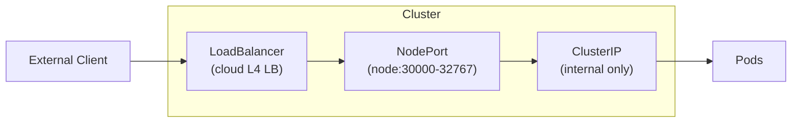
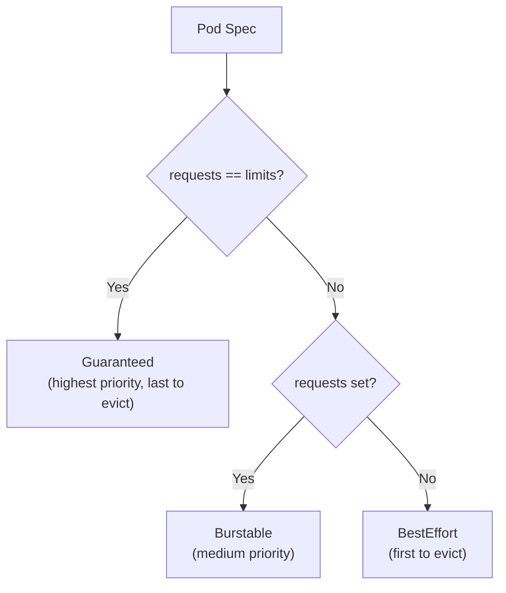
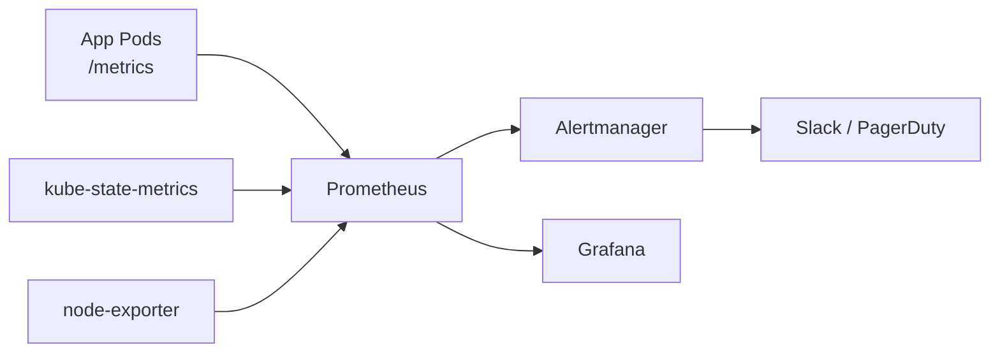

# Kubernetes & Cloud Infrastructure Guide

> **Purpose**: Comprehensive reference for designing, deploying, and operating production workloads on Kubernetes — covering core primitives, networking, security, autoscaling, storage, observability, managed-service selection, and cost optimization.

> **Prerequisites**: Familiarity with containers (Docker), Linux networking basics, YAML syntax, and at least one cloud provider (AWS, GCP, or Azure).

---

## Golden Rule

**Every Kubernetes manifest MUST declare resource requests/limits, health probes, and pod disruption budgets before reaching production — without these, your cluster is an unmanaged free-for-all.**

---

## 1. Core Workload Primitives

### 1.1 Pods

A Pod is the smallest deployable unit — one or more co-located containers sharing network and storage namespaces. You almost never create bare Pods; instead, use a higher-level controller.

```yaml
# ❌ BAD — bare Pod with no controller
apiVersion: v1
kind: Pod
metadata:
  name: my-app
spec:
  containers:
    - name: app
      image: myregistry/app:1.4.2
```

```yaml
# ✅ GOOD — managed by a Deployment (self-healing, rollback, scaling)
apiVersion: apps/v1
kind: Deployment
metadata:
  name: my-app
spec:
  replicas: 3
  selector:
    matchLabels:
      app: my-app
  template:
    metadata:
      labels:
        app: my-app
    spec:
      containers:
        - name: app
          image: myregistry/app:1.4.2
```

### 1.2 Deployments

Deployments manage stateless ReplicaSets with rolling-update and rollback capabilities.

```yaml
apiVersion: apps/v1
kind: Deployment
metadata:
  name: api-server
  namespace: production
spec:
  replicas: 3
  revisionHistoryLimit: 5
  strategy:
    type: RollingUpdate
    rollingUpdate:
      maxSurge: 1          # At most 1 extra Pod during rollout
      maxUnavailable: 0     # Zero-downtime deployments
  selector:
    matchLabels:
      app: api-server
  template:
    metadata:
      labels:
        app: api-server
        version: v2.3.1
    spec:
      terminationGracePeriodSeconds: 60
      containers:
        - name: api
          image: myregistry/api-server:2.3.1
          ports:
            - containerPort: 8080
          resources:
            requests:
              cpu: 250m
              memory: 256Mi
            limits:
              cpu: "1"
              memory: 512Mi
          livenessProbe:
            httpGet:
              path: /healthz
              port: 8080
            initialDelaySeconds: 10
            periodSeconds: 15
            failureThreshold: 3
          readinessProbe:
            httpGet:
              path: /ready
              port: 8080
            initialDelaySeconds: 5
            periodSeconds: 5
          startupProbe:
            httpGet:
              path: /healthz
              port: 8080
            failureThreshold: 30
            periodSeconds: 2
```

### 1.3 StatefulSets

Use StatefulSets for workloads that need **stable network identity** and **persistent storage** (databases, message brokers, distributed caches).

| Feature | Deployment | StatefulSet |
|---|---|---|
| Pod naming | Random suffix | Ordered index (`-0`, `-1`, …) |
| Scaling order | Parallel | Sequential (ordered) |
| Volume lifecycle | Shared / ephemeral | Per-Pod PVC retained on delete |
| DNS | Via Service only | `<pod>.<service>.<ns>.svc.cluster.local` |

```yaml
apiVersion: apps/v1
kind: StatefulSet
metadata:
  name: postgres
spec:
  serviceName: postgres-headless
  replicas: 3
  podManagementPolicy: OrderedReady   # Parallel is also available
  selector:
    matchLabels:
      app: postgres
  template:
    metadata:
      labels:
        app: postgres
    spec:
      containers:
        - name: postgres
          image: postgres:16.1
          ports:
            - containerPort: 5432
          volumeMounts:
            - name: pgdata
              mountPath: /var/lib/postgresql/data
          resources:
            requests:
              cpu: 500m
              memory: 1Gi
            limits:
              cpu: "2"
              memory: 4Gi
  volumeClaimTemplates:
    - metadata:
        name: pgdata
      spec:
        accessModes: ["ReadWriteOnce"]
        storageClassName: gp3-encrypted
        resources:
          requests:
            storage: 100Gi
```

### 1.4 DaemonSets

Run exactly one Pod per node — use for log collectors, monitoring agents, and network plugins.

```yaml
apiVersion: apps/v1
kind: DaemonSet
metadata:
  name: fluentbit
  namespace: logging
spec:
  selector:
    matchLabels:
      app: fluentbit
  template:
    metadata:
      labels:
        app: fluentbit
    spec:
      tolerations:
        - operator: Exists        # Run on ALL nodes including tainted ones
      containers:
        - name: fluentbit
          image: fluent/fluent-bit:3.0
          resources:
            requests:
              cpu: 100m
              memory: 128Mi
            limits:
              cpu: 500m
              memory: 256Mi
          volumeMounts:
            - name: varlog
              mountPath: /var/log
              readOnly: true
      volumes:
        - name: varlog
          hostPath:
            path: /var/log
```

### 1.5 Jobs & CronJobs

```yaml
apiVersion: batch/v1
kind: CronJob
metadata:
  name: db-backup
spec:
  schedule: "0 2 * * *"          # Daily at 02:00 UTC
  concurrencyPolicy: Forbid       # Never overlap runs
  successfulJobsHistoryLimit: 3
  failedJobsHistoryLimit: 5
  jobTemplate:
    spec:
      backoffLimit: 3
      activeDeadlineSeconds: 3600  # Kill after 1 hour
      template:
        spec:
          restartPolicy: OnFailure
          containers:
            - name: backup
              image: myregistry/db-backup:1.0.0
              resources:
                requests:
                  cpu: 500m
                  memory: 512Mi
```

---

## 2. Services & Networking

### 2.1 Service Types



| Type | Scope | Use Case |
|---|---|---|
| `ClusterIP` | Cluster-internal | Default; inter-service communication |
| `NodePort` | External via node IP | Dev/testing; bare-metal without LB |
| `LoadBalancer` | External via cloud LB | Production external traffic |
| `ExternalName` | DNS CNAME alias | Pointing to external services |

```yaml
apiVersion: v1
kind: Service
metadata:
  name: api-server
spec:
  type: ClusterIP
  selector:
    app: api-server
  ports:
    - port: 80
      targetPort: 8080
      protocol: TCP
```

### 2.2 Ingress Controllers

Ingress provides L7 HTTP routing. The two most common controllers:

| Feature | NGINX Ingress | Traefik |
|---|---|---|
| Protocol support | HTTP/HTTPS, gRPC, WebSocket | HTTP/HTTPS, gRPC, TCP/UDP |
| Config model | Annotations + ConfigMap | CRDs (`IngressRoute`) or annotations |
| Auto TLS | cert-manager integration | Built-in Let's Encrypt via ACME |
| Dashboard | None built-in | Built-in web UI |
| Performance | Very high throughput | Good; middleware-heavy setups slower |

```yaml
apiVersion: networking.k8s.io/v1
kind: Ingress
metadata:
  name: api-ingress
  annotations:
    nginx.ingress.kubernetes.io/ssl-redirect: "true"
    nginx.ingress.kubernetes.io/rate-limit: "100"
    cert-manager.io/cluster-issuer: letsencrypt-prod
spec:
  ingressClassName: nginx
  tls:
    - hosts:
        - api.example.com
      secretName: api-tls
  rules:
    - host: api.example.com
      http:
        paths:
          - path: /v1
            pathType: Prefix
            backend:
              service:
                name: api-server
                port:
                  number: 80
```

---

## 3. Configuration & Secrets

### 3.1 ConfigMaps

```yaml
apiVersion: v1
kind: ConfigMap
metadata:
  name: app-config
data:
  LOG_LEVEL: "info"
  DATABASE_POOL_SIZE: "20"
  config.yaml: |
    server:
      port: 8080
      read_timeout: 30s
```

### 3.2 Secrets

> [!CAUTION]
> Kubernetes Secrets are **base64-encoded, not encrypted** at rest by default. You MUST enable etcd encryption at rest or use an external secrets manager (Vault, AWS Secrets Manager, GCP Secret Manager) with the External Secrets Operator.

```yaml
apiVersion: v1
kind: Secret
metadata:
  name: db-credentials
type: Opaque
stringData:                      # stringData avoids manual base64
  username: app_user
  password: "s3cur3-p@ssw0rd"   # NEVER commit this; use sealed-secrets or external-secrets
```

**Production pattern — External Secrets Operator:**

```yaml
apiVersion: external-secrets.io/v1beta1
kind: ExternalSecret
metadata:
  name: db-credentials
spec:
  refreshInterval: 1h
  secretStoreRef:
    name: aws-secrets-manager
    kind: ClusterSecretStore
  target:
    name: db-credentials
  data:
    - secretKey: username
      remoteRef:
        key: prod/db-credentials
        property: username
    - secretKey: password
      remoteRef:
        key: prod/db-credentials
        property: password
```

---

## 4. Resource Management & QoS

### 4.1 Requests vs Limits

| | Requests | Limits |
|---|---|---|
| **Scheduling** | Scheduler uses requests to find a node | Not considered for scheduling |
| **CPU** | Guaranteed minimum; throttled beyond limit | Hard cap via CFS quota |
| **Memory** | Guaranteed minimum; OOM-killed if node exhausted | Hard cap; OOM-killed if exceeded |

### 4.2 Quality of Service (QoS) Classes



**Rule of thumb**: Production workloads MUST be at least `Burstable`; critical services SHOULD be `Guaranteed`.

```yaml
# ✅ Guaranteed QoS — requests exactly equal limits
resources:
  requests:
    cpu: "1"
    memory: 1Gi
  limits:
    cpu: "1"
    memory: 1Gi
```

---

## 5. Autoscaling

### 5.1 Horizontal Pod Autoscaler (HPA)

```yaml
apiVersion: autoscaling/v2
kind: HorizontalPodAutoscaler
metadata:
  name: api-server-hpa
spec:
  scaleTargetRef:
    apiVersion: apps/v1
    kind: Deployment
    name: api-server
  minReplicas: 3
  maxReplicas: 50
  behavior:
    scaleDown:
      stabilizationWindowSeconds: 300   # Wait 5 min before scale-down
      policies:
        - type: Percent
          value: 10
          periodSeconds: 60
    scaleUp:
      stabilizationWindowSeconds: 0
      policies:
        - type: Percent
          value: 100
          periodSeconds: 15
  metrics:
    - type: Resource
      resource:
        name: cpu
        target:
          type: Utilization
          averageUtilization: 70
    - type: Pods
      pods:
        metric:
          name: http_requests_per_second
        target:
          type: AverageValue
          averageValue: "1000"
```

### 5.2 Vertical Pod Autoscaler (VPA)

VPA adjusts resource requests/limits automatically. **Do NOT use VPA and HPA on the same CPU/memory metric** — they conflict.

```yaml
apiVersion: autoscaling.k8s.io/v1
kind: VerticalPodAutoscaler
metadata:
  name: api-server-vpa
spec:
  targetRef:
    apiVersion: apps/v1
    kind: Deployment
    name: api-server
  updatePolicy:
    updateMode: "Auto"      # "Off" for recommendation-only
  resourcePolicy:
    containerPolicies:
      - containerName: api
        minAllowed:
          cpu: 100m
          memory: 128Mi
        maxAllowed:
          cpu: "4"
          memory: 8Gi
```

---

## 6. Health Probes

| Probe | Purpose | Failure Action |
|---|---|---|
| **Startup** | Slow-starting containers | Kills & restarts Pod |
| **Liveness** | Detect deadlocks/hangs | Kills & restarts Pod |
| **Readiness** | Traffic readiness | Removes from Service endpoints |

> [!WARNING]
> A liveness probe that depends on downstream services (database, cache) will cascade-restart Pods when the dependency is down. Liveness probes MUST only check the process itself.

```yaml
# ✅ GOOD — liveness checks in-process health only
livenessProbe:
  httpGet:
    path: /healthz        # Returns 200 if event loop alive
    port: 8080
  initialDelaySeconds: 0
  periodSeconds: 10
  failureThreshold: 3

# ✅ GOOD — readiness checks downstream dependencies
readinessProbe:
  httpGet:
    path: /ready           # Returns 200 if DB + cache reachable
    port: 8080
  periodSeconds: 5
  failureThreshold: 2

# ✅ GOOD — startup probe for slow JVM / ML model loading
startupProbe:
  httpGet:
    path: /healthz
    port: 8080
  failureThreshold: 60    # 60 × 2s = 2 min startup window
  periodSeconds: 2
```

---

## 7. Security

### 7.1 RBAC

```yaml
apiVersion: rbac.authorization.k8s.io/v1
kind: Role
metadata:
  name: app-deployer
  namespace: production
rules:
  - apiGroups: ["apps"]
    resources: ["deployments"]
    verbs: ["get", "list", "watch", "create", "update", "patch"]
  - apiGroups: [""]
    resources: ["pods", "pods/log"]
    verbs: ["get", "list", "watch"]
---
apiVersion: rbac.authorization.k8s.io/v1
kind: RoleBinding
metadata:
  name: deploy-team-binding
  namespace: production
subjects:
  - kind: Group
    name: deploy-team
    apiGroup: rbac.authorization.k8s.io
roleRef:
  kind: Role
  name: app-deployer
  apiGroup: rbac.authorization.k8s.io
```

### 7.2 Network Policies

Default-deny then allow explicitly — defense in depth.

```yaml
# Default deny all ingress in namespace
apiVersion: networking.k8s.io/v1
kind: NetworkPolicy
metadata:
  name: default-deny-ingress
  namespace: production
spec:
  podSelector: {}           # Applies to ALL pods
  policyTypes:
    - Ingress
---
# Allow API server to receive traffic from ingress controller only
apiVersion: networking.k8s.io/v1
kind: NetworkPolicy
metadata:
  name: allow-ingress-to-api
  namespace: production
spec:
  podSelector:
    matchLabels:
      app: api-server
  policyTypes:
    - Ingress
  ingress:
    - from:
        - namespaceSelector:
            matchLabels:
              name: ingress-nginx
          podSelector:
            matchLabels:
              app.kubernetes.io/name: ingress-nginx
      ports:
        - port: 8080
          protocol: TCP
```

### 7.3 Pod Security Standards

Kubernetes v1.25+ enforces Pod Security Standards (PSS) via the built-in admission controller, replacing the deprecated PodSecurityPolicy.

```yaml
apiVersion: v1
kind: Namespace
metadata:
  name: production
  labels:
    pod-security.kubernetes.io/enforce: restricted
    pod-security.kubernetes.io/audit: restricted
    pod-security.kubernetes.io/warn: restricted
```

The `restricted` profile enforces: no privileged containers, no host namespaces, read-only root filesystem, non-root user, no capabilities beyond `NET_BIND_SERVICE`.

---

## 8. Scheduling Controls

### 8.1 Pod Disruption Budgets (PDB)

```yaml
apiVersion: policy/v1
kind: PodDisruptionBudget
metadata:
  name: api-server-pdb
spec:
  minAvailable: 2            # OR use maxUnavailable: 1
  selector:
    matchLabels:
      app: api-server
```

### 8.2 Node Affinity & Anti-Affinity

```yaml
spec:
  affinity:
    # Spread Pods across availability zones
    podAntiAffinity:
      requiredDuringSchedulingIgnoredDuringExecution:
        - labelSelector:
            matchLabels:
              app: api-server
          topologyKey: topology.kubernetes.io/zone
    # Prefer nodes with SSD
    nodeAffinity:
      preferredDuringSchedulingIgnoredDuringExecution:
        - weight: 80
          preference:
            matchExpressions:
              - key: disk-type
                operator: In
                values: ["ssd"]
```

### 8.3 Taints & Tolerations

```bash
# Taint GPU nodes
kubectl taint nodes gpu-pool-0 nvidia.com/gpu=present:NoSchedule
```

```yaml
# Only GPU workloads tolerate the taint
spec:
  tolerations:
    - key: nvidia.com/gpu
      operator: Equal
      value: present
      effect: NoSchedule
  nodeSelector:
    node.kubernetes.io/instance-type: p3.2xlarge
```

---

## 9. Storage

### 9.1 Storage Classes & Persistent Volumes

```yaml
apiVersion: storage.k8s.io/v1
kind: StorageClass
metadata:
  name: gp3-encrypted
provisioner: ebs.csi.aws.com
parameters:
  type: gp3
  encrypted: "true"
  iops: "3000"
  throughput: "125"
reclaimPolicy: Retain          # Keep volume on PVC deletion
volumeBindingMode: WaitForFirstConsumer  # Zone-aware binding
allowVolumeExpansion: true
```

> [!IMPORTANT]
> Always set `reclaimPolicy: Retain` for production database volumes. The default `Delete` policy destroys the underlying cloud volume when the PVC is removed.

---

## 10. Packaging & Multi-Environment Management

### 10.1 Helm Charts

```
my-chart/
├── Chart.yaml
├── values.yaml               # Defaults
├── values-staging.yaml        # Per-environment overrides
├── values-production.yaml
└── templates/
    ├── deployment.yaml
    ├── service.yaml
    ├── ingress.yaml
    ├── hpa.yaml
    └── _helpers.tpl
```

```bash
# Deploy to staging
helm upgrade --install my-app ./my-chart \
  -f my-chart/values.yaml \
  -f my-chart/values-staging.yaml \
  --namespace staging \
  --wait --timeout 5m

# Deploy to production
helm upgrade --install my-app ./my-chart \
  -f my-chart/values.yaml \
  -f my-chart/values-production.yaml \
  --namespace production \
  --wait --timeout 10m \
  --atomic             # Auto-rollback on failure
```

### 10.2 Kustomize Overlays

```
base/
├── kustomization.yaml
├── deployment.yaml
├── service.yaml
└── ingress.yaml
overlays/
├── staging/
│   ├── kustomization.yaml
│   └── replica-patch.yaml
└── production/
    ├── kustomization.yaml
    ├── replica-patch.yaml
    └── resource-patch.yaml
```

```yaml
# overlays/production/kustomization.yaml
apiVersion: kustomize.config.k8s.io/v1beta1
kind: Kustomization
namespace: production
resources:
  - ../../base
patches:
  - path: replica-patch.yaml
  - path: resource-patch.yaml
images:
  - name: myregistry/api-server
    newTag: "2.3.1"
```

---

## 11. Observability — Prometheus Stack



**Essential alerts every cluster MUST have:**

```yaml
# PrometheusRule
groups:
  - name: kubernetes-critical
    rules:
      - alert: PodCrashLooping
        expr: rate(kube_pod_container_status_restarts_total[15m]) > 0
        for: 15m
        labels:
          severity: critical
        annotations:
          summary: "Pod {{ $labels.pod }} is crash-looping"

      - alert: HighMemoryPressure
        expr: |
          container_memory_working_set_bytes / container_spec_memory_limit_bytes > 0.9
        for: 5m
        labels:
          severity: warning
        annotations:
          summary: "Container {{ $labels.container }} using >90% memory limit"

      - alert: NodeNotReady
        expr: kube_node_status_condition{condition="Ready",status="true"} == 0
        for: 5m
        labels:
          severity: critical
```

Install via `kube-prometheus-stack` Helm chart (v55+):

```bash
helm repo add prometheus-community https://prometheus-community.github.io/helm-charts
helm upgrade --install kube-prom prometheus-community/kube-prometheus-stack \
  --namespace monitoring --create-namespace \
  --set prometheus.prometheusSpec.retention=30d \
  --set prometheus.prometheusSpec.storageSpec.volumeClaimTemplate.spec.resources.requests.storage=100Gi
```

---

## 12. Managed Services Comparison

| Feature | EKS (AWS) | GKE (Google) | AKS (Azure) |
|---|---|---|---|
| **Control plane cost** | ~\$73/mo per cluster | Free (Standard); \$73/mo (Enterprise) | Free |
| **Max pods/node** | 110 (VPC CNI default) | 110 | 250 |
| **Default CNI** | AWS VPC CNI | Calico / GKE Dataplane V2 (Cilium) | Azure CNI / kubenet |
| **GPU support** | P3/P4/G5 instances | T4/A100/H100 | NC/ND-series |
| **Serverless pods** | Fargate profiles | GKE Autopilot | Virtual Nodes (ACI) |
| **Node auto-provisioning** | Karpenter | NAP (Node Auto-Provisioning) | Karpenter (preview) |
| **Istio/mesh** | App Mesh / manual | Anthos Service Mesh | Open Service Mesh / Istio |
| **Upgrades** | Manual or managed add-ons | Automated surge upgrades | Automatic channel |
| **Logging** | CloudWatch | Cloud Logging (integrated) | Azure Monitor |

> [!TIP]
> **GKE Autopilot** is the most hands-off option — Google manages nodes, OS patching, and enforces Pod Security Standards automatically. Start here if you have no strong cloud preference.

---

## 13. Cost Optimization

### 13.1 Right-Sizing

1. Deploy VPA in `"Off"` mode to collect recommendations without applying them
2. Review `kubectl get vpa <name> -o jsonpath='{.status.recommendation}'`
3. Set requests to the **P95 recommendation** and limits to **2× requests**
4. Re-evaluate monthly

### 13.2 Spot / Preemptible Nodes

```yaml
# Karpenter NodePool for spot instances (EKS)
apiVersion: karpenter.sh/v1beta1
kind: NodePool
metadata:
  name: spot-pool
spec:
  template:
    spec:
      requirements:
        - key: karpenter.sh/capacity-type
          operator: In
          values: ["spot"]
        - key: node.kubernetes.io/instance-type
          operator: In
          values: ["m5.xlarge", "m5a.xlarge", "m6i.xlarge", "m6a.xlarge"]
      nodeClassRef:
        name: default
  limits:
    cpu: "200"
  disruption:
    consolidationPolicy: WhenUnderutilized
```

### 13.3 Cost Checklist

- [ ] **Cluster autoscaler / Karpenter** active — no idle nodes
- [ ] **HPA** on all stateless workloads — no idle Pods
- [ ] **Spot instances** for fault-tolerant workloads (≥60% cost savings)
- [ ] **Resource requests** set accurately — prevents over-provisioning
- [ ] **Namespace resource quotas** — prevents runaway resource consumption
- [ ] **Idle resource detection** — kubecost or OpenCost deployed
- [ ] **Reserved instances / committed use discounts** for baseline capacity

---

## 14. Common Pitfalls & Anti-Patterns

| Anti-Pattern | Why It's Dangerous | Fix |
|---|---|---|
| Running as root | Container escape → node compromise | `runAsNonRoot: true`, `runAsUser: 1000` |
| No resource limits | Noisy-neighbor OOM kills | Always set requests + limits |
| `latest` image tag | Non-reproducible deployments | Pin exact SemVer + digest |
| Liveness probe checks DB | Cascading restarts when DB is down | Liveness = process health only |
| Single replica in prod | Zero availability during deploys | `replicas: ≥ 2` + PDB |
| No Network Policy | Any Pod can reach any Pod | Default-deny + explicit allow |
| Storing secrets in ConfigMap | Plain-text in etcd | Use Secret + encryption at rest |
| Ignoring `terminationGracePeriodSeconds` | Requests dropped during shutdown | Match to drain timeout + preStop hook |

---

## 15. Verification Checklist

- [ ] All Deployments have ≥ 2 replicas with a PodDisruptionBudget
- [ ] Every container defines `requests` and `limits` for CPU and memory
- [ ] Liveness, readiness, and startup probes are defined and tested
- [ ] Images use immutable tags (SemVer or SHA digest), never `latest`
- [ ] RBAC follows least-privilege; no `ClusterRoleBinding` to `cluster-admin` for applications
- [ ] Network Policies enforce default-deny ingress per namespace
- [ ] Pod Security Standards set to `restricted` on production namespaces
- [ ] Secrets managed via External Secrets Operator or Sealed Secrets — no plain-text in Git
- [ ] HPA configured for stateless services; VPA recommendations reviewed for stateful
- [ ] Prometheus alerts for crash-looping, high memory, node-not-ready are firing
- [ ] `kubectl diff` and `helm diff` run in CI before any apply
- [ ] Storage classes use `reclaimPolicy: Retain` for stateful data
- [ ] Pod anti-affinity spreads replicas across zones
- [ ] Cost visibility tool (kubecost / OpenCost) deployed and reviewed weekly

---

## Cross-References

- [Terraform & Infrastructure as Code Guide](./terraform-iac.md) — Provisioning the underlying cloud infrastructure (VPCs, node pools, IAM roles) that Kubernetes runs on.
