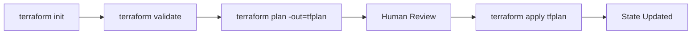
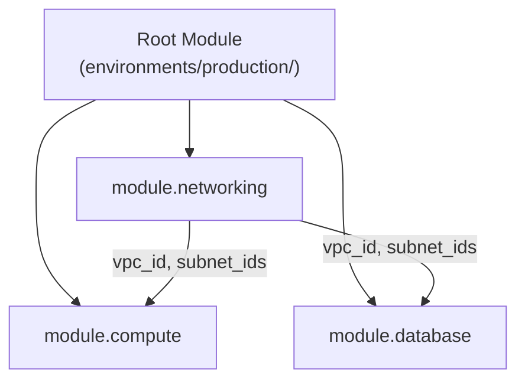

# Terraform & Infrastructure as Code Guide

> **Purpose**: End-to-end reference for managing cloud infrastructure declaratively with Terraform (and its ecosystem) — covering HCL syntax, state management, module design, security, policy-as-code, multi-environment patterns, and CI/CD integration.

> **Prerequisites**: Basic cloud provider knowledge (AWS, GCP, or Azure), Git version control, and command-line familiarity.

---

## Golden Rule

**Infrastructure MUST be defined in code, reviewed in pull requests, and applied through automated pipelines — never manually clicked in a console or applied from a developer laptop.**

---

## 1. HCL Syntax & Project Structure

### 1.1 Recommended Directory Layout

```
infrastructure/
├── modules/                     # Reusable child modules
│   ├── networking/
│   │   ├── main.tf
│   │   ├── variables.tf
│   │   ├── outputs.tf
│   │   └── README.md
│   ├── compute/
│   └── database/
├── environments/                # Root modules — one per environment
│   ├── dev/
│   │   ├── main.tf
│   │   ├── variables.tf
│   │   ├── outputs.tf
│   │   ├── terraform.tfvars
│   │   ├── backend.tf
│   │   └── providers.tf
│   ├── staging/
│   └── production/
├── .terraform-version           # Pin Terraform version (tfenv)
├── .tflint.hcl
└── .pre-commit-config.yaml
```

### 1.2 Core HCL Blocks

```hcl
# providers.tf — pin provider versions explicitly
terraform {
  required_version = ">= 1.7.0, < 2.0.0"

  required_providers {
    aws = {
      source  = "hashicorp/aws"
      version = "~> 5.40"
    }
  }
}

provider "aws" {
  region = var.aws_region

  default_tags {
    tags = {
      Environment = var.environment
      ManagedBy   = "terraform"
      Team        = var.team
    }
  }
}
```

```hcl
# variables.tf
variable "aws_region" {
  description = "AWS region for all resources"
  type        = string
  default     = "us-east-1"

  validation {
    condition     = can(regex("^(us|eu|ap)-(east|west|central|south|north|southeast|northeast)-[1-3]$", var.aws_region))
    error_message = "Must be a valid AWS region identifier."
  }
}

variable "environment" {
  description = "Deployment environment"
  type        = string

  validation {
    condition     = contains(["dev", "staging", "production"], var.environment)
    error_message = "Environment must be dev, staging, or production."
  }
}

variable "vpc_cidr" {
  description = "CIDR block for VPC"
  type        = string
  default     = "10.0.0.0/16"
}
```

```hcl
# outputs.tf
output "vpc_id" {
  description = "ID of the created VPC"
  value       = module.networking.vpc_id
}

output "database_endpoint" {
  description = "RDS endpoint for application configuration"
  value       = module.database.endpoint
  sensitive   = true
}
```

---

## 2. Core Workflow: init → plan → apply



### 2.1 Step-by-Step

```bash
# 1. Initialize — downloads providers, configures backend
terraform init -backend-config=backend.hcl

# 2. Format — enforce canonical HCL style
terraform fmt -recursive -check

# 3. Validate — syntax + provider schema checks
terraform validate

# 4. Plan — preview changes, save binary plan
terraform plan -out=tfplan -var-file=terraform.tfvars

# 5. Apply — execute the saved plan (no re-prompting)
terraform apply tfplan

# 6. Destroy — tear down all managed resources (DANGEROUS)
terraform destroy -var-file=terraform.tfvars
```

> [!CAUTION]
> NEVER run `terraform apply` without a saved plan file in CI/CD. Without `-out=tfplan`, Terraform re-evaluates and may apply different changes than what was reviewed.

---

## 3. State Management

### 3.1 Why Remote State Matters

| Concern | Local State | Remote State |
|---|---|---|
| Collaboration | ❌ Single developer only | ✅ Shared team access |
| Locking | ❌ None | ✅ Prevents concurrent applies |
| Durability | ❌ Lost if disk fails | ✅ Backed by durable storage |
| Secrets in state | ❌ Plaintext on disk | ⚠️ Encrypted at rest (with proper config) |

### 3.2 AWS: S3 + DynamoDB

```hcl
# backend.tf
terraform {
  backend "s3" {
    bucket         = "myorg-terraform-state"
    key            = "production/infrastructure.tfstate"
    region         = "us-east-1"
    encrypt        = true
    dynamodb_table = "terraform-state-lock"
    kms_key_id     = "alias/terraform-state"
  }
}
```

```hcl
# Bootstrap the state backend itself (separate root module)
resource "aws_s3_bucket" "terraform_state" {
  bucket = "myorg-terraform-state"

  lifecycle {
    prevent_destroy = true
  }
}

resource "aws_s3_bucket_versioning" "state_versioning" {
  bucket = aws_s3_bucket.terraform_state.id
  versioning_configuration {
    status = "Enabled"
  }
}

resource "aws_s3_bucket_server_side_encryption_configuration" "state_encryption" {
  bucket = aws_s3_bucket.terraform_state.id
  rule {
    apply_server_side_encryption_by_default {
      sse_algorithm     = "aws:kms"
      kms_master_key_id = aws_kms_key.terraform.arn
    }
  }
}

resource "aws_s3_bucket_public_access_block" "state_public_access" {
  bucket                  = aws_s3_bucket.terraform_state.id
  block_public_acls       = true
  block_public_policy     = true
  ignore_public_acls      = true
  restrict_public_buckets = true
}

resource "aws_dynamodb_table" "terraform_lock" {
  name         = "terraform-state-lock"
  billing_mode = "PAY_PER_REQUEST"
  hash_key     = "LockID"

  attribute {
    name = "LockID"
    type = "S"
  }
}
```

### 3.3 GCP: GCS Backend

```hcl
terraform {
  backend "gcs" {
    bucket = "myorg-terraform-state"
    prefix = "production"
  }
}
```

### 3.4 Terraform Cloud / HCP Terraform

```hcl
terraform {
  cloud {
    organization = "myorg"
    workspaces {
      name = "infrastructure-production"
    }
  }
}
```

### 3.5 State Locking & Consistency

State locking prevents race conditions when multiple engineers or CI pipelines run `terraform apply` concurrently.

| Backend | Lock Mechanism | Notes |
|---|---|---|
| S3 | DynamoDB table (LockID) | MUST create DynamoDB table |
| GCS | Built-in object locking | Automatic |
| Terraform Cloud | Built-in | Run queueing included |
| Azure Blob | Blob lease | Automatic via azurerm backend |

```bash
# Force-unlock (emergency only — verify no other apply is running!)
terraform force-unlock <LOCK_ID>
```

---

## 4. Module Design Patterns

### 4.1 Root vs Child Modules



**Root module** = the directory where you run `terraform apply`. It composes child modules and provides environment-specific configuration.

**Child module** = a reusable package under `modules/` with clear inputs (`variables.tf`) and outputs (`outputs.tf`).

### 4.2 Module Best Practices

```hcl
# ✅ GOOD — well-structured child module
# modules/networking/main.tf

resource "aws_vpc" "this" {
  cidr_block           = var.vpc_cidr
  enable_dns_hostnames = true
  enable_dns_support   = true

  tags = {
    Name = "${var.project}-${var.environment}-vpc"
  }
}

resource "aws_subnet" "private" {
  count             = length(var.availability_zones)
  vpc_id            = aws_vpc.this.id
  cidr_block        = cidrsubnet(var.vpc_cidr, 8, count.index)
  availability_zone = var.availability_zones[count.index]

  tags = {
    Name = "${var.project}-${var.environment}-private-${var.availability_zones[count.index]}"
    "kubernetes.io/role/internal-elb" = "1"
  }
}

resource "aws_subnet" "public" {
  count                   = length(var.availability_zones)
  vpc_id                  = aws_vpc.this.id
  cidr_block              = cidrsubnet(var.vpc_cidr, 8, count.index + 100)
  availability_zone       = var.availability_zones[count.index]
  map_public_ip_on_launch = true

  tags = {
    Name = "${var.project}-${var.environment}-public-${var.availability_zones[count.index]}"
    "kubernetes.io/role/elb" = "1"
  }
}
```

```hcl
# modules/networking/variables.tf
variable "vpc_cidr" {
  description = "CIDR block for the VPC"
  type        = string
}

variable "availability_zones" {
  description = "List of AZs to deploy subnets into"
  type        = list(string)
}

variable "project" {
  description = "Project name for resource tagging"
  type        = string
}

variable "environment" {
  description = "Environment name (dev, staging, production)"
  type        = string
}
```

```hcl
# modules/networking/outputs.tf
output "vpc_id" {
  description = "ID of the VPC"
  value       = aws_vpc.this.id
}

output "private_subnet_ids" {
  description = "IDs of private subnets"
  value       = aws_subnet.private[*].id
}

output "public_subnet_ids" {
  description = "IDs of public subnets"
  value       = aws_subnet.public[*].id
}
```

### 4.3 Calling the Module

```hcl
# environments/production/main.tf
module "networking" {
  source = "../../modules/networking"

  vpc_cidr           = "10.0.0.0/16"
  availability_zones = ["us-east-1a", "us-east-1b", "us-east-1c"]
  project            = "myapp"
  environment        = "production"
}

module "compute" {
  source = "../../modules/compute"

  vpc_id     = module.networking.vpc_id
  subnet_ids = module.networking.private_subnet_ids
  # ...
}
```

---

## 5. Data Sources

Data sources read existing infrastructure without managing it.

```hcl
# Look up the latest Amazon Linux 2023 AMI
data "aws_ami" "al2023" {
  most_recent = true
  owners      = ["amazon"]

  filter {
    name   = "name"
    values = ["al2023-ami-*-x86_64"]
  }

  filter {
    name   = "virtualization-type"
    values = ["hvm"]
  }
}

# Look up existing Route53 zone
data "aws_route53_zone" "primary" {
  name         = "example.com."
  private_zone = false
}

# Reference in resources
resource "aws_instance" "app" {
  ami           = data.aws_ami.al2023.id
  instance_type = "t3.medium"
  # ...
}
```

---

## 6. Provisioners (and Why to Avoid Them)

> [!WARNING]
> Provisioners (`local-exec`, `remote-exec`, `file`) break Terraform's declarative model. They are NOT reflected in state, NOT idempotent, and will NOT be re-run on subsequent applies. Use them ONLY as a last resort.

```hcl
# ❌ BAD — imperative provisioner, fragile and non-idempotent
resource "aws_instance" "app" {
  ami           = data.aws_ami.al2023.id
  instance_type = "t3.medium"

  provisioner "remote-exec" {
    inline = [
      "sudo yum install -y nginx",
      "sudo systemctl start nginx",
    ]
  }
}
```

```hcl
# ✅ GOOD — use user_data (cloud-init) or a pre-baked AMI (Packer)
resource "aws_instance" "app" {
  ami           = data.aws_ami.al2023.id
  instance_type = "t3.medium"

  user_data = base64encode(templatefile("${path.module}/user-data.sh", {
    environment = var.environment
  }))

  user_data_replace_on_change = true
}
```

**Alternatives to provisioners:**

| Need | Solution |
|---|---|
| Install software on VM | Packer AMI / cloud-init `user_data` |
| Configure services | Ansible, Chef, Puppet (run separately) |
| Run scripts after apply | `null_resource` with `local-exec` (still fragile) |
| Wait for resource readiness | Provider-specific waiters or `depends_on` |

---

## 7. Environment Management

### 7.1 Directory-Based (Recommended)

```
environments/
├── dev/
│   ├── main.tf              # Same structure, different tfvars
│   ├── terraform.tfvars      # dev-specific values
│   └── backend.tf            # dev state backend
├── staging/
└── production/
```

Each environment is a completely separate Terraform root module with its own state. This provides **blast-radius isolation** — a bad `apply` in dev cannot affect production.

### 7.2 Workspaces (Limited Use)

```bash
terraform workspace new staging
terraform workspace select production
terraform workspace list
```

```hcl
# Using workspace name in configuration
resource "aws_instance" "app" {
  instance_type = terraform.workspace == "production" ? "m5.2xlarge" : "t3.medium"
  tags = {
    Environment = terraform.workspace
  }
}
```

> [!IMPORTANT]
> Workspaces share the same backend configuration and root module code. They are suitable for **identical infrastructure copies** (e.g., per-developer sandboxes) but NOT for environments with different architectures. Use directory-based separation for dev/staging/production.

---

## 8. Importing Existing Resources

```bash
# Generate import block (Terraform 1.5+)
terraform plan -generate-config-out=generated.tf

# Import block in HCL (preferred over CLI import)
import {
  to = aws_s3_bucket.existing
  id = "my-existing-bucket-name"
}

# Then run plan to see what Terraform would change
terraform plan

# After import, review and align the config to match actual state
```

```hcl
# ❌ BAD — CLI import doesn't generate configuration
# terraform import aws_s3_bucket.existing my-existing-bucket-name
# (You still must write the resource block manually)

# ✅ GOOD — import block + config generation (Terraform ≥ 1.5)
import {
  to = aws_s3_bucket.existing
  id = "my-existing-bucket-name"
}
```

---

## 9. Drift Detection

```bash
# Detect drift — compare state to actual infrastructure
terraform plan -refresh-only

# Apply the refreshed state (update state without changing infra)
terraform apply -refresh-only
```

**Automate drift detection in CI:**

```yaml
# .github/workflows/drift-detection.yml
name: Terraform Drift Detection
on:
  schedule:
    - cron: "0 8 * * 1-5"    # Weekdays at 08:00 UTC

jobs:
  drift:
    runs-on: ubuntu-latest
    steps:
      - uses: actions/checkout@v4
      - uses: hashicorp/setup-terraform@v3
        with:
          terraform_version: "1.7.5"
      - run: terraform init
        working-directory: environments/production
      - run: terraform plan -refresh-only -detailed-exitcode
        working-directory: environments/production
        id: drift
        continue-on-error: true
      - name: Notify on drift
        if: steps.drift.outcome == 'failure'
        run: |
          curl -X POST "$SLACK_WEBHOOK" -d '{
            "text": "⚠️ Terraform drift detected in production!"
          }'
```

---

## 10. Linting, Validation & Policy

### 10.1 terraform fmt & validate

```bash
# Format all HCL files recursively
terraform fmt -recursive

# Check format without modifying (CI gate)
terraform fmt -recursive -check

# Validate configuration syntax and provider schemas
terraform validate
```

### 10.2 tflint

```hcl
# .tflint.hcl
plugin "aws" {
  enabled = true
  version = "0.30.0"
  source  = "github.com/terraform-linters/tflint-ruleset-aws"
}

rule "terraform_naming_convention" {
  enabled = true
  format  = "snake_case"
}

rule "terraform_unused_declarations" {
  enabled = true
}

rule "terraform_documented_variables" {
  enabled = true
}
```

```bash
tflint --init
tflint --recursive
```

### 10.3 Checkov (Policy-as-Code)

```bash
# Scan all Terraform files
checkov -d . --framework terraform

# Run specific checks
checkov -d . --check CKV_AWS_18,CKV_AWS_19

# Skip specific checks with justification
checkov -d . --skip-check CKV_AWS_145 \
  --bc-api-key $BC_API_KEY
```

Common Checkov checks:

| Check ID | Description |
|---|---|
| `CKV_AWS_18` | S3 bucket logging enabled |
| `CKV_AWS_19` | S3 bucket encryption enabled |
| `CKV_AWS_145` | S3 bucket KMS encryption |
| `CKV_AWS_23` | Security group restricts ingress |
| `CKV_AWS_88` | EC2 instance not publicly accessible |
| `CKV2_AWS_5` | Security group attached to resource |

---

## 11. Terragrunt — DRY Multi-Environment Configs

Terragrunt wraps Terraform to eliminate repetition across environments.

```
infrastructure/
├── terragrunt.hcl              # Root config (backend, provider defaults)
├── modules/                    # Terraform child modules (unchanged)
│   ├── networking/
│   ├── compute/
│   └── database/
└── live/
    ├── dev/
    │   ├── networking/
    │   │   └── terragrunt.hcl
    │   ├── compute/
    │   │   └── terragrunt.hcl
    │   └── database/
    │       └── terragrunt.hcl
    ├── staging/
    └── production/
```

```hcl
# Root terragrunt.hcl
remote_state {
  backend = "s3"
  generate = {
    path      = "backend.tf"
    if_exists = "overwrite"
  }
  config = {
    bucket         = "myorg-terraform-state"
    key            = "${path_relative_to_include()}/terraform.tfstate"
    region         = "us-east-1"
    encrypt        = true
    dynamodb_table = "terraform-state-lock"
  }
}

generate "provider" {
  path      = "provider.tf"
  if_exists = "overwrite"
  contents  = <<EOF
provider "aws" {
  region = "${local.aws_region}"
  default_tags {
    tags = {
      Environment = "${local.environment}"
      ManagedBy   = "terraform"
    }
  }
}
EOF
}

locals {
  environment = basename(get_terragrunt_dir())
  aws_region  = "us-east-1"
}
```

```hcl
# live/production/networking/terragrunt.hcl
include "root" {
  path = find_in_parent_folders()
}

terraform {
  source = "../../../modules/networking"
}

inputs = {
  vpc_cidr           = "10.0.0.0/16"
  availability_zones = ["us-east-1a", "us-east-1b", "us-east-1c"]
  project            = "myapp"
  environment        = "production"
}
```

```bash
# Apply all modules in dependency order
cd live/production
terragrunt run-all apply

# Plan a single module
cd live/production/networking
terragrunt plan
```

---

## 12. OpenTofu & Pulumi Comparison

### 12.1 OpenTofu

OpenTofu is a Linux Foundation fork of Terraform, created after HashiCorp changed Terraform's license to BSL in August 2023.

| Aspect | Terraform | OpenTofu |
|---|---|---|
| License | BSL 1.1 (source-available) | MPL 2.0 (truly open source) |
| CLI compatibility | N/A | Drop-in replacement (`tofu` CLI) |
| State encryption | Terraform Cloud only | Built-in client-side encryption |
| Registry | `registry.terraform.io` | `registry.opentofu.org` (mirrors) |
| Provider compat | Full | Full (same provider binaries) |

```bash
# Switch from Terraform to OpenTofu
brew install opentofu     # or apt-get install tofu
tofu init
tofu plan
tofu apply
```

### 12.2 Pulumi

Pulumi uses general-purpose languages instead of HCL.

```python
# Pulumi (Python) — equivalent to the Terraform VPC example
import pulumi_aws as aws

vpc = aws.ec2.Vpc("main",
    cidr_block="10.0.0.0/16",
    enable_dns_hostnames=True,
    tags={"Name": "main-vpc", "ManagedBy": "pulumi"})

subnet = aws.ec2.Subnet("private",
    vpc_id=vpc.id,
    cidr_block="10.0.1.0/24",
    availability_zone="us-east-1a")

pulumi.export("vpc_id", vpc.id)
```

| Aspect | Terraform / OpenTofu | Pulumi |
|---|---|---|
| Language | HCL (DSL) | Python, TypeScript, Go, C#, Java |
| State | Self-managed or Terraform Cloud | Pulumi Cloud or self-managed S3/Azure |
| Learning curve | Low (DSL) | Lower for developers familiar with the language |
| Testing | `terraform test` (limited) | Standard unit test frameworks |
| Plan/diff | Built-in | `pulumi preview` |
| Ecosystem | Largest provider catalog | Uses Terraform providers via bridge |

---

## 13. Provider Patterns by Cloud

### 13.1 AWS

```hcl
# Multi-region pattern
provider "aws" {
  region = "us-east-1"
  alias  = "primary"
}

provider "aws" {
  region = "eu-west-1"
  alias  = "dr"
}

resource "aws_s3_bucket" "primary" {
  provider = aws.primary
  bucket   = "myapp-primary"
}

resource "aws_s3_bucket" "dr" {
  provider = aws.dr
  bucket   = "myapp-dr"
}
```

### 13.2 GCP

```hcl
provider "google" {
  project = var.project_id
  region  = var.region
}

# Enable APIs before creating resources
resource "google_project_service" "apis" {
  for_each = toset([
    "container.googleapis.com",
    "compute.googleapis.com",
    "sqladmin.googleapis.com",
  ])
  service            = each.value
  disable_on_destroy = false
}
```

### 13.3 Azure

```hcl
provider "azurerm" {
  features {}
  subscription_id = var.subscription_id
}

resource "azurerm_resource_group" "main" {
  name     = "rg-${var.project}-${var.environment}"
  location = var.location
}
```

---

## 14. Secrets Handling

### 14.1 SOPS (Mozilla)

Encrypt secret values in `.tfvars` files stored in Git.

```bash
# Encrypt a tfvars file
sops --encrypt --kms arn:aws:kms:us-east-1:123456:key/abc-123 \
  secrets.tfvars > secrets.enc.tfvars

# Decrypt at apply time
sops --decrypt secrets.enc.tfvars > secrets.tfvars
terraform apply -var-file=secrets.tfvars
rm secrets.tfvars   # Clean up decrypted file
```

### 14.2 Vault Provider

```hcl
provider "vault" {
  address = "https://vault.internal.example.com"
}

data "vault_generic_secret" "db_creds" {
  path = "secret/data/production/database"
}

resource "aws_db_instance" "main" {
  engine               = "postgres"
  engine_version       = "16.1"
  instance_class       = "db.r6g.xlarge"
  username             = data.vault_generic_secret.db_creds.data["username"]
  password             = data.vault_generic_secret.db_creds.data["password"]
  skip_final_snapshot  = false

  # ...
}
```

> [!CAUTION]
> Even when using Vault, the secret values end up in Terraform state in **plaintext**. You MUST encrypt state at rest (S3 SSE-KMS, GCS CMEK, or OpenTofu client-side encryption) and restrict state access via IAM.

---

## 15. CI/CD Pipeline Integration

### 15.1 GitHub Actions

```yaml
name: Terraform
on:
  pull_request:
    paths: ["environments/**"]
  push:
    branches: [main]
    paths: ["environments/**"]

permissions:
  id-token: write
  contents: read
  pull-requests: write

jobs:
  plan:
    if: github.event_name == 'pull_request'
    runs-on: ubuntu-latest
    steps:
      - uses: actions/checkout@v4
      - uses: hashicorp/setup-terraform@v3
        with:
          terraform_version: "1.7.5"
      - uses: aws-actions/configure-aws-credentials@v4
        with:
          role-to-assume: arn:aws:iam::123456789:role/terraform-ci
          aws-region: us-east-1
      - name: Terraform Init
        run: terraform init
        working-directory: environments/production
      - name: Terraform Format Check
        run: terraform fmt -check -recursive
      - name: tflint
        run: |
          curl -s https://raw.githubusercontent.com/terraform-linters/tflint/master/install_linux.sh | bash
          tflint --init
          tflint --recursive
      - name: Checkov
        run: |
          pip install checkov
          checkov -d environments/production --framework terraform --quiet
      - name: Terraform Plan
        run: terraform plan -out=tfplan -no-color
        working-directory: environments/production
      - name: Post Plan to PR
        uses: actions/github-script@v7
        with:
          script: |
            const plan = require('fs').readFileSync('environments/production/tfplan.txt', 'utf8');
            github.rest.issues.createComment({
              issue_number: context.issue.number,
              owner: context.repo.owner,
              repo: context.repo.repo,
              body: `## Terraform Plan\n\`\`\`\n${plan.substring(0, 60000)}\n\`\`\``
            });

  apply:
    if: github.ref == 'refs/heads/main' && github.event_name == 'push'
    runs-on: ubuntu-latest
    environment: production     # Requires approval
    steps:
      - uses: actions/checkout@v4
      - uses: hashicorp/setup-terraform@v3
        with:
          terraform_version: "1.7.5"
      - uses: aws-actions/configure-aws-credentials@v4
        with:
          role-to-assume: arn:aws:iam::123456789:role/terraform-ci
          aws-region: us-east-1
      - run: terraform init
        working-directory: environments/production
      - run: terraform apply -auto-approve
        working-directory: environments/production
```

### 15.2 Atlantis

Atlantis is a self-hosted Terraform pull request automation server.

```yaml
# atlantis.yaml (repo-level config)
version: 3
projects:
  - name: production
    dir: environments/production
    workspace: default
    terraform_version: v1.7.5
    autoplan:
      when_modified:
        - "*.tf"
        - "*.tfvars"
        - "../../modules/**/*.tf"
      enabled: true
    apply_requirements:
      - approved
      - mergeable
    workflow: custom

workflows:
  custom:
    plan:
      steps:
        - run: terraform fmt -check -recursive
        - run: tflint --init && tflint
        - init
        - plan
    apply:
      steps:
        - apply
```

### 15.3 Spacelift

Spacelift is a managed Terraform CI/CD platform with policy-as-code (Open Policy Agent), drift detection, and approval workflows built in.

```yaml
# .spacelift/config.yml
version: "1"
stack_defaults:
  terraform_version: "1.7.5"
  before_init:
    - tflint --init && tflint --recursive
  after_plan:
    - checkov -d . --framework terraform --quiet

stacks:
  production:
    project_root: environments/production
    labels:
      - production
    autodeploy: false      # Requires manual approval
```

---

## 16. Common Pitfalls & Anti-Patterns

| Anti-Pattern | Why It's Dangerous | Fix |
|---|---|---|
| Local state file | No locking, no collaboration, no durability | Remote backend (S3, GCS, TF Cloud) |
| `terraform apply` without plan file | May apply different changes than reviewed | Always `plan -out=tfplan` then `apply tfplan` |
| Secrets in `.tfvars` committed to Git | Plaintext credentials in version history | SOPS, Vault, or environment variables |
| Monolithic root module | Blast radius = entire infrastructure | Split into environment-specific root modules |
| Using `count` for named resources | Index shift destroys/recreates resources | Use `for_each` with stable keys |
| Hardcoded provider versions | Surprise breaking changes on `init` | Pin with `~>` or exact version |
| `terraform destroy` without `-target` | Destroys everything | Use `-target` or separate state files |
| Provisioners for config management | Non-idempotent, not in state | Packer AMIs, cloud-init, Ansible |
| Ignoring `prevent_destroy` | Accidental deletion of databases, S3 | Add `lifecycle { prevent_destroy = true }` |
| Not using `moved` blocks | Refactoring destroys + recreates resources | `moved { from = ... to = ... }` |

---

## 17. Security & Performance Considerations

### 17.1 Security

- **State file access**: Treat state as a secret — it contains resource IDs, IP addresses, and any values marked `sensitive`. Restrict S3/GCS access via IAM policies and bucket policies.
- **OIDC authentication**: Use OIDC (OpenID Connect) for CI/CD instead of long-lived IAM access keys. GitHub Actions supports `aws-actions/configure-aws-credentials` with `role-to-assume`.
- **Least-privilege IAM**: The Terraform execution role SHOULD only have permissions needed for the resources it manages. Use IAM Access Analyzer to generate least-privilege policies.
- **Immutable artifacts**: Pin provider versions, use `.terraform.lock.hcl` to lock dependency hashes, and commit the lock file.

### 17.2 Performance

- **Parallelism**: `terraform apply -parallelism=20` (default 10) for large stacks.
- **State splitting**: If `plan` takes minutes, split into smaller root modules per domain (networking, compute, database).
- **Provider caching**: Use `TF_PLUGIN_CACHE_DIR` to avoid re-downloading providers.
- **Plan file size**: Binary plan files can be large; store them as CI artifacts, not in Git.

```bash
# Enable provider caching
export TF_PLUGIN_CACHE_DIR="$HOME/.terraform.d/plugin-cache"
mkdir -p "$TF_PLUGIN_CACHE_DIR"
```

---

## 18. Verification Checklist

- [ ] Remote backend configured with encryption at rest and state locking
- [ ] Provider versions pinned in `required_providers`; `.terraform.lock.hcl` committed
- [ ] All variables have `description`, `type`, and `validation` blocks
- [ ] `terraform fmt -check` and `terraform validate` pass in CI
- [ ] tflint and checkov run as CI gates before merge
- [ ] Secrets NEVER stored in `.tfvars` or HCL — use Vault, SOPS, or env vars
- [ ] CI/CD uses OIDC authentication, not long-lived access keys
- [ ] `plan -out=tfplan` saved and applied; no bare `apply` in pipelines
- [ ] Critical resources have `lifecycle { prevent_destroy = true }`
- [ ] Environments use directory-based separation with isolated state files
- [ ] Drift detection runs on a daily schedule with alerting
- [ ] Modules follow single-responsibility; root modules compose child modules
- [ ] `for_each` used instead of `count` for resources with meaningful keys
- [ ] `moved` blocks used for refactoring instead of destroy + recreate
- [ ] State access restricted via IAM to only CI/CD roles and senior engineers

---

## Cross-References

- [Kubernetes & Cloud Infrastructure Guide](./kubernetes-cloud.md) — The workloads that run on the infrastructure provisioned by Terraform.
