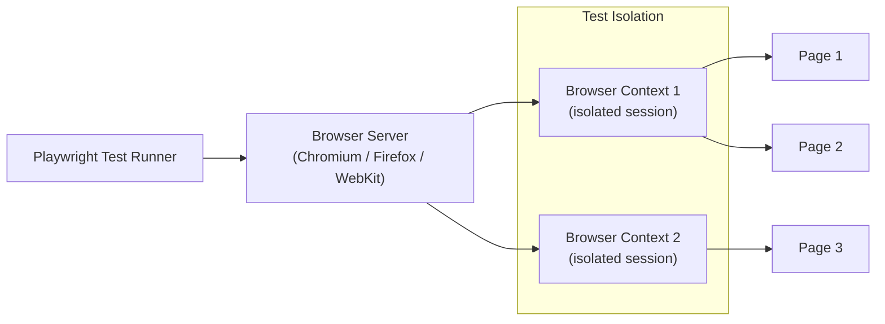

# End-to-End Testing with Playwright Guide

> **Purpose**: Provide a production-grade reference for building, organizing, and scaling end-to-end (E2E) tests using [Playwright](https://playwright.dev/) (v1.47+) — covering architecture, patterns, CI integration, visual regression, accessibility, and debugging.

> **Prerequisites**: Working knowledge of TypeScript/JavaScript, HTML/CSS selectors, a web application to test, and Node.js 18+.

---

## Core Philosophy

**Golden Rule**: E2E tests MUST simulate real user behavior through resilient locators and auto-waiting — never relying on fragile CSS selectors, arbitrary timeouts, or implementation details.

---

## 1. Playwright Architecture



**Key Concepts**:

| Concept | Description |
|---|---|
| **Browser** | A single browser instance (Chromium, Firefox, or WebKit) |
| **Browser Context** | An isolated session — equivalent to an incognito window. Each context has its own cookies, storage, and cache |
| **Page** | A single tab within a context |
| **Locator** | A lazy, auto-waiting element reference that re-queries the DOM on each action |

Each test gets a fresh `BrowserContext` and `Page` by default, ensuring complete isolation without restarting the browser.

---

## 2. Project Setup & Configuration

```bash
# Initialize a new Playwright project
npm init playwright@latest
# Installs: @playwright/test, browsers, example tests
```

### playwright.config.ts

```typescript
import { defineConfig, devices } from "@playwright/test";

export default defineConfig({
  testDir: "./tests/e2e",
  fullyParallel: true,
  forbidOnly: !!process.env.CI,
  retries: process.env.CI ? 2 : 0,
  workers: process.env.CI ? 4 : undefined,
  reporter: process.env.CI
    ? [["html", { open: "never" }], ["github"]]
    : [["html", { open: "on-failure" }]],

  use: {
    baseURL: process.env.BASE_URL ?? "http://localhost:3000",
    trace: "on-first-retry",
    screenshot: "only-on-failure",
    video: "on-first-retry",
  },

  projects: [
    // Desktop browsers
    { name: "chromium", use: { ...devices["Desktop Chrome"] } },
    { name: "firefox", use: { ...devices["Desktop Firefox"] } },
    { name: "webkit", use: { ...devices["Desktop Safari"] } },

    // Mobile viewports
    { name: "mobile-chrome", use: { ...devices["Pixel 7"] } },
    { name: "mobile-safari", use: { ...devices["iPhone 15"] } },
  ],

  webServer: {
    command: "npm run dev",
    url: "http://localhost:3000",
    reuseExistingServer: !process.env.CI,
    timeout: 30_000,
  },
});
```

---

## 3. Locator Strategies

Playwright provides semantic, user-facing locators that SHOULD be preferred over CSS/XPath selectors.

### Priority Order (Most to Least Preferred)

```typescript
import { test, expect } from "@playwright/test";

test("locator strategy examples", async ({ page }) => {
  await page.goto("/signup");

  // 1. Role-based (BEST — maps to accessibility tree)
  const submitButton = page.getByRole("button", { name: "Create Account" });
  const emailInput = page.getByRole("textbox", { name: "Email address" });
  const agreeCheckbox = page.getByRole("checkbox", { name: "I agree to terms" });

  // 2. Test ID (good for components without accessible names)
  const avatar = page.getByTestId("user-avatar");

  // 3. Text-based (good for static content)
  const heading = page.getByText("Welcome to Acme");
  const label = page.getByLabel("Password");
  const placeholder = page.getByPlaceholder("Enter your email");

  // 4. CSS / XPath (LAST RESORT — fragile)
  // ❌ AVOID: page.locator(".btn-primary.submit-form")
  // ❌ AVOID: page.locator("//div[@class='form']/button[2]")

  await emailInput.fill("test@example.com");
  await agreeCheckbox.check();
  await submitButton.click();
});
```

### Good vs. Bad Locators

```typescript
// ✅ GOOD: Resilient, user-facing
page.getByRole("button", { name: "Submit" });
page.getByLabel("Email");
page.getByTestId("checkout-total");

// ❌ BAD: Fragile, implementation-coupled
page.locator("#root > div:nth-child(3) > button.primary");
page.locator(".MuiButton-root.MuiButton-containedPrimary");
page.locator('[class*="styles_submitBtn"]');
```

> [!IMPORTANT]
> Add `data-testid` attributes to your components for elements that lack unique accessible roles or text. This is far more stable than CSS class selectors.

---

## 4. Page Object Model (POM) Pattern

The POM pattern encapsulates page interactions into reusable classes, improving test maintainability.

### Page Object

```typescript
// tests/e2e/pages/login.page.ts
import { type Page, type Locator, expect } from "@playwright/test";

export class LoginPage {
  readonly page: Page;
  readonly emailInput: Locator;
  readonly passwordInput: Locator;
  readonly submitButton: Locator;
  readonly errorBanner: Locator;

  constructor(page: Page) {
    this.page = page;
    this.emailInput = page.getByLabel("Email");
    this.passwordInput = page.getByLabel("Password");
    this.submitButton = page.getByRole("button", { name: "Sign in" });
    this.errorBanner = page.getByRole("alert");
  }

  async goto() {
    await this.page.goto("/login");
  }

  async login(email: string, password: string) {
    await this.emailInput.fill(email);
    await this.passwordInput.fill(password);
    await this.submitButton.click();
  }

  async expectError(message: string) {
    await expect(this.errorBanner).toContainText(message);
  }
}
```

### Test Using the POM

```typescript
// tests/e2e/auth/login.spec.ts
import { test, expect } from "@playwright/test";
import { LoginPage } from "../pages/login.page";

test.describe("Authentication", () => {
  let loginPage: LoginPage;

  test.beforeEach(async ({ page }) => {
    loginPage = new LoginPage(page);
    await loginPage.goto();
  });

  test("successful login redirects to dashboard", async ({ page }) => {
    await loginPage.login("admin@example.com", "SecureP@ss1");
    await expect(page).toHaveURL("/dashboard");
    await expect(page.getByRole("heading", { name: "Dashboard" })).toBeVisible();
  });

  test("invalid credentials show error", async () => {
    await loginPage.login("admin@example.com", "wrong");
    await loginPage.expectError("Invalid email or password");
  });
});
```

---

## 5. Test Fixtures & Hooks

### Custom Fixtures

```typescript
// tests/e2e/fixtures.ts
import { test as base, expect } from "@playwright/test";
import { LoginPage } from "./pages/login.page";
import { DashboardPage } from "./pages/dashboard.page";

type MyFixtures = {
  loginPage: LoginPage;
  dashboardPage: DashboardPage;
  authenticatedPage: DashboardPage;
};

export const test = base.extend<MyFixtures>({
  loginPage: async ({ page }, use) => {
    const loginPage = new LoginPage(page);
    await loginPage.goto();
    await use(loginPage);
  },

  dashboardPage: async ({ page }, use) => {
    await use(new DashboardPage(page));
  },

  authenticatedPage: async ({ page }, use) => {
    // Pre-authenticate before handing to the test
    await page.goto("/login");
    const login = new LoginPage(page);
    await login.login("admin@example.com", "SecureP@ss1");
    await expect(page).toHaveURL("/dashboard");
    await use(new DashboardPage(page));
  },
});

export { expect };
```

```typescript
// Usage in tests
import { test, expect } from "../fixtures";

test("dashboard shows recent activity", async ({ authenticatedPage }) => {
  await expect(
    authenticatedPage.page.getByRole("heading", { name: "Recent Activity" })
  ).toBeVisible();
});
```

---

## 6. Authentication State Reuse (storageState)

Logging in via the UI before every test is slow. Use `storageState` to authenticate once and reuse the session.

### Global Setup

```typescript
// tests/e2e/auth.setup.ts
import { test as setup, expect } from "@playwright/test";

const authFile = "tests/e2e/.auth/user.json";

setup("authenticate", async ({ page }) => {
  await page.goto("/login");
  await page.getByLabel("Email").fill("admin@example.com");
  await page.getByLabel("Password").fill("SecureP@ss1");
  await page.getByRole("button", { name: "Sign in" }).click();

  await expect(page).toHaveURL("/dashboard");

  // Save signed-in state to file
  await page.context().storageState({ path: authFile });
});
```

### Config Integration

```typescript
// In playwright.config.ts
export default defineConfig({
  projects: [
    // Setup project — runs auth first
    { name: "setup", testMatch: /.*\.setup\.ts/ },

    // Dependent projects reuse stored auth state
    {
      name: "chromium",
      use: {
        ...devices["Desktop Chrome"],
        storageState: "tests/e2e/.auth/user.json",
      },
      dependencies: ["setup"],
    },
  ],
});
```

> [!TIP]
> Add `tests/e2e/.auth/` to `.gitignore`. Auth state files contain session tokens and MUST NOT be committed to version control.

---

## 7. Network Interception & Mocking

```typescript
test("displays fallback UI when API fails", async ({ page }) => {
  // Mock a failing API response
  await page.route("**/api/products", (route) =>
    route.fulfill({
      status: 500,
      contentType: "application/json",
      body: JSON.stringify({ error: "Internal Server Error" }),
    })
  );

  await page.goto("/products");
  await expect(page.getByText("Something went wrong")).toBeVisible();
  await expect(page.getByRole("button", { name: "Retry" })).toBeVisible();
});

test("intercepts and modifies API response", async ({ page }) => {
  await page.route("**/api/products", async (route) => {
    const response = await route.fetch(); // Forward to real server
    const json = await response.json();

    // Inject a test product
    json.products.unshift({
      id: "test-001",
      name: "Test Product",
      price: 9.99,
    });

    await route.fulfill({ response, json });
  });

  await page.goto("/products");
  await expect(page.getByText("Test Product")).toBeVisible();
});

test("waits for specific API call", async ({ page }) => {
  const responsePromise = page.waitForResponse(
    (res) => res.url().includes("/api/orders") && res.status() === 200
  );

  await page.getByRole("button", { name: "Place Order" }).click();

  const response = await responsePromise;
  const body = await response.json();
  expect(body.orderId).toBeDefined();
});
```

---

## 8. Auto-Waiting & Assertions

Playwright auto-waits for elements to be actionable before performing actions. Combined with web-first assertions, this eliminates most flakiness.

```typescript
// ✅ GOOD: Web-first assertions (auto-retry until timeout)
await expect(page.getByRole("alert")).toBeVisible();
await expect(page.getByRole("heading")).toHaveText("Dashboard");
await expect(page.getByTestId("cart-count")).toHaveText("3");
await expect(page).toHaveURL(/\/dashboard/);
await expect(page).toHaveTitle("My App — Dashboard");

// ❌ BAD: Manual waits and non-retrying assertions
await page.waitForTimeout(3000); // Never use arbitrary timeouts!
const text = await page.locator("h1").textContent();
expect(text).toBe("Dashboard"); // Does not auto-retry — flaky!
```

> [!CAUTION]
> Never use `page.waitForTimeout()` in production tests. It causes both false positives (passes only because the delay was long enough) and slow tests. Use web-first assertions or `waitForResponse` / `waitForURL` instead.

---

## 9. Visual Regression Testing

```typescript
test("homepage visual regression", async ({ page }) => {
  await page.goto("/");

  // Full page screenshot comparison
  await expect(page).toHaveScreenshot("homepage.png", {
    fullPage: true,
    maxDiffPixelRatio: 0.01, // Allow 1% pixel difference
  });
});

test("component visual regression", async ({ page }) => {
  await page.goto("/components/button");

  const button = page.getByRole("button", { name: "Primary Action" });
  await expect(button).toHaveScreenshot("primary-button.png", {
    animations: "disabled", // Freeze animations for determinism
  });
});

test("responsive visual regression", async ({ page }) => {
  await page.setViewportSize({ width: 375, height: 812 });
  await page.goto("/");
  await expect(page).toHaveScreenshot("homepage-mobile.png", {
    fullPage: true,
  });
});
```

**Updating Snapshots**:

```bash
# Regenerate all visual snapshots
npx playwright test --update-snapshots
```

> [!NOTE]
> Visual snapshots are platform-dependent (font rendering differs across OSes). Run snapshot generation in CI on the same Docker image used for testing (e.g., `mcr.microsoft.com/playwright:v1.47.0-jammy`).

---

## 10. Video Recording & Trace Viewer

### Configuration

```typescript
// playwright.config.ts
use: {
  video: "on-first-retry",    // Record video only when retrying failures
  trace: "on-first-retry",    // Capture full trace on retries
  screenshot: "only-on-failure",
}
```

### Debugging with Trace Viewer

```bash
# Open the trace viewer for a failed test
npx playwright show-trace test-results/auth-login-chromium/trace.zip
```

The Trace Viewer provides:
- **Timeline**: Step-by-step action replay
- **DOM Snapshots**: Full DOM state at each action
- **Network Log**: All HTTP requests/responses
- **Console Log**: Browser console output
- **Source**: Test code mapped to each step

```typescript
// Programmatic trace control within a test
test("complex workflow with trace", async ({ page, context }) => {
  await context.tracing.start({ screenshots: true, snapshots: true });

  await page.goto("/checkout");
  // ... complex steps ...

  await context.tracing.stop({ path: "checkout-trace.zip" });
});
```

---

## 11. Multi-Tab & Multi-Window Testing

```typescript
test("OAuth popup flow", async ({ page, context }) => {
  await page.goto("/login");

  // Listen for new page (popup) BEFORE triggering it
  const popupPromise = context.waitForEvent("page");
  await page.getByRole("button", { name: "Sign in with Google" }).click();

  const popup = await popupPromise;
  await popup.waitForLoadState();

  // Interact with the OAuth popup
  await popup.getByLabel("Email").fill("user@gmail.com");
  await popup.getByRole("button", { name: "Next" }).click();

  // After OAuth completes, popup closes and main page redirects
  await expect(page).toHaveURL("/dashboard");
});

test("multi-tab workflow", async ({ context }) => {
  const page1 = await context.newPage();
  const page2 = await context.newPage();

  await page1.goto("/admin/products");
  await page2.goto("/shop");

  // Admin creates a product
  await page1.getByRole("button", { name: "Add Product" }).click();
  await page1.getByLabel("Name").fill("New Widget");
  await page1.getByRole("button", { name: "Save" }).click();

  // Customer sees it immediately
  await page2.reload();
  await expect(page2.getByText("New Widget")).toBeVisible();
});
```

---

## 12. Mobile Viewport Testing

```typescript
// In playwright.config.ts, projects section:
{
  name: "mobile-chrome",
  use: {
    ...devices["Pixel 7"],
    // Pixel 7: viewport 412×915, deviceScaleFactor 2.625, isMobile true, hasTouch true
  },
},
{
  name: "mobile-safari",
  use: {
    ...devices["iPhone 15"],
  },
},
```

```typescript
test("mobile navigation uses hamburger menu", async ({ page, isMobile }) => {
  await page.goto("/");

  if (isMobile) {
    // Mobile: nav links are hidden behind hamburger
    await expect(page.getByRole("navigation")).not.toBeVisible();
    await page.getByRole("button", { name: "Menu" }).click();
    await expect(page.getByRole("navigation")).toBeVisible();
  }

  await page.getByRole("link", { name: "Products" }).click();
  await expect(page).toHaveURL("/products");
});
```

---

## 13. Accessibility Testing with @axe-core/playwright

```bash
npm install -D @axe-core/playwright@^4.9.1
```

```typescript
import { test, expect } from "@playwright/test";
import AxeBuilder from "@axe-core/playwright";

test.describe("Accessibility", () => {
  test("homepage has no critical a11y violations", async ({ page }) => {
    await page.goto("/");

    const results = await new AxeBuilder({ page })
      .withTags(["wcag2a", "wcag2aa", "wcag21a", "wcag21aa"])
      .exclude(".third-party-widget") // Exclude elements you don't control
      .analyze();

    expect(results.violations).toEqual([]);
  });

  test("login form is accessible", async ({ page }) => {
    await page.goto("/login");

    const results = await new AxeBuilder({ page })
      .include("form") // Scope scan to the login form only
      .analyze();

    // Detailed failure message
    const violationMessages = results.violations.map(
      (v) => `${v.id}: ${v.description} (${v.impact}) — ${v.helpUrl}`
    );
    expect(violationMessages).toEqual([]);
  });
});
```

> [!IMPORTANT]
> Run accessibility scans on *every page and major interaction state* (modals, dropdowns, error states). A page can pass in its default state but fail when a dialog is open.

---

## 14. CI Parallelization (Sharding)

### GitHub Actions with Sharding

```yaml
# .github/workflows/e2e.yml
name: E2E Tests
on: [push]

jobs:
  e2e:
    runs-on: ubuntu-latest
    container:
      image: mcr.microsoft.com/playwright:v1.47.0-jammy
    strategy:
      fail-fast: false
      matrix:
        shardIndex: [1, 2, 3, 4]
        shardTotal: [4]
    steps:
      - uses: actions/checkout@v4
      - uses: actions/setup-node@v4
        with:
          node-version: 20
          cache: npm
      - run: npm ci

      - name: Run Playwright tests
        run: npx playwright test --shard=${{ matrix.shardIndex }}/${{ matrix.shardTotal }}

      - name: Upload test results
        if: ${{ !cancelled() }}
        uses: actions/upload-artifact@v4
        with:
          name: playwright-report-${{ matrix.shardIndex }}
          path: playwright-report/
          retention-days: 7

      - name: Upload blob report (for merging)
        if: ${{ !cancelled() }}
        uses: actions/upload-artifact@v4
        with:
          name: blob-report-${{ matrix.shardIndex }}
          path: blob-report/
          retention-days: 1

  merge-reports:
    if: ${{ !cancelled() }}
    needs: e2e
    runs-on: ubuntu-latest
    steps:
      - uses: actions/checkout@v4
      - uses: actions/setup-node@v4
        with:
          node-version: 20
          cache: npm
      - run: npm ci

      - name: Download blob reports
        uses: actions/download-artifact@v4
        with:
          pattern: blob-report-*
          merge-multiple: true
          path: all-blob-reports

      - name: Merge reports
        run: npx playwright merge-reports --reporter html ./all-blob-reports

      - name: Upload merged HTML report
        uses: actions/upload-artifact@v4
        with:
          name: playwright-report-merged
          path: playwright-report/
          retention-days: 30
```

---

## 15. Playwright Test Reporter Configuration

```typescript
// playwright.config.ts
export default defineConfig({
  reporter: [
    // Always generate HTML report
    ["html", { outputFolder: "playwright-report", open: "never" }],

    // JUnit XML for CI integration
    ["junit", { outputFile: "test-results/junit.xml" }],

    // JSON for programmatic processing
    ["json", { outputFile: "test-results/results.json" }],

    // Console output during local dev
    ["list"],

    // GitHub Actions annotations
    ...(process.env.CI ? [["github"] as const] : []),
  ],
});
```

---

## 16. Performance Testing with Playwright

Playwright can capture Web Vitals and performance metrics, though it is NOT a replacement for dedicated load testing tools.

```typescript
test("page load performance", async ({ page }) => {
  await page.goto("/products");

  // Navigation Timing API
  const timing = await page.evaluate(() => {
    const nav = performance.getEntriesByType("navigation")[0] as PerformanceNavigationTiming;
    return {
      domContentLoaded: nav.domContentLoadedEventEnd - nav.startTime,
      fullLoad: nav.loadEventEnd - nav.startTime,
      ttfb: nav.responseStart - nav.requestStart,
    };
  });

  expect(timing.ttfb).toBeLessThan(800);           // TTFB < 800ms
  expect(timing.domContentLoaded).toBeLessThan(2000); // DCL < 2s
  expect(timing.fullLoad).toBeLessThan(4000);       // Full load < 4s
});

test("measure Largest Contentful Paint", async ({ page }) => {
  // Collect LCP via PerformanceObserver
  const lcpPromise = page.evaluate(() => {
    return new Promise<number>((resolve) => {
      new PerformanceObserver((list) => {
        const entries = list.getEntries();
        const last = entries[entries.length - 1];
        resolve(last.startTime);
      }).observe({ type: "largest-contentful-paint", buffered: true });
    });
  });

  await page.goto("/");
  const lcp = await lcpPromise;
  expect(lcp).toBeLessThan(2500); // LCP < 2.5s (Good threshold)
});
```

---

## 17. Security & Performance Considerations

### Security

| Risk | Mitigation |
|---|---|
| Auth tokens in `storageState` files | Add `.auth/` to `.gitignore`; never commit session files |
| Test credentials in source code | Store in CI secrets / environment variables |
| Screenshots/videos with sensitive data | Restrict artifact access; set short retention policies |
| Network mocks masking real vulnerabilities | Run a subset of tests against real APIs in staging |

### Performance

| Concern | Recommendation |
|---|---|
| Slow test suite | Shard across CI matrix; use `fullyParallel: true` |
| Slow auth | Reuse `storageState` instead of UI login per test |
| Flaky visual snapshots | Pin CI to the Playwright Docker image; disable animations |
| Large trace files | Use `trace: "on-first-retry"` instead of `trace: "on"` |
| Browser download time in CI | Use `mcr.microsoft.com/playwright` Docker image with pre-installed browsers |

---

## 18. Common Pitfalls & Anti-Patterns

| ❌ Anti-Pattern | ✅ Better Approach |
|---|---|
| `page.waitForTimeout(5000)` | Use `await expect(locator).toBeVisible()` or `page.waitForURL()` |
| `page.locator(".btn-submit")` | `page.getByRole("button", { name: "Submit" })` |
| Logging in via UI in every test | Use `storageState` for auth reuse |
| Giant test files with 50+ tests | Split into focused spec files by feature |
| Testing third-party UI (OAuth popups) | Mock OAuth at the network level; test only *your* redirect handler |
| Hardcoded `localhost:3000` | Use `baseURL` in config; override via `BASE_URL` env var |
| Ignoring accessibility | Add `@axe-core/playwright` scans to every critical page |
| Running only Chromium in CI | Test across Chromium, Firefox, and WebKit via projects |
| Not using Trace Viewer for debugging | Set `trace: "on-first-retry"` and use `npx playwright show-trace` |
| Screenshot assertions without `maxDiffPixelRatio` | Set `maxDiffPixelRatio: 0.01` to tolerate anti-aliasing differences |

---

## 19. Verification Checklist

Before merging E2E test changes, verify:

- [ ] All locators use semantic strategies (`getByRole`, `getByLabel`, `getByTestId`) — no raw CSS selectors
- [ ] Zero `waitForTimeout()` calls — all waits use web-first assertions or `waitForResponse`/`waitForURL`
- [ ] Page Object Model is used for pages with ≥ 3 tests interacting with the same elements
- [ ] Authentication uses `storageState` — not UI login in every test
- [ ] Tests pass on Chromium, Firefox, and WebKit (`npx playwright test --project=chromium --project=firefox --project=webkit`)
- [ ] Visual regression snapshots are generated inside the Playwright Docker image (not on a developer laptop)
- [ ] Accessibility scans run on all critical pages and interactive states
- [ ] CI pipeline uses sharding (`--shard`) with ≥ 2 shards and merges reports
- [ ] `trace: "on-first-retry"` is configured for CI debugging
- [ ] `.auth/` directory is in `.gitignore`
- [ ] `webServer` config starts the app automatically in CI
- [ ] Test suite completes in < 15 minutes per shard in CI

---

## Related Resources

- [Integration Testing & Contract Testing](./integration-contract.md)
- [Playwright Official Documentation](https://playwright.dev/docs/intro)
- [Playwright Best Practices](https://playwright.dev/docs/best-practices)
- [@axe-core/playwright](https://github.com/dequelabs/axe-core-npm/tree/develop/packages/playwright)
- [Playwright Docker Images](https://playwright.dev/docs/docker)
