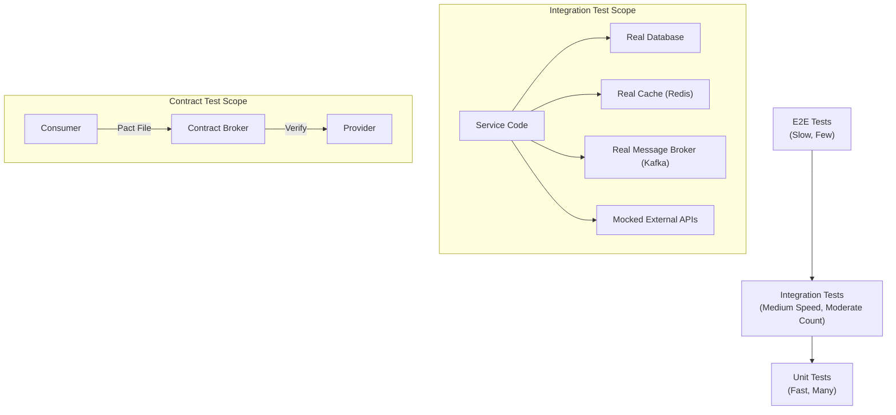
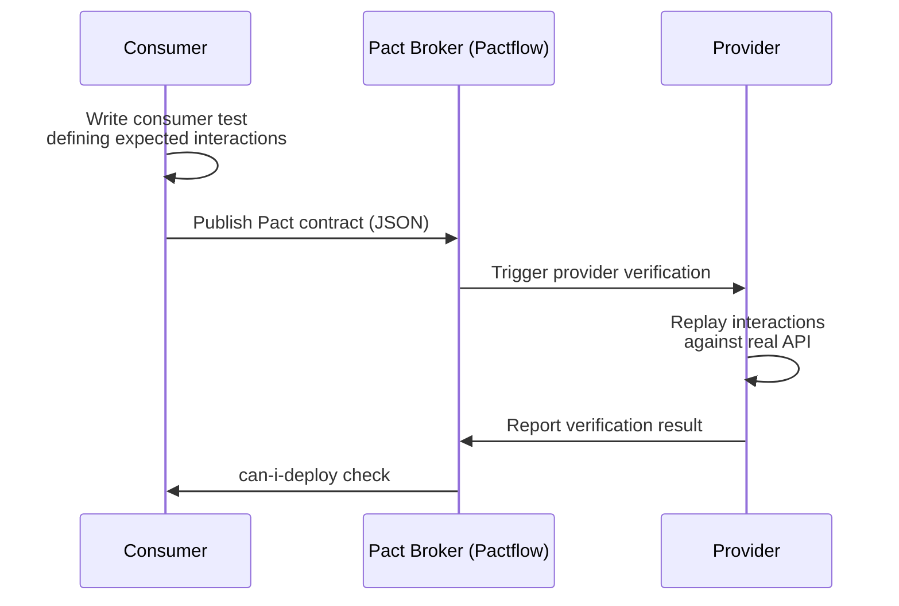

# Integration Testing & Contract Testing Guide

> **Purpose**: Provide a comprehensive reference for writing reliable integration tests that verify component interactions and contract tests that enforce API agreements between services — enabling teams to catch integration failures early without relying solely on expensive end-to-end tests.

> **Prerequisites**: Familiarity with unit testing frameworks (pytest, JUnit, Jest), Docker basics, REST/event-driven API concepts, and CI/CD pipelines.

---

## Core Philosophy

**Golden Rule**: Integration tests MUST verify the *real* interaction between components — not mocked approximations — while contract tests MUST enforce *agreed-upon API shapes* between consumers and providers independently.

---

## 1. Architecture & Testing Pyramid Context



Integration tests sit between unit and E2E tests. They exercise real infrastructure (databases, caches, message brokers) but mock *external* third-party services to maintain determinism and speed.

---

## 2. Testcontainers for Real Infrastructure

[Testcontainers](https://testcontainers.com/) spins up lightweight, disposable Docker containers for databases, caches, and message brokers during test execution.

### 2.1 Java (JUnit 5 + Testcontainers 1.19+)

```java
// build.gradle.kts
// testImplementation("org.testcontainers:testcontainers:1.19.8")
// testImplementation("org.testcontainers:postgresql:1.19.8")
// testImplementation("org.testcontainers:junit-jupiter:1.19.8")

import org.testcontainers.containers.PostgreSQLContainer;
import org.testcontainers.junit.jupiter.Container;
import org.testcontainers.junit.jupiter.Testcontainers;
import org.junit.jupiter.api.Test;
import java.sql.*;
import static org.junit.jupiter.api.Assertions.*;

@Testcontainers
class UserRepositoryIntegrationTest {

    @Container
    static PostgreSQLContainer<?> postgres = new PostgreSQLContainer<>("postgres:16-alpine")
            .withDatabaseName("testdb")
            .withUsername("test")
            .withPassword("test")
            .withInitScript("schema.sql");

    @Test
    void shouldPersistAndRetrieveUser() throws SQLException {
        String jdbcUrl = postgres.getJdbcUrl();
        try (Connection conn = DriverManager.getConnection(
                jdbcUrl, postgres.getUsername(), postgres.getPassword())) {

            PreparedStatement insert = conn.prepareStatement(
                    "INSERT INTO users (name, email) VALUES (?, ?)");
            insert.setString(1, "Alice");
            insert.setString(2, "alice@example.com");
            insert.executeUpdate();

            PreparedStatement select = conn.prepareStatement(
                    "SELECT name FROM users WHERE email = ?");
            select.setString(1, "alice@example.com");
            ResultSet rs = select.executeQuery();

            assertTrue(rs.next());
            assertEquals("Alice", rs.getString("name"));
        }
    }
}
```

### 2.2 Python (pytest + testcontainers-python 4.x)

```python
# requirements-test.txt
# testcontainers[postgres]==4.7.2
# psycopg2-binary==2.9.9
# pytest==8.3.2

import pytest
from testcontainers.postgres import PostgresContainer
import psycopg2


@pytest.fixture(scope="module")
def postgres_db():
    """Spin up a real PostgreSQL container for the test module."""
    with PostgresContainer("postgres:16-alpine") as pg:
        conn = psycopg2.connect(
            host=pg.get_container_host_ip(),
            port=pg.get_exposed_port(5432),
            user=pg.username,
            password=pg.password,
            dbname=pg.dbname,
        )
        conn.autocommit = True
        with conn.cursor() as cur:
            cur.execute("""
                CREATE TABLE users (
                    id SERIAL PRIMARY KEY,
                    name VARCHAR(100) NOT NULL,
                    email VARCHAR(255) UNIQUE NOT NULL
                )
            """)
        yield conn
        conn.close()


def test_insert_and_retrieve_user(postgres_db):
    conn = postgres_db
    with conn.cursor() as cur:
        cur.execute(
            "INSERT INTO users (name, email) VALUES (%s, %s)",
            ("Bob", "bob@example.com"),
        )
        cur.execute("SELECT name FROM users WHERE email = %s", ("bob@example.com",))
        row = cur.fetchone()

    assert row is not None
    assert row[0] == "Bob"
```

### 2.3 Node.js (Jest + testcontainers 10.x)

```typescript
// package.json devDependencies:
// "testcontainers": "^10.10.0"
// "@jest/globals": "^29.7.0"

import { PostgreSqlContainer, StartedPostgreSqlContainer } from "testcontainers";
import { Client } from "pg";
import { describe, it, expect, beforeAll, afterAll } from "@jest/globals";

describe("UserRepository Integration", () => {
  let container: StartedPostgreSqlContainer;
  let client: Client;

  beforeAll(async () => {
    container = await new PostgreSqlContainer("postgres:16-alpine").start();
    client = new Client({
      host: container.getHost(),
      port: container.getPort(),
      database: container.getDatabase(),
      user: container.getUsername(),
      password: container.getPassword(),
    });
    await client.connect();
    await client.query(`
      CREATE TABLE users (
        id SERIAL PRIMARY KEY,
        name VARCHAR(100) NOT NULL,
        email VARCHAR(255) UNIQUE NOT NULL
      )
    `);
  }, 60_000);

  afterAll(async () => {
    await client.end();
    await container.stop();
  });

  it("should persist and retrieve a user", async () => {
    await client.query("INSERT INTO users (name, email) VALUES ($1, $2)", [
      "Charlie",
      "charlie@example.com",
    ]);

    const result = await client.query(
      "SELECT name FROM users WHERE email = $1",
      ["charlie@example.com"]
    );

    expect(result.rows[0].name).toBe("Charlie");
  });
});
```

### 2.4 Redis & Kafka Testcontainers

```python
# Redis
from testcontainers.redis import RedisContainer

@pytest.fixture(scope="module")
def redis_client():
    with RedisContainer("redis:7-alpine") as redis:
        import redis as r
        client = r.Redis(
            host=redis.get_container_host_ip(),
            port=redis.get_exposed_port(6379),
            decode_responses=True,
        )
        yield client


# Kafka
from testcontainers.kafka import KafkaContainer

@pytest.fixture(scope="module")
def kafka_bootstrap():
    with KafkaContainer("confluentinc/cp-kafka:7.6.1") as kafka:
        yield kafka.get_bootstrap_server()
```

---

## 3. Database Fixtures & Factories

### 3.1 Factory Boy (Python)

```python
# pip install factory-boy==3.3.0 faker==28.0.0
import factory
from factory import fuzzy
from myapp.models import User, Order


class UserFactory(factory.Factory):
    class Meta:
        model = User

    name = factory.Faker("name")
    email = factory.LazyAttribute(lambda obj: f"{obj.name.lower().replace(' ', '.')}@test.com")
    role = fuzzy.FuzzyChoice(["admin", "editor", "viewer"])


class OrderFactory(factory.Factory):
    class Meta:
        model = Order

    user = factory.SubFactory(UserFactory)
    total_cents = factory.Faker("random_int", min=100, max=100_000)
    currency = "USD"
    status = "pending"


# Usage in tests
def test_order_total_display():
    order = OrderFactory(total_cents=4999, currency="USD")
    assert order.display_total() == "$49.99"
```

### 3.2 @faker-js/faker (Node.js)

```typescript
// npm install -D @faker-js/faker@9.0.0
import { faker } from "@faker-js/faker";

interface User {
  id: string;
  name: string;
  email: string;
  role: "admin" | "editor" | "viewer";
}

function buildUser(overrides: Partial<User> = {}): User {
  return {
    id: faker.string.uuid(),
    name: faker.person.fullName(),
    email: faker.internet.email(),
    role: faker.helpers.arrayElement(["admin", "editor", "viewer"]),
    ...overrides,
  };
}

// Usage
const admin = buildUser({ role: "admin" });
const users = Array.from({ length: 50 }, () => buildUser());
```

### 3.3 Test Database Seeding Strategies

| Strategy | When to Use | Trade-offs |
|---|---|---|
| **Per-test factory creation** | Each test creates its own data | Slowest; perfect isolation |
| **Module-level seed script** | Shared read-only reference data | Fast; risk of cross-test coupling |
| **Snapshot restore** | Large datasets (100k+ rows) | Fast startup; complex setup |
| **SQL fixture files** | Schema + seed in version control | Portable; manual maintenance |

> [!TIP]
> Use per-test factories for write-path tests and module-level seeds for read-only query tests.

---

## 4. Test Isolation Strategies

### 4.1 Transaction Rollback

Each test runs inside a database transaction that is rolled back after completion. This is the fastest approach.

```python
# pytest + SQLAlchemy
@pytest.fixture(autouse=True)
def db_session(engine):
    connection = engine.connect()
    transaction = connection.begin()
    session = Session(bind=connection)
    yield session
    session.close()
    transaction.rollback()   # All writes disappear
    connection.close()
```

**Limitation**: Cannot test code that issues its own `COMMIT` or manages transactions internally.

### 4.2 Table Truncation

After each test, truncate all tables. Slower but works with any transaction strategy.

```python
@pytest.fixture(autouse=True)
def clean_tables(db_session):
    yield
    for table in reversed(Base.metadata.sorted_tables):
        db_session.execute(table.delete())
    db_session.commit()
```

### Good vs. Bad Isolation

```python
# ✅ GOOD: Each test is independent
def test_create_user(db_session):
    user = UserFactory()
    db_session.add(user)
    db_session.flush()
    assert db_session.query(User).count() == 1

def test_list_users_empty(db_session):
    # Does NOT depend on test_create_user's side effects
    assert db_session.query(User).count() == 0


# ❌ BAD: Tests share mutable state
users_created = []

def test_create_user(db_session):
    user = UserFactory()
    users_created.append(user)        # Shared mutable state!
    db_session.add(user)

def test_list_users(db_session):
    assert len(users_created) == 1    # Depends on execution order!
```

---

## 5. Consumer-Driven Contract Testing with Pact

### 5.1 How Pact Works



### 5.2 Consumer Side (Node.js — @pact-foundation/pact v13)

```typescript
// npm install -D @pact-foundation/pact@^13.1.0
import { PactV4, MatchersV3 } from "@pact-foundation/pact";
import { resolve } from "path";

const { like, eachLike, string, integer } = MatchersV3;

const provider = new PactV4({
  consumer: "OrderService",
  provider: "UserService",
  dir: resolve(process.cwd(), "pacts"),
});

describe("UserService Contract", () => {
  it("returns a user by ID", async () => {
    await provider
      .addInteraction()
      .given("user 42 exists")
      .uponReceiving("a request for user 42")
      .withRequest("GET", "/api/users/42", (builder) => {
        builder.headers({ Accept: "application/json" });
      })
      .willRespondWith(200, (builder) => {
        builder
          .headers({ "Content-Type": "application/json" })
          .jsonBody(
            like({
              id: integer(42),
              name: string("Alice"),
              email: string("alice@example.com"),
            })
          );
      })
      .executeTest(async (mockServer) => {
        const response = await fetch(`${mockServer.url}/api/users/42`, {
          headers: { Accept: "application/json" },
        });
        const body = await response.json();
        expect(response.status).toBe(200);
        expect(body).toHaveProperty("id");
        expect(body).toHaveProperty("email");
      });
  });
});
```

### 5.3 Provider Verification (Python — pact-python 2.x)

```python
# pip install pact-python==2.2.1
from pact import Verifier

def test_provider_honors_contracts():
    verifier = Verifier(
        provider="UserService",
        provider_base_url="http://localhost:8080",
    )
    output, logs = verifier.verify_with_broker(
        broker_url="https://your-org.pactflow.io",
        broker_token="your-read-only-token",
        publish_version="1.0.0",
        provider_states_setup_url="http://localhost:8080/_pact/setup",
        enable_pending=True,
        include_wip_pacts_since="2024-01-01",
    )
    assert output == 0, f"Provider verification failed:\n{logs}"
```

### 5.4 Contract Broker (Pactflow)

Pactflow (or the open-source Pact Broker) stores contracts and verification results.

**Key Workflow Commands**:

```bash
# Publish consumer pact
pact-broker publish ./pacts \
  --consumer-app-version=$(git rev-parse --short HEAD) \
  --branch=$(git branch --show-current) \
  --broker-base-url=https://your-org.pactflow.io \
  --broker-token=$PACT_BROKER_TOKEN

# Can I Deploy? (gate CI/CD pipeline)
pact-broker can-i-deploy \
  --pacticipant=OrderService \
  --version=$(git rev-parse --short HEAD) \
  --to-environment=production \
  --broker-base-url=https://your-org.pactflow.io \
  --broker-token=$PACT_BROKER_TOKEN
```

> [!IMPORTANT]
> Always run `can-i-deploy` as a CI gate before deploying either consumers or providers to production. This prevents deploying a version whose contracts have not been verified.

---

## 6. API Schema Testing

Validate that API responses conform to an OpenAPI/JSON Schema specification.

```python
# pip install schemathesis==3.33.2
import schemathesis

schema = schemathesis.from_url("http://localhost:8080/openapi.json")

@schema.parametrize()
def test_api_conforms_to_schema(case):
    response = case.call()
    case.validate_response(response)
```

```typescript
// Jest + ajv for JSON Schema validation
// npm install -D ajv@^8.17.1 ajv-formats@^3.0.1
import Ajv from "ajv";
import addFormats from "ajv-formats";

const ajv = new Ajv({ allErrors: true });
addFormats(ajv);

const userSchema = {
  type: "object",
  properties: {
    id: { type: "integer" },
    name: { type: "string", minLength: 1 },
    email: { type: "string", format: "email" },
    created_at: { type: "string", format: "date-time" },
  },
  required: ["id", "name", "email", "created_at"],
  additionalProperties: false,
};

it("GET /users/:id matches schema", async () => {
  const res = await fetch("http://localhost:8080/api/users/1");
  const body = await res.json();
  const validate = ajv.compile(userSchema);
  const valid = validate(body);
  expect(valid).toBe(true);
  if (!valid) console.error(validate.errors);
});
```

---

## 7. Mocking External Services

### 7.1 WireMock (Java / Standalone)

```java
// testImplementation("org.wiremock:wiremock:3.8.0")
import com.github.tomakehurst.wiremock.junit5.WireMockTest;
import static com.github.tomakehurst.wiremock.client.WireMock.*;

@WireMockTest(httpPort = 9090)
class PaymentGatewayTest {

    @Test
    void shouldHandlePaymentSuccess() {
        stubFor(post(urlEqualTo("/v1/charges"))
            .willReturn(okJson("""
                {"id": "ch_1234", "status": "succeeded", "amount": 5000}
            """)));

        PaymentResult result = paymentService.charge("tok_visa", 5000);

        assertEquals("succeeded", result.status());
        verify(postRequestedFor(urlEqualTo("/v1/charges"))
            .withRequestBody(matchingJsonPath("$.amount", equalTo("5000"))));
    }
}
```

### 7.2 responses (Python)

```python
# pip install responses==0.25.3
import responses
import requests

@responses.activate
def test_external_api_timeout():
    responses.add(
        responses.GET,
        "https://api.stripe.com/v1/charges/ch_1234",
        json={"error": {"message": "timeout"}},
        status=504,
    )

    result = payment_client.get_charge("ch_1234")
    assert result.is_error
    assert result.should_retry is True
```

### 7.3 nock (Node.js)

```typescript
// npm install -D nock@^14.0.0
import nock from "nock";

describe("PaymentClient", () => {
  afterEach(() => nock.cleanAll());

  it("retries on 502", async () => {
    nock("https://api.stripe.com")
      .get("/v1/charges/ch_1234")
      .reply(502)
      .get("/v1/charges/ch_1234")
      .reply(200, { id: "ch_1234", status: "succeeded" });

    const charge = await paymentClient.getCharge("ch_1234");
    expect(charge.status).toBe("succeeded");
    expect(nock.isDone()).toBe(true); // Both requests were made
  });
});
```

---

## 8. Testing Event-Driven Architectures

```python
# Testing a Kafka consumer with testcontainers
from confluent_kafka import Producer, Consumer
import json, time

def test_order_event_processing(kafka_bootstrap):
    # Produce an event
    producer = Producer({"bootstrap.servers": kafka_bootstrap})
    event = {"order_id": "ord-123", "status": "paid", "amount_cents": 4999}
    producer.produce("orders.paid", json.dumps(event).encode())
    producer.flush(timeout=5)

    # Consume and verify processing
    consumer = Consumer({
        "bootstrap.servers": kafka_bootstrap,
        "group.id": "test-group",
        "auto.offset.reset": "earliest",
    })
    consumer.subscribe(["orders.processed"])

    messages = []
    deadline = time.time() + 10
    while time.time() < deadline and not messages:
        msg = consumer.poll(timeout=1.0)
        if msg and not msg.error():
            messages.append(json.loads(msg.value()))

    consumer.close()

    assert len(messages) == 1
    assert messages[0]["order_id"] == "ord-123"
    assert messages[0]["fulfillment_status"] == "ready"
```

> [!WARNING]
> Event-driven tests are inherently asynchronous. Always use polling with a deadline rather than fixed `time.sleep()` calls. A `sleep(5)` that works locally may flake in CI.

---

## 9. Snapshot Testing for API Responses

```typescript
// Jest snapshot testing for API responses
it("GET /api/users/42 response shape", async () => {
  const res = await fetch(`${baseUrl}/api/users/42`);
  const body = await res.json();

  // Redact volatile fields before snapshotting
  const sanitized = {
    ...body,
    id: expect.any(Number),
    created_at: expect.any(String),
  };

  expect(sanitized).toMatchSnapshot();
});
```

```python
# pytest with syrupy (snapshot testing)
# pip install syrupy==4.6.1
def test_user_api_response_shape(client, snapshot):
    response = client.get("/api/users/42")
    data = response.json()
    # Replace volatile fields
    data["created_at"] = "REDACTED"
    data["id"] = "REDACTED"
    assert data == snapshot
```

> [!TIP]
> Always redact timestamps, UUIDs, and auto-increment IDs before snapshotting to prevent false negatives.

---

## 10. Docker Compose Test Environments

```yaml
# docker-compose.test.yml
services:
  postgres:
    image: postgres:16-alpine
    environment:
      POSTGRES_DB: testdb
      POSTGRES_USER: test
      POSTGRES_PASSWORD: test
    ports:
      - "5433:5432"
    healthcheck:
      test: ["CMD-SHELL", "pg_isready -U test -d testdb"]
      interval: 2s
      timeout: 5s
      retries: 10

  redis:
    image: redis:7-alpine
    ports:
      - "6380:6379"
    healthcheck:
      test: ["CMD", "redis-cli", "ping"]
      interval: 2s
      timeout: 5s
      retries: 10

  localstack:
    image: localstack/localstack:3.6
    ports:
      - "4566:4566"
    environment:
      SERVICES: s3,sqs,sns
```

```bash
# CI script
docker compose -f docker-compose.test.yml up -d --wait
pytest tests/integration/ --tb=short -q
docker compose -f docker-compose.test.yml down -v
```

---

## 11. CI Parallelization of Integration Tests

```yaml
# .github/workflows/integration-tests.yml
name: Integration Tests
on: [push]

jobs:
  integration:
    runs-on: ubuntu-latest
    strategy:
      fail-fast: false
      matrix:
        shard: [1, 2, 3, 4]
    services:
      postgres:
        image: postgres:16-alpine
        env:
          POSTGRES_DB: testdb
          POSTGRES_USER: test
          POSTGRES_PASSWORD: test
        ports:
          - 5432:5432
        options: >-
          --health-cmd="pg_isready -U test"
          --health-interval=5s
          --health-timeout=5s
          --health-retries=5
    steps:
      - uses: actions/checkout@v4
      - uses: actions/setup-python@v5
        with:
          python-version: "3.12"
      - run: pip install -r requirements-test.txt
      - run: |
          pytest tests/integration/ \
            --splits=4 \
            --group=${{ matrix.shard }} \
            --splitting-algorithm=least_duration \
            -q --tb=short
```

> [!NOTE]
> The `pytest-split` plugin uses historical test durations (stored in `.test_durations`) to balance shards evenly. Commit this file to version control and regenerate periodically.

---

## 12. Security & Performance Considerations

### Security

| Risk | Mitigation |
|---|---|
| Leaked credentials in test containers | Use static, non-production passwords; never reuse prod secrets |
| Container escape in CI | Pin image tags to digests; run rootless Docker |
| Pact broker token exposure | Store as CI secret; use read-only tokens for consumers |
| Test data in snapshot files | Scrub PII before committing snapshots |

### Performance

| Concern | Recommendation |
|---|---|
| Container startup time | Use `reuse=True` (Testcontainers) for local dev; singleton containers |
| Parallel test interference | Each shard gets its own database schema or separate container |
| Flaky network mocks | Use deterministic stubs; avoid `time.sleep` |
| Large Docker images | Prefer `-alpine` variants; cache layers in CI |

---

## 13. Common Pitfalls & Anti-Patterns

| ❌ Anti-Pattern | ✅ Better Approach |
|---|---|
| Testing against shared staging DB | Each test run gets its own disposable container |
| Mocking the database in integration tests | Use a real database — that is the point of integration tests |
| Sharing state between tests via module globals | Use per-test fixtures with rollback or truncation |
| Hardcoding `localhost:5432` | Read dynamic port from Testcontainers: `container.get_exposed_port(5432)` |
| Skipping `can-i-deploy` in CI | Always gate deployments on contract verification |
| Recording snapshots with volatile fields | Redact timestamps, IDs, and random values before snapshot |
| `time.sleep(10)` in async event tests | Poll with a deadline using a retry loop |
| Running all integration tests serially | Shard tests across CI matrix jobs using `pytest-split` or Jest `--shard` |

---

## 14. Verification Checklist

Before merging integration or contract test changes, verify:

- [ ] All Testcontainers use pinned image tags (e.g., `postgres:16-alpine`, not `postgres:latest`)
- [ ] Each test is isolated — rerunning a single test in any order produces the same result
- [ ] No `time.sleep()` calls without a polling loop and deadline
- [ ] External service mocks assert that all expected requests were made (`nock.isDone()`, `verify()`)
- [ ] Pact contracts are published with `--consumer-app-version` set to the Git SHA
- [ ] `can-i-deploy` runs as a required CI gate before production deployment
- [ ] Snapshot files are committed with volatile fields redacted
- [ ] CI integration tests run in < 10 minutes per shard
- [ ] Docker Compose test files include `healthcheck` for every service
- [ ] Test database credentials are static, non-production values stored in test config only

---

## Related Resources

- [End-to-End Testing with Playwright](./e2e-playwright.md)
- [Testcontainers Documentation](https://testcontainers.com/)
- [Pact Documentation](https://docs.pact.io/)
- [Pactflow Platform](https://pactflow.io/)
- [Schemathesis for API Testing](https://schemathesis.readthedocs.io/)
