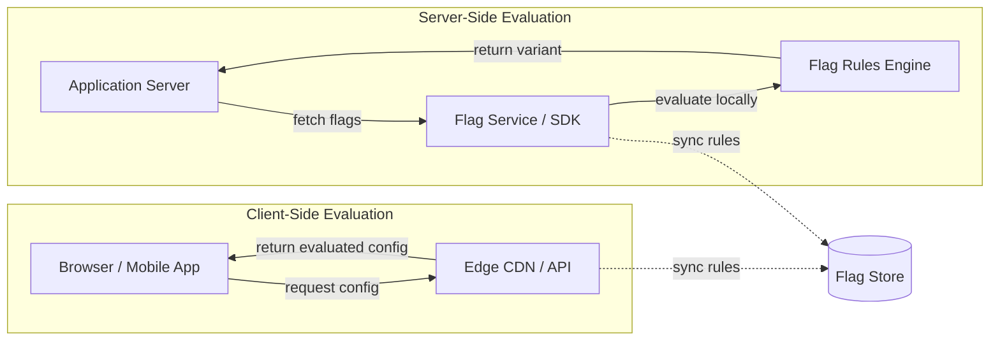
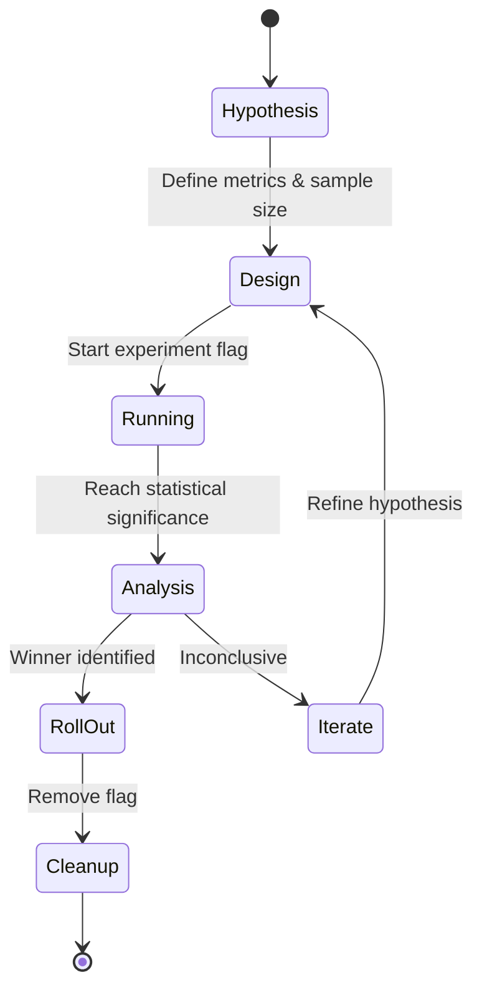

# Feature Flags & Progressive Delivery Guide

> **Purpose**: Define production-grade patterns for feature flag management, progressive delivery, and experiment-driven development that enable safe, continuous deployment at scale.

> **Prerequisites**: Trunk-based development workflow, CI/CD pipeline fundamentals, basic statistics knowledge for A/B testing, familiarity with at least one feature flag platform.

---

## Core Philosophy

**Every deployment MUST be decoupled from every release** — code ships continuously behind flags; features activate independently through runtime configuration, not code pushes.

---

## 1. Feature Flag Taxonomy

Not all flags are equal. Each type has a distinct lifecycle, ownership model, and hygiene expectation.

| Type | Purpose | Lifetime | Owner | Example |
|------|---------|----------|-------|---------|
| **Release** | Gate incomplete features during development | Days–weeks | Engineering | `enable_new_checkout_flow` |
| **Experiment** | A/B test variations for data-driven decisions | Weeks–months | Product/Data | `experiment_pricing_page_v2` |
| **Ops** | Runtime operational controls (circuit breakers, kill switches) | Permanent | SRE/Platform | `enable_redis_cache_fallback` |
| **Permission** | Entitlement-based access control | Permanent | Product | `feature_advanced_analytics` |

### Naming Conventions

```
# Pattern: <type>_<domain>_<description>

# Good
release_checkout_apple_pay
experiment_onboarding_wizard_v2
ops_search_elasticsearch_circuit_breaker
permission_team_sso_enforcement

# Bad
new_feature           # No type prefix, no domain
flag1                 # Meaningless
temp_fix_jan2024      # Date-based, no semantic meaning
```

> [!IMPORTANT]
> Every flag MUST have a defined type at creation time. This determines its lifecycle policy, cleanup cadence, and alerting thresholds.

---

## 2. Architecture & Evaluation Models

### Server-Side vs Client-Side Evaluation



| Aspect | Server-Side | Client-Side |
|--------|-------------|-------------|
| Latency | Sub-millisecond (local eval) | Network round-trip on init |
| Security | Flag rules never exposed | Rules/segments visible to client |
| Targeting granularity | Full context available | Limited to client-known attributes |
| Use case | Backend services, APIs | UI components, frontend experiments |

### SDK Integration Pattern (Server-Side)

```python
# Python example using OpenFeature SDK (v0.7+)
from openfeature import api
from openfeature.contrib.provider.flagd import FlagdProvider

# Initialize once at application startup
api.set_provider(FlagdProvider(
    host="flagd.internal.svc.cluster.local",
    port=8013,
    cache_type="lru",
    max_cache_size=1000,
))

client = api.get_client()

def get_checkout_flow(user_context: dict) -> str:
    """Evaluate which checkout flow variant to serve."""
    evaluation_context = {
        "targetingKey": user_context["user_id"],
        "email": user_context["email"],
        "plan": user_context["plan"],
        "country": user_context["country"],
    }

    variant = client.get_string_value(
        flag_key="release_checkout_flow_variant",
        default_value="legacy",
        evaluation_context=evaluation_context,
    )
    return variant
```

### SDK Integration Pattern (Client-Side)

```typescript
// React example using OpenFeature Web SDK (v1.0+)
import { OpenFeature } from "@openfeature/web-sdk";
import { LaunchDarklyClientProvider } from "@launchdarkly/openfeature-browser-provider";

// Initialize at app bootstrap
const provider = new LaunchDarklyClientProvider("client-side-sdk-key", {
  streaming: true, // Real-time flag updates via SSE
});
await OpenFeature.setProviderAndWait(provider);

// In a React component
import { useFlag } from "@openfeature/react-sdk";

function CheckoutButton() {
  const showNewCheckout = useFlag("release_checkout_apple_pay", false);

  return showNewCheckout.value ? (
    <ApplePayCheckout />
  ) : (
    <LegacyCheckout />
  );
}
```

---

## 3. Progressive Delivery Strategies

### Percentage-Based Rollouts

```yaml
# flagd flag definition (OpenFeature-compatible)
flags:
  release_new_search_engine:
    state: ENABLED
    variants:
      "on": true
      "off": false
    defaultVariant: "off"
    targeting:
      fractional:
        - ["on", 10]   # 10% of users get the new search
        - ["off", 90]
```

**Rollout schedule (example):**

| Day | Percentage | Monitoring Gate |
|-----|-----------|-----------------|
| 0 | 1% (internal dogfood) | Error rate, latency P99 |
| 1 | 5% | Same + user feedback signals |
| 3 | 25% | Business metrics (conversion, engagement) |
| 7 | 50% | Full statistical significance check |
| 10 | 100% | All gates green → remove flag |

### User Segment Targeting

```yaml
# Target by plan tier AND geography
flags:
  experiment_pricing_page_v2:
    state: ENABLED
    variants:
      control: "pricing_v1"
      treatment: "pricing_v2"
    defaultVariant: "control"
    targeting:
      if:
        - in:
            - var: plan
            - ["enterprise", "business"]
        - if:
            - in:
                - var: country
                - ["US", "CA", "GB"]
            - "treatment"
            - "control"
        - "control"
```

### Dark Launches & Shadow Traffic

Dark launches evaluate new code paths in production without exposing results to users:

```python
import asyncio
import time
from dataclasses import dataclass
from openfeature import api

client = api.get_client()

@dataclass
class DarkLaunchResult:
    primary_result: dict
    shadow_result: dict | None
    shadow_latency_ms: float | None
    shadow_error: str | None

async def search_with_dark_launch(query: str, user_ctx: dict) -> DarkLaunchResult:
    """Execute primary search; optionally shadow-test new engine."""
    dark_launch_enabled = client.get_boolean_value(
        "ops_search_dark_launch_new_engine", False, user_ctx
    )

    # Always run primary
    primary_result = await search_legacy(query)

    shadow_result = None
    shadow_latency_ms = None
    shadow_error = None

    if dark_launch_enabled:
        start = time.monotonic()
        try:
            shadow_result = await asyncio.wait_for(
                search_new_engine(query), timeout=2.0
            )
            shadow_latency_ms = (time.monotonic() - start) * 1000
        except Exception as e:
            shadow_error = str(e)
            shadow_latency_ms = (time.monotonic() - start) * 1000

        # Emit comparison metrics — NEVER return shadow result to user
        emit_dark_launch_metrics(
            flag="ops_search_dark_launch_new_engine",
            primary_latency_ms=primary_result.latency_ms,
            shadow_latency_ms=shadow_latency_ms,
            results_match=compare_results(primary_result, shadow_result),
            shadow_error=shadow_error,
        )

    return DarkLaunchResult(
        primary_result=primary_result.data,
        shadow_result=shadow_result,
        shadow_latency_ms=shadow_latency_ms,
        shadow_error=shadow_error,
    )
```

---

## 4. Kill Switches for Emergency Rollback

Ops flags that act as circuit breakers MUST be pre-provisioned and tested before incidents occur.

```python
# Kill switch pattern — immediate feature disable without deployment
KILL_SWITCHES = {
    "ops_payments_stripe_enabled": {
        "fallback": "ops_payments_paypal_fallback",
        "alert_channel": "#payments-oncall",
        "runbook": "https://wiki.internal/runbooks/payments-failover",
    },
    "ops_search_enabled": {
        "fallback": "ops_search_degraded_mode",
        "alert_channel": "#search-oncall",
        "runbook": "https://wiki.internal/runbooks/search-degraded",
    },
}

def process_payment(order, user_ctx):
    if not client.get_boolean_value("ops_payments_stripe_enabled", True, user_ctx):
        # Kill switch tripped — use fallback processor
        logger.warning("Kill switch active: payments falling back to PayPal")
        return process_payment_paypal(order)
    return process_payment_stripe(order)
```

> [!CAUTION]
> Kill switch defaults MUST be the **safe** value. If the flag service is unreachable, the default should keep the system operational — typically `True` for existing features and `False` for new, untested paths.

---

## 5. A/B Testing & Experiment Analysis

### Experiment Lifecycle



### Statistical Rigor Requirements

| Parameter | Requirement |
|-----------|-------------|
| Significance level (α) | 0.05 (95% confidence) |
| Statistical power (1-β) | 0.80 minimum |
| Minimum detectable effect | Define BEFORE experiment starts |
| Sample size | Pre-calculate; do NOT peek early |
| Correction method | Bonferroni for multiple comparisons |

```python
from scipy import stats
import math

def calculate_sample_size(
    baseline_rate: float,
    minimum_detectable_effect: float,
    alpha: float = 0.05,
    power: float = 0.80,
) -> int:
    """Calculate required sample size per variant for a two-proportion z-test."""
    p1 = baseline_rate
    p2 = baseline_rate + minimum_detectable_effect
    effect_size = abs(p2 - p1) / math.sqrt((p1 * (1 - p1) + p2 * (1 - p2)) / 2)
    z_alpha = stats.norm.ppf(1 - alpha / 2)
    z_beta = stats.norm.ppf(power)
    n = ((z_alpha + z_beta) / effect_size) ** 2
    return math.ceil(n)

# Example: 5% baseline conversion, detect 0.5% absolute lift
sample_size = calculate_sample_size(0.05, 0.005)
# Returns ~31,234 per variant
```

> [!WARNING]
> **Peeking invalidates results.** Do NOT check experiment results before the pre-calculated sample size is reached. Use sequential testing methods (e.g., CUPED or always-valid p-values) if early stopping is required.

---

## 6. Flag Lifecycle Management

### Lifecycle Stages

```
CREATE → ENABLE → MEASURE → REMOVE
  │         │         │         │
  │         │         │         └─ Delete flag, remove code branches
  │         │         └─ Validate metrics, reach rollout target
  │         └─ Progressive rollout begins
  └─ Flag registered with metadata, default OFF
```

### Flag Metadata Schema

Every flag MUST be registered with structured metadata:

```json
{
  "key": "release_checkout_apple_pay",
  "type": "release",
  "owner": "team-payments",
  "created": "2025-03-15",
  "expected_removal": "2025-04-15",
  "jira_ticket": "PAY-1234",
  "description": "Gates Apple Pay integration in checkout flow",
  "dependencies": [],
  "kill_switch": false,
  "cleanup_alert_days": 30
}
```

### Stale Flag Detection & Cleanup

```python
"""
Stale flag detector — run weekly via CI/CD or cron.
Scans codebase for flag references and cross-references with flag service.
"""
import subprocess
import json
from datetime import datetime, timedelta

STALENESS_THRESHOLDS = {
    "release": timedelta(days=30),
    "experiment": timedelta(days=90),
    "ops": None,          # Ops flags MAY be permanent
    "permission": None,   # Permission flags MAY be permanent
}

def find_stale_flags(flags: list[dict]) -> list[dict]:
    """Identify flags that have exceeded their type-specific lifetime."""
    stale = []
    now = datetime.utcnow()

    for flag in flags:
        threshold = STALENESS_THRESHOLDS.get(flag["type"])
        if threshold is None:
            continue

        created = datetime.fromisoformat(flag["created"])
        age = now - created

        if age > threshold:
            # Verify the flag is still referenced in code
            grep_result = subprocess.run(
                ["grep", "-r", flag["key"], "src/", "--include=*.py", "--include=*.ts", "-l"],
                capture_output=True, text=True,
            )
            code_references = grep_result.stdout.strip().split("\n") if grep_result.stdout.strip() else []

            stale.append({
                "key": flag["key"],
                "type": flag["type"],
                "age_days": age.days,
                "threshold_days": threshold.days,
                "owner": flag["owner"],
                "code_references": code_references,
                "ticket": flag.get("jira_ticket", "NONE"),
            })

    return stale
```

> [!TIP]
> Automate stale flag reports into Slack/Teams weekly. Include a direct link to the flag in your flag management UI and the owning team. Teams SHOULD have OKRs around flag cleanup velocity.

---

## 7. Flag Dependencies & Prerequisites

Flags MAY depend on other flags. Model these explicitly to prevent inconsistent states.

```yaml
# Dependency example: Apple Pay requires new checkout flow
flags:
  release_checkout_new_flow:
    state: ENABLED
    # ... targeting rules

  release_checkout_apple_pay:
    state: ENABLED
    prerequisites:
      - flagKey: release_checkout_new_flow
        targetVariant: "on"    # Apple Pay only evaluates if new flow is ON
    # ... targeting rules
```

```python
# Application-level dependency enforcement
FLAG_PREREQUISITES = {
    "release_checkout_apple_pay": ["release_checkout_new_flow"],
    "release_checkout_crypto_pay": ["release_checkout_new_flow"],
}

def evaluate_with_prerequisites(flag_key: str, user_ctx: dict) -> bool:
    """Evaluate flag only if all prerequisites are met."""
    prerequisites = FLAG_PREREQUISITES.get(flag_key, [])

    for prereq in prerequisites:
        if not client.get_boolean_value(prereq, False, user_ctx):
            return False  # Prerequisite not met

    return client.get_boolean_value(flag_key, False, user_ctx)
```

---

## 8. Testing with Feature Flags

### Unit Testing: Test All Variants

```python
import pytest
from unittest.mock import patch

class TestCheckoutFlow:
    """Every flag-gated code path MUST have tests for ALL variants."""

    @patch("myapp.flags.client.get_string_value", return_value="legacy")
    def test_checkout_legacy_flow(self, mock_flag):
        result = process_checkout(order, user)
        assert result.flow == "legacy"
        assert result.payment_methods == ["credit_card", "paypal"]

    @patch("myapp.flags.client.get_string_value", return_value="new_v2")
    def test_checkout_new_flow(self, mock_flag):
        result = process_checkout(order, user)
        assert result.flow == "new_v2"
        assert "apple_pay" in result.payment_methods

    @patch("myapp.flags.client.get_string_value", side_effect=Exception("SDK timeout"))
    def test_checkout_flag_service_unavailable(self, mock_flag):
        """MUST fall back to safe default when flag service is down."""
        result = process_checkout(order, user)
        assert result.flow == "legacy"  # Safe default
```

### Integration Testing: Flag Override Headers

```python
# FastAPI middleware for test-environment flag overrides
from fastapi import Request

ALLOW_FLAG_OVERRIDES = os.getenv("ENVIRONMENT") in ("test", "staging")

async def flag_override_middleware(request: Request, call_next):
    """Allow flag overrides via headers in non-production environments."""
    if ALLOW_FLAG_OVERRIDES:
        overrides = {}
        for header, value in request.headers.items():
            if header.startswith("x-flag-override-"):
                flag_key = header.replace("x-flag-override-", "").replace("-", "_")
                overrides[flag_key] = value
        request.state.flag_overrides = overrides

    response = await call_next(request)
    return response
```

> [!CAUTION]
> Flag override mechanisms MUST be disabled in production. Guard with explicit environment checks — never rely on "it won't be called" assumptions.

---

## 9. Platform Comparison

| Feature | LaunchDarkly | Unleash (v5) | Flagsmith | Statsig |
|---------|-------------|--------------|-----------|---------|
| **Pricing model** | Per-seat | Open-source + Enterprise | Open-source + Cloud | Per-event |
| **OpenFeature support** | Yes (official provider) | Yes (official provider) | Yes (community) | Yes (official) |
| **Server-side SDKs** | 25+ languages | 15+ languages | 12+ languages | 10+ languages |
| **Experimentation** | Built-in | Requires add-on | Basic | Advanced (Bayesian) |
| **Edge evaluation** | Yes (Relay Proxy) | Yes (Edge API) | Yes (Edge Proxy) | No |
| **Self-hosted option** | No | Yes | Yes | No |
| **Audit log** | Yes | Enterprise only | Yes | Yes |
| **Flag dependencies** | Yes (prerequisites) | Yes (v5+) | No | No |
| **Stale flag detection** | Yes (code refs) | No | No | No |
| **Approval workflows** | Yes | Enterprise only | Yes | Yes |

### Decision Matrix

- **Startup / Cost-sensitive**: Unleash OSS or Flagsmith OSS self-hosted
- **Enterprise / Full-featured**: LaunchDarkly or Statsig
- **Experiment-heavy / Data-driven**: Statsig (Bayesian engine) or LaunchDarkly
- **Regulatory / Air-gapped**: Unleash or Flagsmith self-hosted

---

## 10. Security & Performance Considerations

### Security

| Attack Vector | Mitigation |
|---------------|------------|
| Flag key enumeration via client SDK | Use server-side evaluation for sensitive flags; client SDKs SHOULD only receive evaluated results, not rule definitions |
| Unauthorized flag changes | Enforce RBAC + approval workflows; require MR-based flag config changes for production |
| SDK key leakage | Rotate client-side keys quarterly; use short-lived tokens where supported |
| Flag poisoning (malicious flag values) | Validate flag values at evaluation time; never use flag values as raw SQL, shell commands, or template inputs |

### Performance

| Concern | Guideline |
|---------|-----------|
| Evaluation latency | Server-side local evaluation SHOULD be < 1ms; use LRU caching for flag rules |
| SDK initialization | Lazy-load client SDKs; cache bootstrap payload for offline/cold-start scenarios |
| Network resilience | SDKs MUST cache last-known-good state; evaluate from cache if flag service is unreachable |
| Bundle size (client) | Typical client SDK is 10–30 KB gzipped; evaluate if tree-shaking is supported |

---

## 11. Common Pitfalls & Anti-Patterns

| Anti-Pattern | Why It's Dangerous | Correct Approach |
|-------------|-------------------|-----------------|
| Long-lived release flags | Accumulates dead code branches; increases cognitive load and merge conflicts | Set max lifetime (30 days); alert on expiry |
| Nested flag dependencies without modeling | Combinatorial explosion of states; untestable | Explicitly model prerequisites; limit depth to 2 |
| Using flags for config that changes per-deploy | Conflates deployment config with runtime toggles | Use environment variables or config files for static config |
| Evaluating flags in hot loops | Unnecessary overhead even with caching | Evaluate once per request; pass result down the call stack |
| No default value strategy | SDK errors cause crashes or undefined behavior | ALWAYS provide a safe default; test the default path |
| Boolean-only flags | Limits future flexibility (can't add a third variant) | Use string variants even for binary choices (`"on"` / `"off"`) |
| Skipping flag cleanup | Technical debt compounds; new engineers can't distinguish live flags from dead ones | Automate stale detection; tie cleanup to sprint ceremonies |

---

## 12. Verification Checklist

Before merging any flag-gated code, verify:

- [ ] Flag is registered in the flag service with complete metadata (type, owner, ticket, expected removal date)
- [ ] Flag key follows naming convention: `<type>_<domain>_<description>`
- [ ] Default value is the **safe** value (existing behavior)
- [ ] All code paths (each variant + flag-service-unavailable) have unit tests
- [ ] Integration tests exist using flag override mechanisms
- [ ] Rollout plan is documented (percentage stages, monitoring gates, rollback criteria)
- [ ] Kill switch is identified for emergency rollback (if applicable)
- [ ] Stale flag alert is configured for the flag's type-specific threshold
- [ ] Client-side flags do NOT expose sensitive targeting rules
- [ ] Flag evaluation is NOT performed inside hot loops
- [ ] Prerequisites/dependencies are explicitly modeled (not implicit)
- [ ] Experiment flags have pre-calculated sample size and defined primary metric

---

## Related Resources

- [OpenFeature Specification](https://openfeature.dev/specification/)
- [Martin Fowler — Feature Toggles](https://martinfowler.com/articles/feature-toggles.html)
- Cross-reference: `../pipelines/gitlab-ci.md` for integrating flag-based deployment gates into CI/CD pipelines
